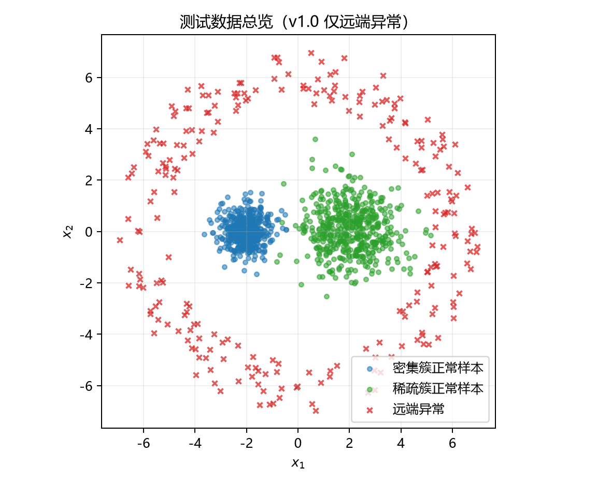
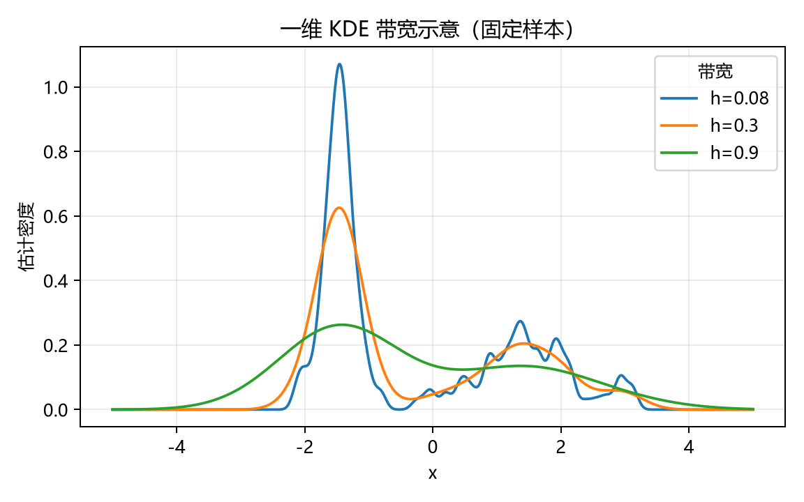
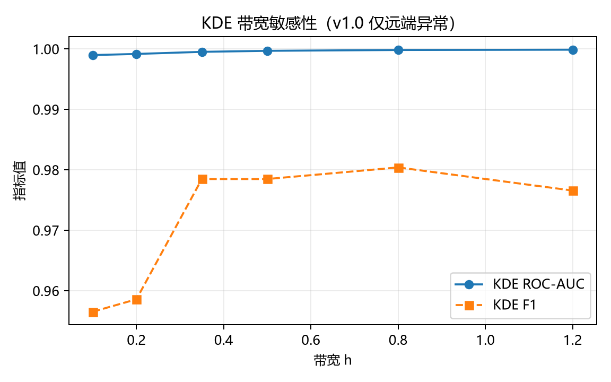
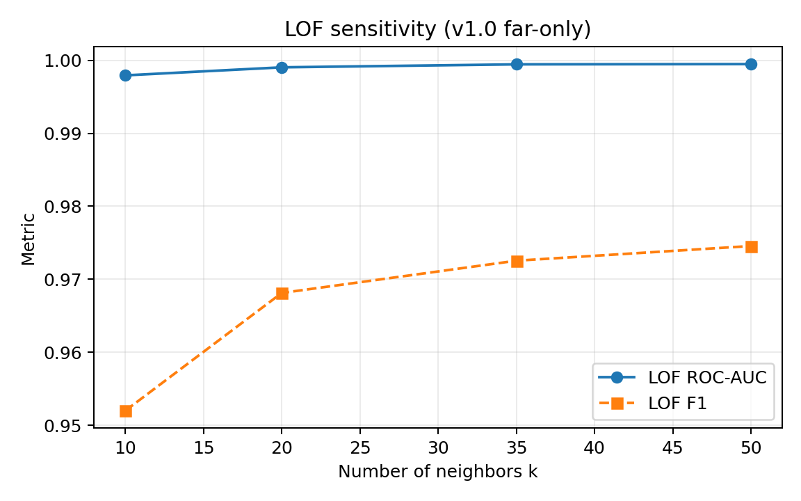
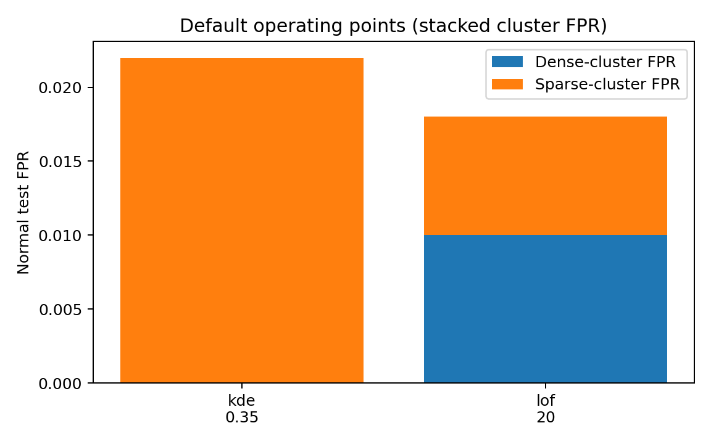
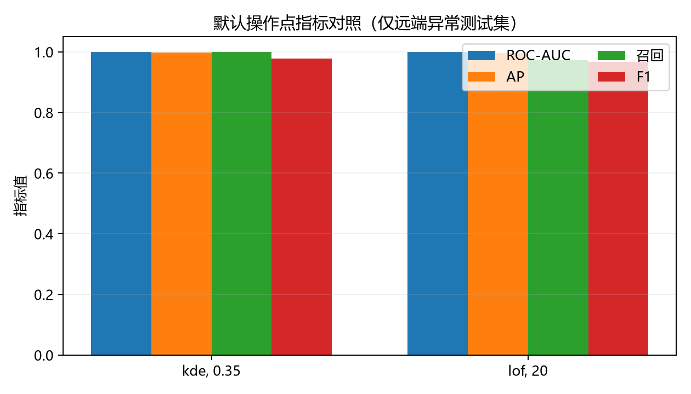
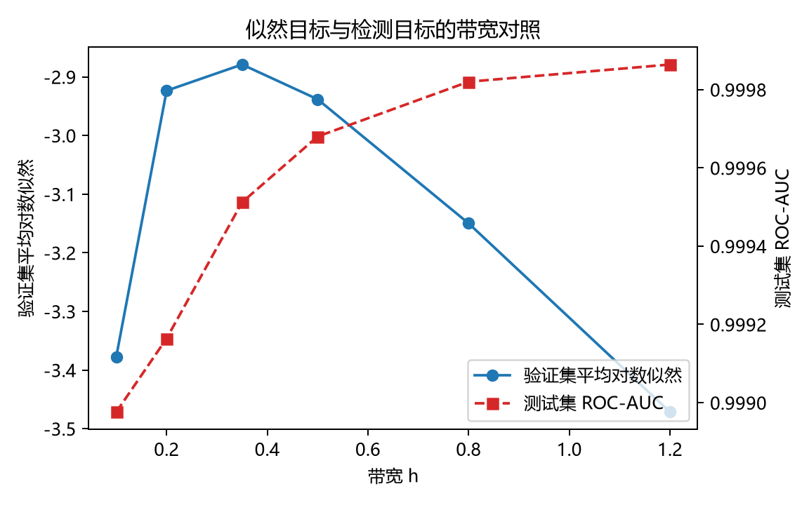

# 带宽与局部密度结构对异常检测的影响：核密度估计与 LOF 的对照研究

## 封面信息

- 小组：瓦洛兰特
- 组长：A 林辰旭（理论、文献与项目组织，7--10 h）
- 成员 B：连昭悦（数据与实验设计，7--10 h）
- 成员 C：沈伊镄（实现、复现与核验，8--11 h）
- 成员 D：陈永喆（结果分析、论文整合与提交清单，8--11 h）
- 结果版本：`B-v1.0-locked`，冻结于 tag `v1.0-results-frozen`

## 摘要

本文研究核密度估计（KDE）带宽与局部异常因子（LOF）邻居数对密度异质数据异常检测的影响。实验以固定随机种子生成二维高斯正常簇和远端异常，严格分离训练、验证与测试集，并用独立实现、指标重算和审计脚本核验复现性。结果显示，增大带宽会平滑并合并密度峰；预先指定的 KDE 在远端异常上的召回和排序指标略高，LOF 的稀疏簇误报率较低；正常验证对数似然选择的带宽与测试集事后 AUC 最高的带宽不一致，后者不构成选参准则。研究表明密度拟合目标不能直接替代检测目标，但结论受二维合成数据限制，不能直接外推。

**关键词：**核密度估计；局部异常因子；带宽敏感性；密度异质性；可复现实验

## 1 引言

### 1.1 问题背景与算法意义

异常检测常面临异常样本稀缺或没有异常标签的情形。基于密度的方法从正常样本的分布结构出发，用低密度或相对稀疏性识别异常。KDE 通过核函数叠加得到全局密度估计，LOF 则比较一个点与其邻域的局部可达密度。两者分别代表全局密度和局部相对密度视角，在含有不同密度正常簇的数据上可能产生不同的误报分布。

### 1.2 基础概念

KDE 的输出是概率密度，不是概率。连续分布的单点概率为 0，区域概率需对密度积分；密度值也不要求位于 $[0,1]$。LOF 输出局部相对稀疏度，不是 KDE 意义下的概率密度。本文将异常分数统一定义为“越大越异常”，并分别报告阈值无关的排序指标与固定阈值下的分类指标。

### 1.3 探究目标与验证思路

本文围绕三个研究问题展开：带宽改变如何影响密度曲线和异常排序；在相同阈值规程下 KDE 与 LOF 的检测表现有何差异；密度拟合质量与检测效果是否一致。对应的 H1--H4 假设在实验前写明支持和推翻条件，分别由 E0 一维带宽示意、E1 KDE 敏感性、E2 LOF 敏感性和 E3 方法对照验证。

## 2 基础原理与数学定义

### 2.1 符号约定

训练样本为 $x_1,\ldots,x_n\in\mathbb R^d$，核函数为 $K$，各向同性带宽为 $h>0$。训练集只用于拟合，正常验证集只用于阈值校准，测试集在参数和流程冻结后作一次最终评估。LOF 的邻居数记为 $k$。[5]

### 2.2 KDE 公式与异常分数

核密度估计定义为 [1]

$$
\widehat p_h(x)=\frac{1}{n h^d}\sum_{i=1}^{n}K\left(\frac{x-x_i}{h}\right).
$$

本项目使用高斯核

$$
K(u)=\frac{1}{(2\pi)^{d/2}}\exp\left(-\frac{\|u\|^2}{2}\right),
$$

其积分为 1。$1/(n h^d)$ 是样本平均与体积缩放因子。带宽较小时，每个样本的影响范围较窄，估计曲线保留更多局部起伏，方差倾向较高；带宽较大时，曲线更平滑，但可能抹平多峰结构，偏差倾向较高。

定义 KDE 异常分数为

$$
s_{KDE}(x)=-\log \widehat p_h(x).
$$

密度越低，异常分数越高。阈值由正常验证集分数的 99% 经验分位数确定，使用 `numpy.quantile(scores_val, 0.99, method="inverted_cdf")`，并按 $s(x)>t$ 判为异常。

### 2.3 LOF 的局部机制

令 $N_k(x)$ 为点 $x$ 的 $k$ 个近邻，$d_k(y)$ 为 $y$ 的第 $k$ 近邻距离。可达距离定义为

$$
\operatorname{reach\text{-}dist}_k(x,y)=\max\{d_k(y),d(x,y)\}.
$$

局部可达密度为

$$
\operatorname{lrd}_k(x)=\left(\frac{1}{|N_k(x)|}\sum_{y\in N_k(x)}\operatorname{reach\text{-}dist}_k(x,y)\right)^{-1},
$$

局部异常因子为 [2]

$$
\operatorname{LOF}_k(x)=\frac{1}{|N_k(x)|}\sum_{y\in N_k(x)}\frac{\operatorname{lrd}_k(y)}{\operatorname{lrd}_k(x)}.
$$

LOF 越大，点相对于邻域越稀疏。本文使用欧氏距离和 `LocalOutlierFactor(novelty=True)`，仅在训练正常样本上拟合。库的原始 `score_samples` 方向通过人工构造的正常点和远端点实测，再取负得到统一异常分数。

### 2.4 KDE 与 LOF 的对照机制

KDE 依赖全局带宽 $h$，给出绝对密度视角；LOF 依赖局部邻居数 $k$，给出相对密度视角。密度异质时，稀疏正常簇的绝对密度可能整体较低，使全局阈值对其尾部更敏感；LOF 可能通过局部比较降低部分误报，但对 $k$、边界点和簇间结构敏感。两者不存在脱离数据形态的普遍优劣关系。

## 3 验证方案

### 3.1 验证假设

| 假设 | 可观测变量 | 支持条件 | 推翻或修订条件 |
|---|---|---|---|
| H1 | E0 不同 $h$ 的局部极大数、显著峰数和谷填充率 | 小带宽局部波动更强，大带宽峰合并、谷被填平 | 增大带宽不产生平滑或抹平趋势 |
| H2 | KDE 在密集/稀疏正常簇上的 FPR | KDE 稀疏簇 FPR 高于密集簇 | KDE 两簇 FPR 相当或稀疏簇不更高 |
| H3 | KDE 与 LOF 的 AUC、AP、召回、F1 和分簇 FPR | LOF 降低稀疏簇误报或在局部结构上有优势 | LOF 稀疏簇 FPR 不低于 KDE，且其余指标也无优势 |
| H4 | 正常验证对数似然 argmax 与测试集事后 AUC argmax | 两者不一致；测试集 AUC 最高点仅作事后描述，不用于选参 | 两者相同，或无法区分两种目标 |

### 3.2 数据集与测试样本

正常数据由两个二维高斯簇组成。密集簇均值为 $(-2,0)$、各维标准差为 0.5；稀疏簇均值为 $(2,0)$、各维标准差为 1.0。测试异常采用参数化远端圆环，半径从 5.0 到 7.0 均匀生成，远离两个正常簇。

**图 1.** 二维测试数据总览，横轴为 $x_1$、纵轴为 $x_2$。数据由均值 $(-2,0)$、标准差 0.5 的密集簇和均值 $(2,0)$、标准差 1.0 的稀疏簇组成；远端异常半径为 5.0--7.0。训练集含 600 个正常样本，正常验证集含 1000 个正常样本，测试集含 1000 个正常样本和 250 个远端异常。本图为数据角色示意，不使用阈值；正式检测分数方向统一为越大越异常。

### 3.3 评价指标与控制变量

KDE 带宽网格为 $\{0.10,0.20,0.35,0.50,0.80,1.20\}$，LOF 邻居数网格为 $\{10,20,35,50\}$。方法对照默认点在测试前指定为 $h^*=0.35$ 和 $k^*=20$。每个模型和参数单独用正常验证集校准阈值，测试标签不参与参数、阈值或网格选择。

报告 ROC-AUC、scikit-learn 阶梯定义的 Average Precision（测试异常比例为 0.2000）、precision、recall、F1、混淆矩阵、总体 FPR 及密集/稀疏正常簇 FPR。正文数值统一保留四位小数。实验固定随机种子：train、validation、test 的核心数据流分别使用配置登记的独立 PCG64 随机源；多种子扩展预先登记 10 个重复，种子按核心种子加 $10000r$。

### 3.4 实验流程与代码实现

实验按“拟合—校准—评估”三段隔离。E0 固定一维双峰样本、核函数和绘图网格，只改变 $h\in\{0.08,0.30,0.90\}$；E1 只改变 KDE 带宽；E2 只改变 LOF 邻居数；E3 固定预先指定的默认参数，只改变检测器。两个检测器均为确定性算法，随机性只来自数据生成。

数据生成使用独立 `numpy.random.Generator(PCG64(seed))`，二维簇采用显式的均值加尺度乘标准正态，远端异常采用先生成角度再生成半径的参数化圆环。阈值使用 `inverted_cdf`，1000 个正常验证样本严格超过阈值的样本数为 10。根据 `05_results/main/sanity_checks.md`、`audit_results.md` 和 `reconciliation_vs_B.md`，正式实现分别通过 15 项正确性检查、13 项结果审计并完成 50 项逐项对账；这些计数不属于 `metrics.csv` 字段。[3][4]

## 4 结果与分析

### 4.1 带宽和邻居数敏感性

**图 2.** 独立一维原理示意，横轴为 $x$、纵轴为估计密度；$h=0.08,0.30,0.90$，样本数为 200。该图只展示带宽对密度曲线的影响，不属于二维检测性能汇总，也不使用阈值或异常分数。

E0 中，$h=0.08$ 的局部极大点数为 8、显著峰数为 2、谷填充率为 0.0007；$h=0.30$ 对应 3、2 和 0.1581；$h=0.90$ 对应 2、1 和 0.9140。以上数字来自独立一维示意文件 `e0_demo1d_peaks.csv`，不混入二维检测性能汇总。峰数减少和谷填平支持 H1。

**图 3.** KDE 带宽敏感性。横轴为带宽 $h$，纵轴为测试指标；$h$ 网格为 $\{0.10,0.20,0.35,0.50,0.80,1.20\}$。测试集含 1000 个正常样本和 250 个远端异常；每个点均由正常验证集 99% 经验分位数阈值校准（`inverted_cdf`，严格超过阈值 10/1000）。数据角色为验证集仅校准阈值、测试集仅最终评估；异常分数方向为越大越异常。

KDE 的 AUC 从 $h=0.10$ 的 0.9990 增至 $h=1.20$ 的 0.9999，AP 从 0.9960 增至 0.9994，召回从 0.9680 增至 1.0000。等价错排配对数从 256 降至 34，说明 AUC 接近饱和时，错排数量更能显示带宽差异。$h=0.80$ 的 F1 为 0.9804，高于 $h=1.20$ 的 0.9766，表明排序指标和固定阈值指标未必同步。

**图 4.** LOF 邻居数敏感性。横轴为邻居数 $k$，纵轴为测试指标；$k$ 网格为 $\{10,20,35,50\}$。模型以 `novelty=True` 在 600 个训练正常样本上拟合，阈值由 1000 个正常验证样本的 99% 经验分位数确定，测试集含 1000 个正常样本和 250 个远端异常；异常分数方向为越大越异常。

LOF 的 AUC 从 $k=10$ 的 0.9979 增至 $k=50$ 的 0.9995，AP 从 0.9919 增至 0.9979，召回从 0.9520 增至 0.9960。邻居数改变会影响局部结构的稳定性，支持需要报告参数敏感性的判断。

### 4.2 方法对照与 H2/H3 判定

**图 5.** 默认操作点下密集与稀疏正常簇的测试误报率。横轴为检测器（KDE $h=0.35$ / LOF $k=20$），纵轴为正常簇测试误报率（堆叠：密集簇 + 稀疏簇）。KDE 使用 $h=0.35$、阈值 6.1760；LOF 使用 $k=20$、阈值 2.0223；阈值均由正常验证集 99% 经验分位数（`inverted_cdf`）确定。测试集中每个正常簇有 500 个样本，共 1000 个正常样本和 250 个远端异常；异常分数方向为越大越异常。

**图 6.** 默认操作点的整体检测指标对照，横轴为指标，纵轴为指标值；KDE 为 $h=0.35$，LOF 为 $k=20$，数据为含 1000 个正常样本和 250 个远端异常的冻结测试集，分数方向为越大越异常。

| 方法 | AUC | AP | Precision | Recall | F1 | 总 FPR | 密集簇 FPR | 稀疏簇 FPR | TP/FP/TN/FN |
|---|---:|---:|---:|---:|---:|---:|---:|---:|---|
| KDE, $h=0.35$ | 0.9995 | 0.9980 | 0.9579 | 1.0000 | 0.9785 | 0.0110 | 0.0000 | 0.0220 | 250/11/989/0 |
| LOF, $k=20$ | 0.9990 | 0.9962 | 0.9643 | 0.9720 | 0.9681 | 0.0090 | 0.0100 | 0.0080 | 243/9/991/7 |

KDE 在默认点的 AUC、AP、召回和 F1 较高；LOF 的总体 FPR 为 0.0090，低于 KDE 的 0.0110。KDE 的稀疏簇误报为 11/500，密集簇误报为 0/500；LOF 的对应误报为 4/500 和 5/500。KDE 在单一全局阈值下使稀疏正常簇承担更高误报，支持 H2 的 KDE 情形；LOF 未呈现同一方向。LOF 将稀疏簇误报从 KDE 的 11/500 降至 4/500，支持 H3 中“降低部分密度异质性误报”的限定子句，但其远端异常召回和排序指标较低，不能写成 LOF 整体优于 KDE。

### 4.3 似然目标与检测目标

**图 7.** 正常验证平均对数似然与测试 AUC 的带宽对照。横轴为带宽 $h$，左纵轴为正常验证平均对数似然，右纵轴为测试 ROC-AUC；$h$ 网格为 $\{0.10,0.20,0.35,0.50,0.80,1.20\}$。验证集含 1000 个正常样本，只用于似然计算和阈值校准；测试集含 1000 个正常样本和 250 个远端异常。两纵轴指标均不依赖分类阈值；测试 AUC 仅作冻结流程后的事后描述，异常分数方向为越大越异常，不参与选参。

正常验证平均对数似然在 $h=0.35$ 达到最大，数值为 $-2.8790$；测试集事后 AUC 在 $h=1.20$ 最高，为 0.9999。两者不一致，说明正常验证似然选择与测试集事后检测排序指向不同带宽。但验证集只含正常样本，无法在验证阶段计算 AUC、AP 或召回；$h=1.20$ 只是冻结流程后的测试集事后最高点，不能表述为事前可选的“检测最优带宽”。因此 H4 只能获得描述性支持。

### 4.4 多种子稳定性

作为 P1 多种子补充（来源为 `05_results/main/metrics_multiseed_summary.csv`，不属于主 `metrics.csv`），十次预先登记的重复中，KDE $h=0.35$ 的 AUC 为 $0.9998\pm0.0002$，稀疏簇 FPR 为 $0.0258\pm0.0127$；LOF $k=20$ 的 AUC 为 $0.9995\pm0.0003$，稀疏簇 FPR 为 $0.0110\pm0.0054$。这些结果已由 C 逐项对照 `metrics_multiseed_summary.csv`（2026-11-27）一致；分簇误报率受有限样本影响。

## 5 讨论：局限与适用边界

### 5.1 方法局限

KDE 在高维下受到维数灾难影响，单一全局带宽难以适应强烈的密度差异；带宽过小会增加局部波动，带宽过大可能抹平多峰结构。LOF 对 $k$ 敏感，过小会放大局部噪声，过大则丢失局部性；边界点、孤立小簇和簇间交界处也可能造成不稳定。

### 5.2 实验设计局限

测试集规模为 1250，正常分簇误报率分辨率为 0.2%，异常召回率分辨率为 0.4%。99% 分位数只规定正常验证集上的约 1% 经验操作点，不能承诺测试集严格达到 1%。十次重复提供了稳定性补充，但仍不能替代更大规模的重复和真实数据验证。

### 5.3 合成数据假设

本文只使用两个二维高斯正常簇和参数化远端圆环异常，且不做标准化。结论依赖当前簇均值、标准差比例和异常几何位置，不能直接外推到真实高维数据、污染训练集或其他异常形态。所有参数、阈值和网格在测试前锁定，测试标签没有参与选择；这保证了内部比较的有效性，但不等于对所有数据分布都有普适保证。

## 6 小结

实验结果支持带宽增大带来平滑和多峰抹平现象，也显示单一全局密度阈值会使稀疏正常簇承担更高误报。预先指定的 KDE 在远端异常上的整体排序和召回略高，LOF 在稀疏簇误报分配上更有优势，但其性能随邻居数变化，不能宣称整体优于 KDE。正常验证似然选择带宽与测试集事后 AUC 最高带宽不一致，说明密度拟合和异常检测是不同目标；测试集事后最高点不构成选参依据。后续研究应扩大数据形态、维度和真实数据验证范围。

## 参考文献

[1] Silverman B W. *Density Estimation for Statistics and Data Analysis*. London: Chapman and Hall, 1986. ISBN: 0-412-24620-1.

[2] Breunig M M, Kriegel H-P, Ng R T, et al. LOF: Identifying density-based local outliers[C]//Proceedings of the 2000 ACM SIGMOD International Conference on Management of Data. 2000: 93–104. DOI: 10.1145/342009.335388.

[3] scikit-learn developers. `sklearn.neighbors.KernelDensity`[EB/OL]. https://scikit-learn.org/stable/modules/generated/sklearn.neighbors.KernelDensity.html, 2026-11-27.

[4] scikit-learn developers. `sklearn.neighbors.LocalOutlierFactor`[EB/OL]. https://scikit-learn.org/stable/modules/generated/sklearn.neighbors.LocalOutlierFactor.html, 2026-11-27.

[5] 李航. 机器学习方法[M]. 北京: 清华大学出版社, 2022. ISBN: 978-7-302-59730-8.

## 附录：复现索引

- 主结果：`05_results/main/metrics.csv`
- 多种子：`05_results/main/metrics_multiseed_summary.csv`
- E0 峰结构：`05_results/main/e0_demo1d_peaks.csv`
- 随机种子：`05_results/main/seed_registry.csv`
- 配置与协议：仓库当前 `04_code/config_ref.json` 已是 `B-v1.1-near`；主结果须以冻结 tag `v1.0-results-frozen` 内的 v1.0 配置复现（快照：`05_results/main/config_ref.v1.0.snapshot.json`）
- 运行日志：`05_results/main/run_log.txt`
- 正确性与审计：`05_results/main/sanity_checks.md`、`audit_results.md`、`reconciliation_vs_B.md`
