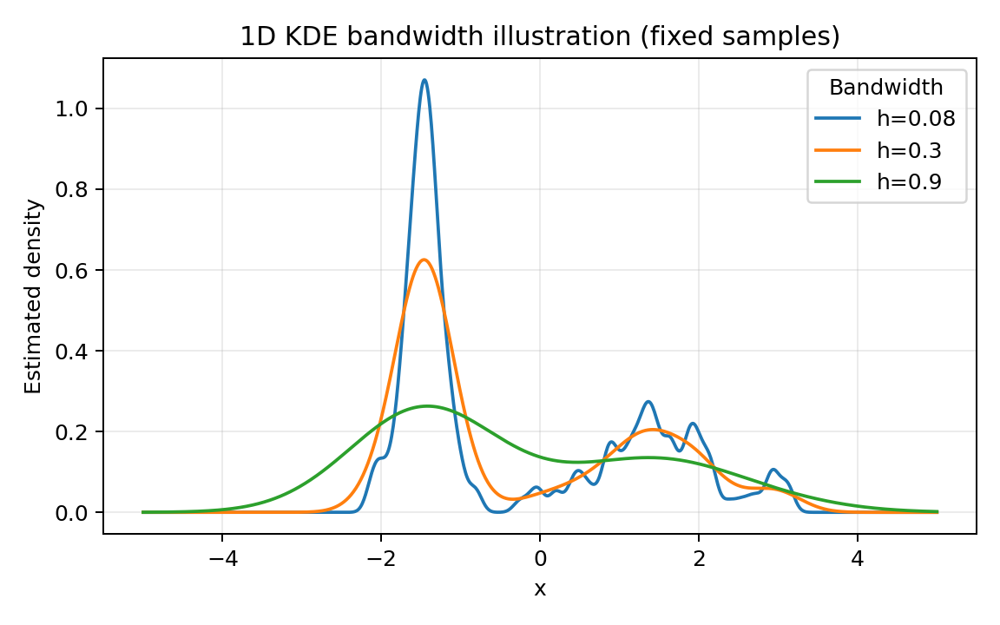
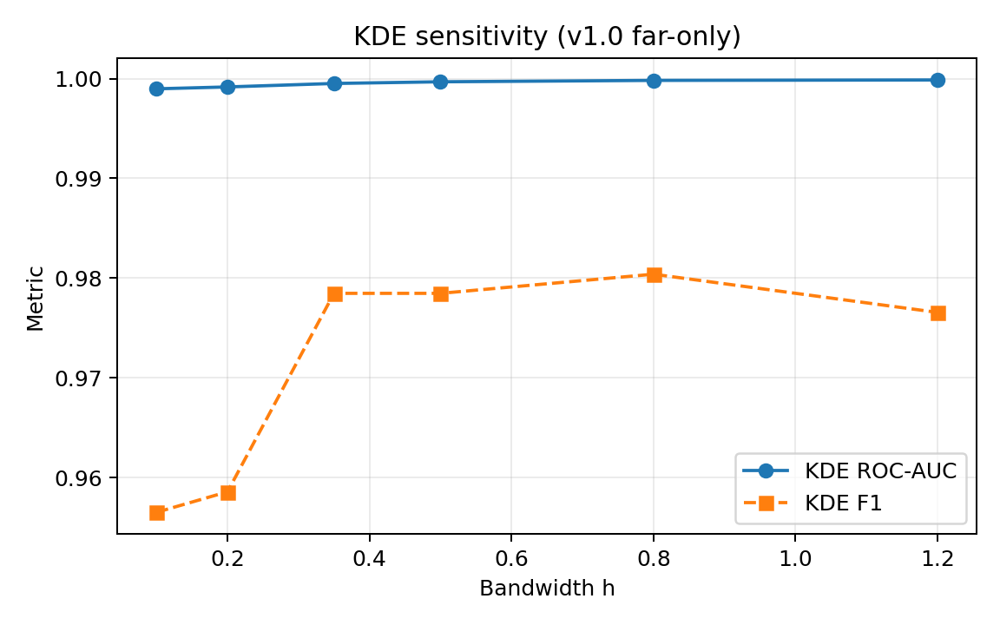
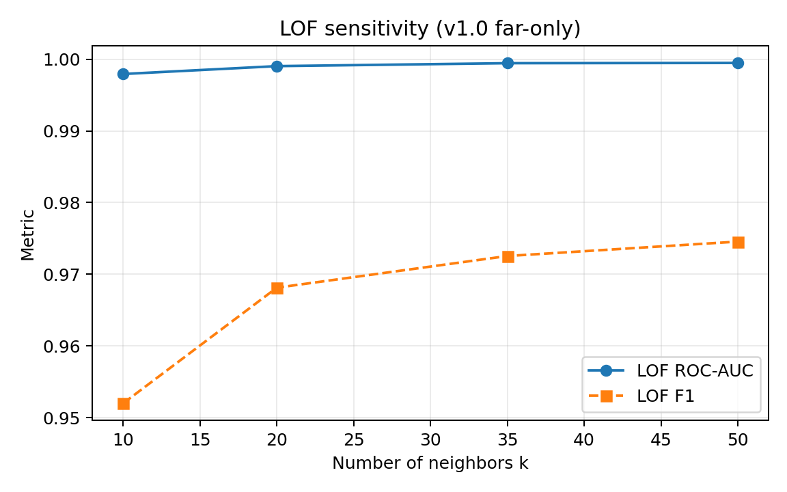
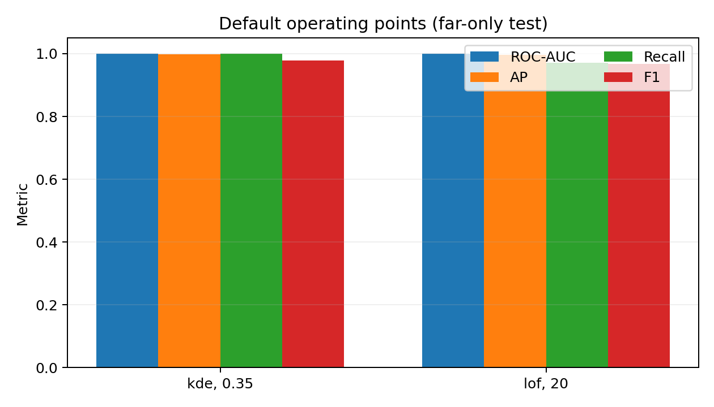
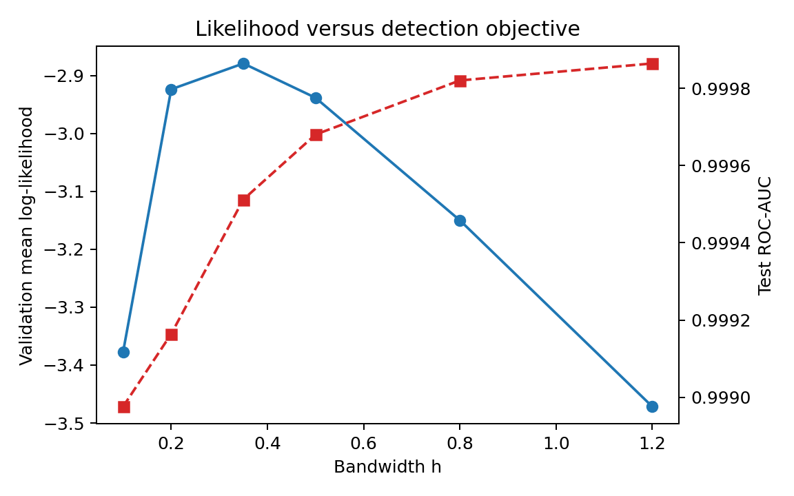

# 带宽与局部密度结构对异常检测的影响：核密度估计与 LOF 的对照研究

> 版本：D 负责的 v1.0 论文初稿（2026-11-27）  
> 主结果口径：`B-v1.0-locked`，冻结于提交 `7f4990c`（tag `v1.0-results-frozen`）。  
> 补充口径：B-v1.1-near 已于 2026-11-27 签署；B 参考实现已有 near 分层数据，C 的正式 v1.1 结果仍待 C 完成适配后运行。本文将 v1.0 保留为预注册主结果，不把 B 参考数据并入主表。当前仍待 A 理论/文献互审、B 协议确认、C 数值复核及全组签字。

## 摘要

本文研究 KDE 带宽与 LOF 邻居数对密度异质数据异常检测的影响。实验以固定种子生成双高斯正常簇和远端异常，分离训练、正常验证与测试集，并用独立实现和审计脚本核验复现性。一维示意中，带宽增大使双峰逐渐合并；正式测试中，预设 KDE 参数的召回较高，LOF 的稀疏簇误报较少。正常验证似然最优带宽与测试 AUC 最高带宽不同，表明密度拟合与检测目标并不等价。结论受合成数据和 far-only 异常设计限制，不能直接外推到真实数据。

**关键词：**核密度估计；局部异常因子；带宽敏感性；密度异质性；可复现实验

## 1 引言

### 1.1 问题背景与意义

异常检测通常只有正常样本或异常标签稀缺。密度方法通过“低密度”或“相对稀疏”识别异常，适合研究无监督检测的建模假设。本项目关注两个具体因素：KDE 的全局带宽如何改变密度形状和异常排序，以及 LOF 的局部比较能否减轻不同密度正常簇造成的误报。

### 1.2 基础概念

KDE 用训练样本周围的核函数叠加估计概率密度；带宽决定单个样本影响范围。LOF 比较待测点与邻域点的局部可达密度，输出的是相对稀疏程度而不是概率密度。本文将异常分数统一为“越大越异常”，并将不依赖阈值的排序指标与阈值处指标分开报告。

### 1.3 探究目标与验证思路

本文检验四条预先写出的假设：H1，增大带宽会平滑并抹平多峰结构；H2，全局阈值会使稀疏正常簇产生更高误报；H3，LOF 可能降低部分密度异质性误报，但不保证总体优于 KDE；H4，正常验证似然最优带宽可能不同于检测指标最优带宽。E0--E3 分别提供一维机制示意、KDE 敏感性、LOF 敏感性和方法对照。

## 2 基础原理与数学定义

### 2.1 符号约定

训练样本为 $x_1,\ldots,x_n\in\mathbb R^d$，核函数为 $K$，带宽为各向同性标量 $h>0$。训练集只拟合模型，正常验证集只校准阈值，测试集在流程冻结后作一次最终评估。

### 2.2 KDE 定义与带宽作用

KDE 定义为

$$
\widehat p_h(x)=\frac{1}{n h^d}\sum_{i=1}^{n}K\left(\frac{x-x_i}{h}\right).
$$

本文采用高斯核

$$
K(u)=\frac{1}{(2\pi)^{d/2}}\exp\left(-\frac{\|u\|^2}{2}\right),
$$

它满足积分为 1。$h$ 较小时每个样本的影响范围窄，曲线保留更多局部起伏，方差倾向较高；$h$ 较大时曲线更平滑，但可能抹平真实多峰结构，偏差倾向较高。这里的密度是概率密度，不是概率，密度值不要求属于 $[0,1]$。

令异常分数为

$$
s_{KDE}(x)=-\log\widehat p_h(x).
$$

密度越低，分数越大。阈值 $t$ 只由正常验证集分数的 0.99 经验分位数计算，严格按 $s(x)>t$ 判为异常。

### 2.3 LOF 定义与实现

LOF 通过 $k$ 邻域的可达距离和局部可达密度比较点与邻居的相对稀疏程度。本文使用欧氏距离和 `LocalOutlierFactor(novelty=True)`，仅在 600 个训练正常样本上拟合，再对验证集和测试集评分。库的原始 `score_samples` 方向经人工构造正常点与远端点检查后取负，得到统一的异常分数方向“越大越异常”。LOF 的输出不是概率密度，不能与 KDE 密度值直接等同。

### 2.4 两类方法的分工

KDE 是全局密度视角，依赖带宽 $h$；LOF 是局部相对密度视角，依赖邻居数 $k$。在密度不均衡的正常数据中，稀疏簇的低绝对密度可能导致 KDE 全局阈值误报，而 LOF 可能通过局部比较缓解该问题；但边界、孤立小簇和邻居数不合适时，LOF 也可能不稳定。因此本文不预设 LOF 整体优于 KDE。

## 3 验证方案

### 3.1 验证假设

| 假设 | 支持条件 | 推翻或修订条件 | 主要观测 |
|---|---|---|---|
| H1 | 小带宽局部波动更明显，大带宽峰合并、谷被填平 | 增大带宽不产生平滑或抹平趋势 | E0 峰数、谷填充率 |
| H2 | 稀疏正常簇 FPR 高于密集正常簇 | 两簇 FPR 相当或稀疏簇不更高 | E1/E3 分簇 FPR |
| H3 | LOF 稀疏簇 FPR 较低或局部召回有优势，同时不要求总体胜出 | LOF 未降低误报且没有条件性优势 | E2/E3 AUC、AP、召回、FPR |
| H4 | 验证似然选择与检测指标最优带宽不同 | 两者在预先声明的重复中完全一致 | E1 的 `val_mean_log_likelihood` 与 AUC |

### 3.2 数据与划分

主结果 v1.0 的正常数据为二维两个高斯簇：密集簇均值 $(-2,0)$、标准差 0.5；稀疏簇均值 $(2,0)$、标准差 1.0。训练集含 600 个正常点（每簇 300），正常验证集含 1000 个正常点（每簇 500），测试集含 1000 个正常点和 250 个远端 `far` 异常，异常比例为 0.2。v1.0 测试集不含 `near`，该主结果的 `n_anomaly_compact_void=0`，不用于 near 召回结论。

一维 E0 仅用于机制示意，含 200 个双峰样本，绘图区间为 $[-5,5]$。数据生成使用独立 `numpy.random.Generator(PCG64(seed))`；配置中的数据流种子、样本指纹和环境版本见 `04_code/config_ref.json`、`05_results/main/seed_registry.csv` 与 `run_log.txt`。

### 3.3 参数、阈值和指标

KDE 网格为 $h\in\{0.10,0.20,0.35,0.50,0.80,1.20\}$，LOF 网格为 $k\in\{10,20,35,50\}$。方法对照的默认点在测试前指定为 KDE $h^*=0.35$、LOF $k^*=20$，不是根据测试结果选择。每个模型参数单独用正常验证分数的 `numpy.quantile(..., method="inverted_cdf")`、$q=0.99$ 校准阈值；验证集严格超过阈值的样本数为 10/1000。报告 ROC-AUC、scikit-learn 阶梯定义的 AP、阈值处 precision/recall/F1、总体 FPR 以及密集/稀疏正常簇 FPR。正文统一保留四位小数。

### 3.4 实验流程与复现

流程为“训练拟合 $→$ 正常验证校准 $→$ 测试一次性评估”。C 的 `run_checks.py`、`run_audit.py` 和 `reconcile_with_baseline.py` 已分别通过 15、13 和 50 项检查；参考实现与正式实现交叉核对，分数方向、阈值来源、混淆矩阵和指标重算均通过。主结果文件为 `05_results/main/metrics.csv`，不得使用 `05_results/ai_draft/` 或 `05_results/ref_check/` 的数字替代。

## 4 结果与分析

### 4.1 带宽和邻居数敏感性

**图 1.** 固定一维双峰样本和高斯核时，$h=0.08,0.30,0.90$ 的密度曲线。图中峰数、谷填充率来自 `e0_demo1d_peaks.csv`。

E0 中，$h=0.08$ 有 8 个局部极大点、2 个显著峰、谷填充率 0.0007；$h=0.30$ 有 3 个局部极大点、2 个显著峰、谷填充率 0.1581；$h=0.90$ 有 2 个局部极大点、1 个显著峰、谷填充率 0.9140。该趋势支持 H1：增大带宽降低局部波动并最终抹平双峰。

**图 2.** KDE 在六个带宽上的测试排序指标与阈值处指标；阈值均由正常验证集 99% 分位数得到。

KDE 的 AUC 从 $h=0.10$ 的 0.9990 增至 $h=1.20$ 的 0.9999，召回从 0.9680 增至 1.0000 后保持不变。$h=0.80$ 的 F1 为 0.9804，是表中最高值；$h=1.20$ 虽 AUC 最高，但 F1 回落至 0.9766，说明排序指标和固定阈值指标未必同步。

**图 3.** LOF 在四个邻居数上的测试指标。

LOF 的 AUC 从 $k=10$ 的 0.9979 增至 $k=50$ 的 0.9995，召回从 0.9520 增至 0.9960；F1 从 0.9520 增至 0.9746。$k=20$ 是预先指定的默认点，不是曲线上 AUC 最高点。

### 4.2 方法对照与 H2/H3 判定

**图 4.** KDE $h=0.35$ 与 LOF $k=20$ 的默认操作点。正常测试样本 1000 个，远端异常 250 个。

| 方法 | AUC | AP | Precision | Recall | F1 | 总 FPR | 密集簇 FPR | 稀疏簇 FPR |
|---|---:|---:|---:|---:|---:|---:|---:|---:|
| KDE, $h=0.35$ | 0.9995 | 0.9980 | 0.9579 | 1.0000 | 0.9785 | 0.0110 | 0.0000 | 0.0220 |
| LOF, $k=20$ | 0.9990 | 0.9962 | 0.9643 | 0.9720 | 0.9681 | 0.0090 | 0.0100 | 0.0080 |

KDE 在默认点的召回、AUC、AP 和 F1 较高；LOF 的总体 FPR 为 0.0090，低于 KDE 的 0.0110，且稀疏簇 FPR 为 0.0080，低于 KDE 的 0.0220。KDE 的稀疏簇误报为 11/500，密集簇为 0/500；多种子汇总中，$h=0.35$ 的稀疏/密集簇 FPR 均值分别为 $0.0258\pm0.0127$ 和 $0.0024\pm0.0016$。因此 H2 得到支持：全局阈值对稀疏正常簇的尾部更不利。

H3 得到“有条件支持”而非总体优胜结论：LOF 在默认点降低了稀疏簇误报，但 KDE 在远端异常召回和整体排序上更高；LOF 的结果还随 $k$ 变化。v1.1 的 near 参考实现进一步显示 near 的 125/125 样本被两种方法检出，因而该类型不构成 KDE/LOF 方法差异的判别点（见第 5 节，明确作为 B 参考实现旁证）。

### 4.3 H4：似然目标与检测目标

**图 5.** 正常验证平均对数似然与测试 AUC 的带宽对照。测试 AUC 仅作为冻结流程后的事后描述。

正常验证平均对数似然在 $h=0.35$ 达到最大（$-2.8790$），而测试 AUC 在网格中于 $h=1.20$ 最高（0.9999）。二者不同，支持 H4 的可检验部分。但测试 AUC 没有参与参数选择，不能据此把 1.20 宣称为无偏的事前最优带宽；该结果只说明密度拟合目标与异常排序目标可能不一致。

### 4.4 结果可靠性

十次预先声明的多种子重复显示，KDE $h=0.35$ 的 AUC 为 $0.9998\pm0.0002$、AP 为 $0.9990\pm0.0007$；LOF $k=20$ 的 AUC 为 $0.9995\pm0.0003$、AP 为 $0.9982\pm0.0011$。这些均值和标准差用于稳健性补充，主表仍报告冻结单次划分。正式结果的 15 项正确性检查、13 项审计和 50 项对账均通过。

### 4.5 v1.1-near 分层旁证

B-v1.1-near 将测试异常拆为 125 个 far 与 125 个 near，并以固定 `n_draw=250` 保证 far 点级嵌套。B 参考实现 `05_results/ref_check_v1.1/metrics_ref.csv` 显示，10 个 KDE/LOF 参数配置的 `recall_compact_void` 均为 125/125。该结果仅作为机制旁证：在 `novelty=True`、训练集只含正常样本时，near 与训练参照集整体距离较远，两种方法都会将其判为异常。由于 v1.1 是看过 v1.0 测试结果后的 post-hoc 协议修订，且正例构成发生变化，AUC/AP 不得与 v1.0 跨版本比较。C 完成 C3/C14 适配并生成正式 v1.1 结果前，这部分不进入 v1.0 主表。

## 5 讨论：局限与适用边界

第一，数据是二维合成高斯簇，far 异常位于远离正常簇的环上，因而检测任务相对容易，不能外推到真实高维数据。第二，KDE 存在维数灾难，单一全局带宽难以适应强烈密度差异；LOF 依赖邻居数，在边界、孤立小簇和簇交界处可能不稳定。第三，99% 验证分位数只保证验证集上的约 1% 经验误报，不能承诺测试集严格达到 1%。第四，B-v1.1-near 虽已签署且 B 参考实现通过审计，C 的正式实现仍待 C3/C14 适配和正式重跑；因此 B 的 near 数据只作单独标明的机制旁证，不能并入 v1.0 主表。第五，一次冻结划分和十次重复仍不足以替代公开数据或跨维度实验。最后，H4 的检测最优带宽是事后观察，不能用作模型选择证据。

早期 boundary 球壳和 compact@(0,0) 设计被交叉审查证伪：前者会把部分正常稀疏簇尾部标成异常，后者位于两簇鞍部且不构成有效异常。它们应作为设计迭代和人机纠错记录讨论，不作为 v1.0 测试结果。

## 6 小结

在固定、可复现的 v1.0 far-only 合成实验中，带宽增大确实使 KDE 密度曲线平滑并抹平多峰；全局阈值对稀疏正常簇造成更高误报；LOF 可在默认点降低稀疏簇误报，但整体排序和召回不超过 KDE；验证似然最优带宽与测试 AUC 最优带宽不同。B-v1.1 参考实现显示 near 在两种方法下均为 125/125 检出，不构成方法差异证据。结论说明带宽、局部邻居和评价目标必须分别分析，不能跨版本比较 AUC/AP。

## 参考文献

1. Silverman, B. W. *Density Estimation for Statistics and Data Analysis*. Chapman & Hall, 1986.（原文核验状态和完整出版信息待 A 补齐。）
2. Breunig, M. M., Kriegel, H.-P., Ng, R. T., & Sander, J. “LOF: Identifying Density-Based Local Outliers.” *Proceedings of the 2000 ACM SIGMOD International Conference on Management of Data*, 2000.（由 A 核验原文，页码/DOI 待补齐。）
3. scikit-learn developers. “`sklearn.neighbors.KernelDensity`.” Official documentation.（访问日期和稳定 URL 待 A 补齐。）
4. scikit-learn developers. “`sklearn.neighbors.LocalOutlierFactor`.” Official documentation.（访问日期和稳定 URL 待 A 补齐。）

## 附：数据与代码索引

- v1.0 配置与协议：tag `v1.0-results-frozen` 中的 `04_code/config_ref.json`；当前工作区 `04_code/config_ref.json` 是已签署的 B-v1.1-near 配置
- 正式结果：`05_results/main/metrics.csv`
- 多种子补充：`05_results/main/metrics_multiseed_summary.csv`
- 运行与版本：`05_results/main/run_log.txt`、`05_results/INDEX.md`
- 审计与复现：`05_results/main/audit_results.md`、`sanity_checks.md`、`reconciliation_vs_B.md`
- 图表：`05_results/main/figures/`
