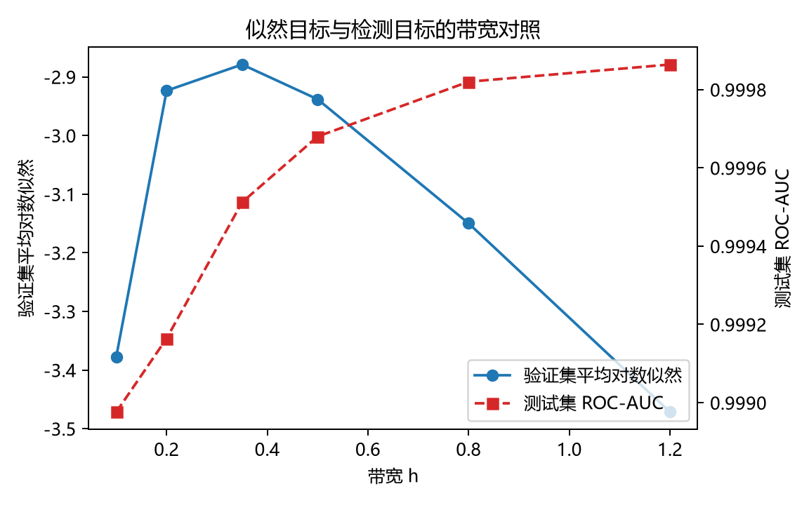
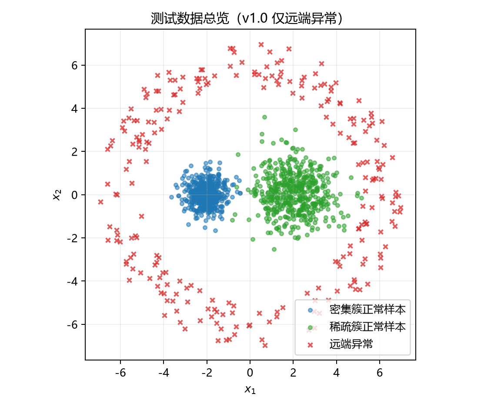
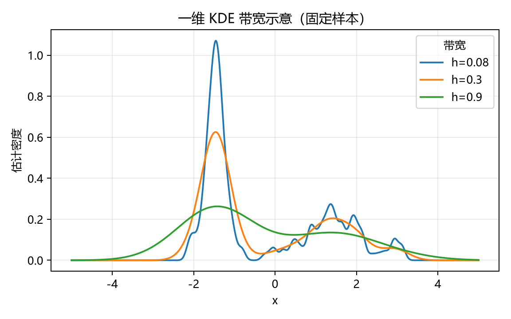

# 成员 C 会话导出（原始交互记录）

| 项 | 内容 |
|---|---|
| 会话 ID | `session-d45d2b76-a1bd-48c6-897e-69e0530118c7` |
| 会话起止 | 2026-11-26 20:24 → 2026-11-27 14:41（Asia/Shanghai） |
| 导出方式 | 客户端「下载 Session 日志」（`/export`），得到 `dsh-session-…c7.zip`；本文件由其中的 `session.v4.jsonl` 全文转写，未删改对话内容 |
| 原始文件 | 同目录 `member_C_session_export.zip`（含 `session.v4.jsonl` 与图片附件） |
| sha256（session.v4.jsonl） | `a05a4cb15bd26f1a5b6abad7847ad299a0f956a5e2ae1939cad591821b1a4dc7` |
| sha256（zip） | `3479d35cd9b90e68af3daa58ef1195711e8323743d8041fe473c0f99139f294e` |
| 条目计数 | 我的提示词 11 条 · 模型输出块 222 个 · 工具输出 261 条 |
| 说明 | 工具输出为避免文件过大做了截断（保留前 400 字符，标注「截断」）；对话正文与提示词原文未截断。结构化整理版见 [member_C.md](member_C.md) |

> 本文件的作用是**凭证**：证明 `member_C.md` 里描述的回合、提示词、模型输出与纠错过程，都发生在同一个连续会话里。
> 阅读时以结构化版 `member_C.md` 为主线，需要核对某一句原文时再回查这里。

---

### 【我】2026-11-26 20:28

@作业要求.md 这是作业要求。 @课程报告任务书_第1题_核密度估计与基于密度的异常检测.docx 我们做的是这一题。 @核密度估计异常检测_四人项目规划.pdf 这是分工和规划。我是成员c 实现与复现负责人@kde-anomaly-detection-project/  这是成员a发的skill， @kde-anomaly-detection-handoff/ 这是成员B发的文件。git@github.com:kekan1120/kde-anomaly-detection-course-project.git
这是我们小组github的仓库。
开始完成我的工作！/caveman


### 【模型】2026-11-26 20:29

I'll load caveman mode and read all the materials first.


**工具调用**

- `skill` — {"name": "caveman"}
- `pwsh` — Get-ChildItem -Force | Select-Object Mode,Length,Name


> **工具输出**：<skill_content name="caveman"> <skill_resources> Base directory for this skill: C:\Users\33547\.agents\skills\caveman Resolve relative paths mentioned by this skill against the base directory before using them. Load referenced resources only as needed. </skill_resources> <skill_instructions> Respond terse like smart caveman. All technical substance stay. Only fluff die. ## Persistence ACTIVE EVERY …（截断）


> **工具输出**：Mode Length Name ---- ------ ---- d----- kde-anomaly-detection-handoff d----- kde-anomaly-detection-project -ar--- 656634 kde-anomaly-detection-handoff.zip -ar--- 13597 kde-anomaly-detection-project(1).zip -a---- 2583 作业要求.md -a---- 570964 核密度估计异常检测_四人项目规划.pdf -a---- 41690 课程报告任务书_第1题_核密度估计与基于密度的异常检测.docx


### 【模型】2026-11-26 20:29


**工具调用**

- `read` — {"file_path": "D:\\ml\\作业要求.md"}
- `pwsh` — Get-ChildItem -Recurse -Force -File kde-anomaly-detection-project, kde-anomaly-detection-handoff | Select-Object @{n='Rel';e={$_.FullName.Replace('D:\ml\','')}},Length | Sort-Object Rel | Format-Table -AutoSize


> **工具输出**：<path>D:\ml\作业要求.md</path> <type>file</type> <content> 1: 总体目标：以人机协作的方式探索机器学习新领域与未知前沿。 2: 3: 4: 5: 实施形式：以小组形式合作完成，从5个候选题目任选其一（见资料栏目：机器学习课程探究任务书_5题.zip）。 6: 7: 8: 9: 交付物清单（两份文件）： 10: 11: 人机协作流程记录（55 分）： 12: 13: 1. 每人使用自己帐号下的同一会话完成所负责的全部课程报告工作； 14: 15: 1. 人机协作记录中，全部成员都需要分享自己完成所负责工作的会话链接，可以包含（但不限于）提示词、模型输出、人工校验、纠错过程； 16: 17: 1. 每组总结人机协作范式。 18: 19: 专题探究论文（45 分）：例如，原理与公式；对照推导 / 可复现仿真实验；结果分析、方法局限讨论（参见专题 …（截断）


> **工具输出**：Rel Length --- ------ kde-anomaly-detection-handoff\.gitignore 341 kde-anomaly-detection-handoff\01_protocol_and_data_dictionary.md 25626 kde-anomaly-detection-handoff\04_code\config_ref.json 18506 kde-anomaly-detection-handoff\04_code\ref_check\audit_results.py 10623 kde-anomaly-detection-handoff\04_code\ref_check\checks.py 26978 kde-anomaly-detection-handoff\04_code\ref_check\probe_demo1d.py 195 …（截断）


### 【模型】2026-11-26 20:29


**工具调用**

- `read` — {"file_path": "D:\\ml\\kde-anomaly-detection-project\\SKILL.md"}
- `read` — {"file_path": "D:\\ml\\kde-anomaly-detection-handoff\\START_HERE.md"}


> **工具输出**：<path>D:\ml\kde-anomaly-detection-project\SKILL.md</path> <type>file</type> <content> 1: --- 2: name: kde-anomaly-detection-project 3: description: Plan, execute, audit, and report a four-person machine-learning course project on kernel density estimation and density-based anomaly detection, including reproducible KDE/LOF experiments and human-AI process records. 4: --- 5: 6: # KDE Anomaly Detecti …（截断）


> **工具输出**：<path>D:\ml\kde-anomaly-detection-handoff\START_HERE.md</path> <type>file</type> <content> 1: # 先读这个 2: 3: **《核密度估计与基于密度的异常检测》四人课程项目 —— 阶段 1（数据与实验设计）交付包** 4: 5: B（数据与实验设计负责人）已经把数据生成协议、参数网格、阈值规则、指标定义全部锁定， 6: 并跑通了参考实验、通过了 13 项正确性核验和 12 项结果审计。**现在可以开始写正式实现和论文了。** 7: 8: --- 9: 10: ## 一、三步开始 11: 12: 在**解压后的项目文件夹里**打开 PowerShell，依次执行： 13: 14: ```powershell 15: # 第 1 步：装环境（只有第一次需要） 16: python -m venv .ve …（截断）


### 【模型】2026-11-26 20:29


**工具调用**

- `read` — {"file_path": "D:\\ml\\kde-anomaly-detection-handoff\\HANDOFF_README.md"}


> **工具输出**：<path>D:\ml\kde-anomaly-detection-handoff\HANDOFF_README.md</path> <type>file</type> <content> 1: # 交接说明：B 数据与实验设计负责人交付物 2: 3: > 读者：C（实现与复现）、D（分析与论文整合）、A（组长兼理论） 4: > 状态：**阶段 1 的 B 产出已齐备并通过 13 项自检**；阶段 2 起由 C 接手实现，B 转为协议监督与交叉核验。 5: 6: --- 7: 8: ## 1. 我交付了什么（你可以直接用的东西） 9: 10: | 文件 | 是什么 | 谁怎么用 | 11: |---|---|---| 12: | `01_protocol_and_data_dictionary.md` | **预注册协议**：数据生成、划分、异常构造、参数网格、阈值规则、指标定义、控制变量 …（截断）


### 【模型】2026-11-26 20:29


**工具调用**

- `read` — {"file_path": "D:\\ml\\kde-anomaly-detection-handoff\\01_protocol_and_data_dictionary.md"}
- `pwsh` — python -V; py -0p; Get-ChildItem D:\ml -Directory -Force | Select Name; Test-Path D:\ml\.venv


> **工具输出**：<path>D:\ml\kde-anomaly-detection-handoff\01_protocol_and_data_dictionary.md</path> <type>file</type> <content> 1: # 实验预注册说明与数据字典（B 数据与实验设计负责人） 2: 3: | 项 | 内容 | 4: |---|---| 5: | 协议版本 | `B-v1.0-locked` | 6: | 负责人 | B 数据与实验设计负责人 | 7: | 机器可读副本 | `04_code/config_ref.json`（**本文件的唯一数值事实来源**，两者冲突时以 JSON 为准并立即修文档） | 8: | 下游使用者 | C（实现与复现）、D（分析与论文整合）、A（理论与引用核验） | 9: | 复核人 | C 交叉走查本协议后确认可实现；A 核验公式与得分方向 | 10 …（截断）


> **工具输出**：Python 3.11.9 -V:3.13 * D:\Python\python.exe -V:3.11 C:\Users\33547\AppData\Local\Programs\Python\Python311\python.exe Name ---- kde-anomaly-detection-handoff kde-anomaly-detection-project False


### 【模型】2026-11-26 20:29


**工具调用**

- `read` — {"file_path": "D:\\ml\\kde-anomaly-detection-handoff\\env\\requirements.txt"}
- `pwsh` — git --version; git ls-remote https://github.com/kekan1120/kde-anomaly-detection-course-project.git 2>&1 | Select-Object -First 10


> **工具输出**：<path>D:\ml\kde-anomaly-detection-handoff\env\requirements.txt</path> <type>file</type> <content> 1: # KDE / LOF 课程项目 —— Python 依赖 2: # 3: # 用法（在项目根目录执行）： 4: # pip install -r env\requirements.txt 5: # 6: # 这 18 个包是参考环境（Windows x64 + Python 3.14.6）实测锁定的精确版本。 7: # 精确锁定的意义：四个人跑出同一份数字。版本漂移时数据通常仍一致，但阈值和 8: # 指标可能在末几位不同 —— 详见 env/README_ENVIRONMENT.md。 9: # 10: # 如果 pip 报 "No matching distribution found …（截断）


> **工具输出**：git version 2.51.0.windows.1 [stderr] git : fatal: unable to access 'https://github.com/kekan1120/kde-anomaly-detection-course-project.git/': Failed to conne ct to 127.0.0.1 port 7897 after 2069 ms: Could not connect to server 所在位置 行:1 字符: 144 + ... --version; git ls-remote https://github.com/kekan1120/kde-anomaly-de ... + ~~~~~~~~~~~~~~~~~~~~~~~~~~~~~~~~~~~~~~~~~~~~~~~~~~~~~~~~~ + CategoryInfo :  …（截断）


### 【模型】2026-11-26 20:30


**工具调用**

- `pwsh` — git config --global --get-regexp 'proxy|url' 2>&1; $env:HTTP_PROXY; $env:HTTPS_PROXY; try { $r = Invoke-WebRequest -Uri https://github.com -TimeoutSec 15 -UseBasicParsing; "github OK $($r.StatusCode)" } catch { "github FAIL: $($_.Exception. …（截断）


> **工具输出**：http.proxy http://127.0.0.1:7897 https.proxy http://127.0.0.1:7897 github FAIL: 操作超时。


### 【模型】2026-11-26 20:30


**工具调用**

- `pwsh` — python -c "import numpy, scipy, sklearn, matplotlib, pandas; print(numpy.__version__, scipy.__version__, sklearn.__version__, matplotlib.__version__, pandas.__version__)" 2>&1
- `read` — {"file_path": "D:\\ml\\kde-anomaly-detection-handoff\\04_code\\ref_check\\reference_impl.py"}


> **工具输出**：[stderr] python : Traceback (most recent call last): 所在位置 行:1 字符: 129 + ... ew($false); python -c "import numpy, scipy, sklearn, matplotlib, pand ... + ~~~~~~~~~~~~~~~~~~~~~~~~~~~~~~~~~~~~~~~~~~~~~~~~~~~~~~~~~ + CategoryInfo : NotSpecified: (Traceback (most recent call last)::String) [], RemoteException + FullyQualifiedErrorId : NativeCommandError File "<string>", line 1, in <module> ModuleNotFoun …（截断）


> **工具输出**：<path>D:\ml\kde-anomaly-detection-handoff\04_code\ref_check\reference_impl.py</path> <type>file</type> <content> 1: """B 角色独立参考实现 —— 数据与实验设计负责人的对照基准. 2: 3: 本模块不属于正式提交代码（正式代码由 C 实现与复现负责人编写）。它的存在目的有三个： 4: 5: 1. 把 ``04_code/config_ref.json`` 中的预注册协议变成可执行、可核验的唯一事实来源。 6: 2. 为 C 的实现提供逐位可比的基准数值（数据指纹、阈值、指标）。 7: 3. 提供**不依赖 sklearn 的独立计算路径**（手写 KDE 密度、手写 LOF、手算 AUC/AP/混淆矩阵）， 8: 用于交叉核验 C 的库调用是否正确、得分方向是否被搞反、阈 …（截断）


### 【模型】2026-11-26 20:31


**工具调用**

- `pwsh` — $ErrorActionPreference='Continue'; try { $r=Invoke-WebRequest -Uri https://pypi.org/simple/numpy/ -TimeoutSec 12 -UseBasicParsing; "pypi OK $($r.StatusCode)" } catch { "pypi FAIL: $($_.Exception.Message)" }; python -m pip config list 2>&1;  …（截断）


> **工具输出**：pypi OK 200 pip 24.0 from C:\Users\33547\AppData\Local\Programs\Python\Python311\Lib\site-packages\pip (python 3.11)


### 【模型】2026-11-26 20:31


**工具调用**

- `pwsh` — python -m venv D:\ml\.venv; if ($LASTEXITCODE -ne 0) { "venv FAIL"; exit 1 }; & D:\ml\.venv\Scripts\python.exe -V; & D:\ml\.venv\Scripts\python.exe -m pip install --upgrade pip -q 2>&1 | Select-Object -Last 3; & D:\ml\.venv\Scripts\python.e …（截断）
- `read` — {"file_path": "D:\\ml\\kde-anomaly-detection-handoff\\references\\four-person-project-plan.md"}


> **工具输出**：started background job pwsh-87d3898415684f7d


> **工具输出**：<path>D:\ml\kde-anomaly-detection-handoff\references\four-person-project-plan.md</path> <type>file</type> <content> 1: # KDE异常检测课程项目计划 2: 3: GitHub公开仓库：[kekan1120/kde-anomaly-detection-course-project](https://github.com/kekan1120/kde-anomaly-detection-course-project)。当前项目状态为阶段0进行中，仓库默认分支为`main`。 4: 5: ## 1. 项目目标 6: 7: 建议项目题目为《带宽与局部密度结构对异常检测的影响：核密度估计与LOF的对照研究》。项目选择实验分支，主线是分析KDE带宽对密度估计和异常检测的影响，并与LOF …（截断）


### 【模型】2026-11-26 20:32


**工具调用**

- `todo_write` — {"todos": [{"content": "Read all materials (task book docx, plan pdf, B handoff code/results)", "status": "in_progress"}, {"content": "Set up isolated venv with pinned deps, run B's verify_env/checks/audit as baseline", "status": "pending"} …（截断）
- `read` — {"file_path": "D:\\ml\\kde-anomaly-detection-handoff\\04_code\\config_ref.json"}


> **工具输出**：Updated todo list: 8 pending, 1 in progress, 0 completed.


> **工具输出**：<path>D:\ml\kde-anomaly-detection-handoff\04_code\config_ref.json</path> <type>file</type> <content> 1: { 2: "protocol_version": "B-v1.0-locked", 3: "protocol_locked_utc": "TBD-by-team", 4: "owner": "B 数据与实验设计负责人", 5: "consumers": ["C 实现与复现负责人", "D 分析与论文整合负责人", "A 组长兼理论负责人"], 6: "spec_document": "01_protocol_and_data_dictionary.md", 7: "disclaimer": "本文件中所有数值在运行任何实验之前锁定。测试集指标一经产出，禁止反向修改本文件任何字段。若必须 …（截断）


### 【模型】2026-11-26 20:32


**工具调用**

- `read` — {"file_path": "D:\\ml\\kde-anomaly-detection-handoff\\04_code\\ref_check\\run_ref.py"}


> **工具输出**：<path>D:\ml\kde-anomaly-detection-handoff\04_code\ref_check\run_ref.py</path> <type>file</type> <content> 1: """全量参考实验：E0 一维带宽示意 / E1 KDE 敏感性 / E2 LOF 敏感性 / E3 方法对照. 2: 3: 产出（全部写入 ``05_results/ref_check/``）： 4: 5: * ``metrics_ref.csv`` 主结果，长表一格一个数值，D 直接读它画图，不允许手抄 6: * ``metrics_ref.json`` 同上，便于程序读取 7: * ``data_fingerprints.json`` 三个 split 的指纹与统计量，C 用来自查数据是否一致 8: * ``seed_registry.csv`` 种子与数据流登记表（机 …（截断）


### 【模型】2026-11-26 20:32


**工具调用**

- `pwsh` — D:\Python\python.exe -V; Remove-Item -Recurse -Force D:\ml\.venv; D:\Python\python.exe -m venv D:\ml\.venv; D:\ml\.venv\Scripts\python.exe -V


> **工具输出**：Python 3.13.5 Python 3.13.5


### 【模型】2026-11-26 20:33


**工具调用**

- `pwsh` — D:\ml\.venv\Scripts\python.exe -m pip install -r D:\ml\kde-anomaly-detection-handoff\env\requirements.txt 2>&1 | Select-Object -Last 30
- `read` — {"file_path": "D:\\ml\\kde-anomaly-detection-handoff\\04_code\\ref_check\\checks.py"}


> **工具输出**：started background job pwsh-f4c0689ef775435d


> **工具输出**：<path>D:\ml\kde-anomaly-detection-handoff\04_code\ref_check\checks.py</path> <type>file</type> <content> 1: """正确性核验套件 —— B 角色对「结果是否可信」的举证. 2: 3: 每一项检查都产出：编号、名称、被判定的具体量、实测值、通过与否。检查失败不会静默跳过， 4: 而是记录 FAIL 并以非零退出码结束，避免用一份有问题的结果去支撑结论。 5: 6: 用法:: 7: 8: .venv\\Scripts\\python.exe 04_code\\ref_check\\checks.py 9: """ 10: 11: from __future__ import annotations 12: 13: import json 14: import sys 15: from p …（截断）


### 【模型】2026-11-26 20:33


**工具调用**

- `read` — {"file_path": "D:\\ml\\kde-anomaly-detection-handoff\\04_code\\ref_check\\audit_results.py"}
- `pwsh` — D:\ml\.venv\Scripts\python.exe -c "import numpy,scipy,sklearn,matplotlib,pandas;print(numpy.__version__,scipy.__version__,sklearn.__version__,matplotlib.__version__,pandas.__version__)" 2>&1


> **工具输出**：<path>D:\ml\kde-anomaly-detection-handoff\04_code\ref_check\audit_results.py</path> <type>file</type> <content> 1: """结果审计：用配置清单逐项核对运行结果与预注册网格是否一致. 2: 3: 这是 B 在阶段 3 的监督产物（协议 §7 的「B 工作流和验收」第 1、2 条）： 4: 不重新跑实验，只检查已冻结的 ``metrics_ref.csv`` 内部是否自洽、是否覆盖了预注册网格、 5: 是否与他处记录一致。 6: 7: 用法:: 8: 9: .venv\\Scripts\\python.exe 04_code\\ref_check\\audit_results.py 10: """ 11: 12: from __future__ import annotations …（截断）


> **工具输出**：[stderr] D:\ml\.venv\Scripts\python.exe : Traceback (most recent call last): 所在位置 行:1 字符: 129 + ... ew($false); D:\ml\.venv\Scripts\python.exe -c "import numpy,scipy,skl ... + ~~~~~~~~~~~~~~~~~~~~~~~~~~~~~~~~~~~~~~~~~~~~~~~~~~~~~~~~~ + CategoryInfo : NotSpecified: (Traceback (most recent call last)::String) [], RemoteException + FullyQualifiedErrorId : NativeCommandError File "<string>", line 1, i …（截断）


### 【模型】2026-11-26 20:33


**工具调用**

- `job_output` — {"job_id": "pwsh-f4c0689ef775435d", "wait": true, "timeout_ms": 120000}


> **工具输出**：Downloading contourpy-1.4.0-cp313-cp313-win_amd64.whl (234 kB) Downloading cycler-0.12.1-py3-none-any.whl (8.3 kB) Downloading fonttools-4.68.0-cp313-cp313-win_amd64.whl (2.5 MB) ---------------------------------------- 2.5/2.5 MB 4.3 MB/s eta 0:00:00 Downloading joblib-1.6.0-py3-none-any.whl (306 kB) Downloading kiwisolver-1.5.1-cp313-cp313-win_amd64.whl (70 kB) Downloading matplotlib-3.11.2-cp31 …（截断）


### 【模型】2026-11-26 20:35


**工具调用**

- `pwsh` — cd D:\ml\kde-anomaly-detection-handoff; D:\ml\.venv\Scripts\python.exe env\verify_env.py 2>&1 | Select-Object -Last 40


> **工具输出**：========================================================================== Environment check for the KDE / LOF course project ========================================================================== python : 3.13.5 executable : D:\ml\.venv\Scripts\python.exe platform : win32 [ OK ] Python 3.13.5 (>= 3.10) [WARN] Reference environment used Python 3.14; you have 3.13.5. Results should still match  …（截断）


### 【模型】2026-11-26 20:35


**工具调用**

- `pwsh` — cd D:\ml\kde-anomaly-detection-handoff; D:\ml\.venv\Scripts\python.exe 04_code\ref_check\checks.py 2>&1 | Select-Object -Last 20; D:\ml\.venv\Scripts\python.exe 04_code\ref_check\run_ref.py --multiseed 2>&1 | Select-Object -Last 40; D:\ml\. …（截断）
- `pwsh` — cd D:\ml; D:\ml\.venv\Scripts\python.exe -c @" import zipfile,re,sys p=r'D:\ml\课程报告任务书_第1题_核密度估计与基于密度的异常检测.docx' z=zipfile.ZipFile(p) x=z.read('word/document.xml').decode('utf-8') x=re.sub(r'</w:p>','\n',x) x=re.sub(r'<w:tab/>','\t',x) t=re …（截断）


> **工具输出**：started background job pwsh-ffcd0e279490463b


> **工具输出**：���ܶȹ���������ܶȵ��쳣��⣨��1�⣩ һ������Ŀ�� ����ѧϰ�ĸ��������޼ල����֪ʶ�����ϣ������ܶȹ��Ƶ�ͳ�ƺ��壬���մ�����һ���ij��������ܶȹ���ƫ����⻬�Ե�Ӱ�죻�������ܶȹ����쳣�����ֲ��쳣��������˼·�IJ��죻ͨ��С��ģ���ݼ���ɶ��շ��棬�����ع����Ч���������쳣���ķ������ܡ�ȫ���̼�¼�˻�Э����·����ϰ���ô�ģ�͸��������Ƶ�����ͼ�����ʵ�֣���������𡢾�֤������ģ������еĴ��������γ��ʺϸ���ϰ�ߵ��˻�Э�����̡� ����̽������ ��������Ҫ��������ȫ�����ݣ���ѡ������һ����������չ������������� …（截断）


### 【模型】2026-11-26 20:35


**工具调用**

- `pwsh` — cd D:\ml; D:\ml\.venv\Scripts\python.exe -c @" import zipfile,re,html p=r'D:\ml\课程报告任务书_第1题_核密度估计与基于密度的异常检测.docx' z=zipfile.ZipFile(p) x=z.read('word/document.xml').decode('utf-8') x=re.sub(r'</w:p>','\n',x); x=re.sub(r'<w:tab/>','\t',x) t= …（截断）


> **工具输出**：ok 1586


### 【模型】2026-11-26 20:36


**工具调用**

- `read` — {"file_path": "D:\\ml\\_task_book_text.txt"}


> **工具输出**：<path>D:\ml\_task_book_text.txt</path> <type>file</type> <content> 1: 2: 核密度估计与基于密度的异常检测（第1题） 3: 一、任务目标 4: 在已学习的概率论与无监督聚类知识基础上，理解核密度估计的统计含义，掌握带宽这一核心超参数对密度估计偏差与光滑性的影响；辨析核密度估计异常检测与局部异常因子两种思路的差异；通过小规模数据集完成对照仿真，区分重构拟合效果与下游异常检测的泛化性能。全过程记录人机协作链路，练习利用大模型辅助概率推导、绘图与代码实现，并主动甄别、举证、修正模型输出中的错误，最终形成适合个人习惯的人机协作流程。 5: 二、探究主线 6: 本任务不需要覆盖下列全部内容，请选择其中一条主线深入展开，其余内容作为背景理解。 7: 核密度估计的定义：给出密度估计表达式与常用核函数（高斯核、均匀核）的形式及适用条件， …（截断）


### 【模型】2026-11-26 20:36


**工具调用**

- `job_output` — {"job_id": "pwsh-ffcd0e279490463b"}


> **工具输出**：E0 һά����ʾ�⣨������ھ���prominence >= 10% ȫ������ܶȣ� h=0.08 �ֲ�����=8 ������=2 ���=1.0705 �������=0.0007 ��λ=[-1.460 | 1.360] h=0.3 �ֲ�����=3 ������=2 ���=0.6254 �������=0.1581 ��λ=[-1.460 | 1.420] h=0.9 �ֲ�����=2 ������=1 ���=0.2629 �������=0.9140 ��λ=[-1.420] E1 KDE ��������ԣ�test һ������������ֵ���� validation 99% ��λ���� h AUC inv_pairs AP recall precision F1 FPR(all) FPR(dense) FPR(sparse) thr v …（截断）


### 【模型】2026-11-26 20:36

Baseline reproduced. Now building C's own implementation.


**工具调用**

- `pwsh` — cd D:\ml; New-Item -ItemType Directory -Force -Path kde-anomaly-detection-course-project\04_code\src\kdelof, kde-anomaly-detection-course-project\04_code\env, kde-anomaly-detection-course-project\05_results\main\figures, kde-anomaly-detecti …（截断）


> **工具输出**：FullName -------- D:\ml\kde-anomaly-detection-course-project\03_process_logs D:\ml\kde-anomaly-detection-course-project\04_code D:\ml\kde-anomaly-detection-course-project\05_results D:\ml\kde-anomaly-detection-course-project\06_paper D:\ml\kde-anomaly-detection-course-project\04_code\env D:\ml\kde-anomaly-detection-course-project\04_code\src D:\ml\kde-anomaly-detection-course-project\04_code\confi …（截断）


### 【模型】2026-11-26 20:37


**工具调用**

- `write` — {"file_path": "D:\\ml\\kde-anomaly-detection-course-project\\04_code\\src\\kdelof\\__init__.py", "content": "\"\"\"KDE / LOF 异常检测课程项目 —— C（实现与复现）的正式实现。\n\n模块划分（每一步对应协议里的一条要求，便于逐条追溯）：\n\n=============== ====================================== …（截断）
- `write` — {"file_path": "D:\\ml\\kde-anomaly-detection-course-project\\04_code\\src\\kdelof\\protocol.py", "content": "\"\"\"预注册配置的加载与自洽性校验。\n\n设计立场\n--------\n配置 ``04_code/config_ref.json`` 由 B（数据与实验设计负责人）锁定，C 只读不改。\n本模块把「配置自洽」变成可执行的断言：任何一条不满足就立刻抛 ` …（截断）


> **工具输出**：<path>D:\ml\kde-anomaly-detection-course-project\04_code\src\kdelof\__init__.py</path> <type>file</type> <content> Created file </content>


> **工具输出**：<path>D:\ml\kde-anomaly-detection-course-project\04_code\src\kdelof\protocol.py</path> <type>file</type> <content> Created file </content>


### 【模型】2026-11-26 20:38


**工具调用**

- `write` — {"content": "\"\"\"数据生成（DGP）—— 协议 §2 / §3 / §8 / §9。\n\n复现要求\n--------\n* 每个数据流一个**独立** ``Generator(PCG64(seed))``，流之间不共享随机数消耗顺序。\n* 二维高斯簇一律写成 ``mean + fixed_scale * standard_normal((n, 2))``，不用\n ``multivariate_normal``：前者的语义在任意 numpy 版本下都 …（截断）


> **工具输出**：<path>D:\ml\kde-anomaly-detection-course-project\04_code\src\kdelof\dgp.py</path> <type>file</type> <content> Created file </content>


### 【模型】2026-11-26 20:38


**工具调用**

- `write` — {"content": "\"\"\"检测器打分 —— 协议 §4 / §6.1。\n\n两条打分路径\n------------\n* **正式路径**（提交代码使用）：``sklearn`` 的 ``KernelDensity`` 与\n ``LocalOutlierFactor(novelty=True)``。\n* **手写路径**（独立核验用，不依赖 sklearn 的 KDE/LOF）：直接按定义展开的高斯核 KDE 与\n Breunig 原始定义的 LOF。它 …（截断）


> **工具输出**：<path>D:\ml\kde-anomaly-detection-course-project\04_code\src\kdelof\scoring.py</path> <type>file</type> <content> Created file </content>


### 【模型】2026-11-26 20:40


**工具调用**

- `edit` — {"file_path": "D:\\ml\\kde-anomaly-detection-course-project\\04_code\\src\\kdelof\\scoring.py", "old_string": " return lrd_fit[idx_qf].mean(axis=1) / lrd_q", "new_string": " # 逐邻居取比值再平均（与 sklearn 的 lrd_ratio 语义一致，不要先平均再相除）\n return (lrd_fit …（截断）
- `write` — {"content": "\"\"\"阈值校准 —— 协议 §5。\n\n规则\n----\n* 只用 ``validation`` 的**正常样本**异常分数；\n* 分位数 0.99，方法写死 ``numpy.quantile(..., method=\"inverted_cdf\")``；\n* 判定 ``score > threshold``，**严格大于**；等于阈值判正常；\n* 每个 (检测器, 参数配置) **各自独立**校准，两个检测器不共用阈值。\n\n为 …（截断）


> **工具输出**：The file D:\ml\kde-anomaly-detection-course-project\04_code\src\kdelof\scoring.py has been updated successfully.


> **工具输出**：<path>D:\ml\kde-anomaly-detection-course-project\04_code\src\kdelof\calibration.py</path> <type>file</type> <content> Created file </content>


### 【模型】2026-11-26 20:40


**工具调用**

- `write` — {"content": "\"\"\"指标计算 —— 协议 §6。\n\n约定\n----\n* ``y_true``：0 = 正常，1 = 异常。\n* ``scores``：异常分数，**越大越异常**。\n* 阈值处指标：混淆矩阵 ``[[TN, FP], [FN, TP]]``，precision / recall / F1 / 总 FPR。\n* **分簇误报率必须与总 FPR 并列报告**：总 FPR 会把「稀疏正常簇被系统性误报」这一现象\n 藏起来（总 1.1 …（截断）


> **工具输出**：<path>D:\ml\kde-anomaly-detection-course-project\04_code\src\kdelof\metrics.py</path> <type>file</type> <content> Created file </content>


### 【模型】2026-11-26 20:41


**工具调用**

- `edit` — {"file_path": "D:\\ml\\kde-anomaly-detection-course-project\\04_code\\src\\kdelof\\metrics.py", "old_string": " tn = int(np.sum((y_true == 1e9))) if False else int(np.sum((y_true == 0) & (y_pred == 0)))", "new_string": " tn = int(np.sum((y_ …（截断）
- `write` — {"content": "\"\"\"一维密度曲线的峰结构 —— 协议 §7.1。\n\n口径（写死在协议里，正文图注必须沿用同一口径）\n-----------------------------------------------\n* **局部极大点**：``p[i-1] < p[i] >= p[i+1]`` 意义上的内部点（与 ``numpy.diff`` 判号等价）。\n* **显著峰**：``prominence >= 10% × 全局最大密度`` 的局部极大点。 …（截断）


> **工具输出**：The file D:\ml\kde-anomaly-detection-course-project\04_code\src\kdelof\metrics.py has been updated successfully.


> **工具输出**：<path>D:\ml\kde-anomaly-detection-course-project\04_code\src\kdelof\peaks.py</path> <type>file</type> <content> Created file </content>


### 【模型】2026-11-26 20:41


**工具调用**

- `write` — {"content": "\"\"\"实验编排 —— 协议 §7 的控制变量表与 §7.2 的拓展。\n\n四条主实验\n----------\n* **E0** 一维带宽示意：同一组样本、同一网格，只改带宽 ``h ∈ {0.08, 0.30, 0.90}``。\n* **E1** KDE 敏感性：只改 ``h ∈ {0.10, 0.20, 0.35, 0.50, 0.80, 1.20}``。\n* **E2** LOF 敏感性：只改 ``k ∈ {10, 20, 35,  …（截断）


> **工具输出**：<path>D:\ml\kde-anomaly-detection-course-project\04_code\src\kdelof\experiment.py</path> <type>file</type> <content> Created file </content>


### 【模型】2026-11-26 20:43


**工具调用**

- `write` — {"content": "\"\"\"结果落盘：CSV / JSON / 运行日志 / 自检图。\n\n纪律\n----\n* 所有数字只从内存中的 DataFrame 写盘，**不允许**手抄。\n* 运行日志必须在结果文件生成前写入 ``protocol_version``（协议 §10 L7）。\n* ``figures/`` 里的是 **自检图**，不是论文定稿图：坐标轴为英文、没有样本量与参数标注。\n D 必须从 CSV 重绘正式图（协议 §7 / HANDOFF …（截断）


> **工具输出**：<path>D:\ml\kde-anomaly-detection-course-project\04_code\src\kdelof\reporting.py</path> <type>file</type> <content> Created file </content>


### 【模型】2026-11-26 20:44


**工具调用**

- `write` — {"content": "\"\"\"全量实验入口（C 实现与复现负责人）。\n\n用法（在项目根目录执行）::\n\n D:\\\\ml\\\\.venv\\\\Scripts\\\\python.exe 04_code\\\\run_experiment.py # 核心实验（repeat 0）\n D:\\\\ml\\\\.venv\\\\Scripts\\\\python.exe 04_code\\\\run_experiment.py --multiseed # 追加 …（截断）


> **工具输出**：<path>D:\ml\kde-anomaly-detection-course-project\04_code\run_experiment.py</path> <type>file</type> <content> Created file </content>


### 【模型】2026-11-26 20:44


**工具调用**

- `edit` — {"file_path": "D:\\ml\\kde-anomaly-detection-course-project\\04_code\\run_experiment.py", "old_string": "from kdelof import calibration, dgp, experiment, peaks, reporting, scoring # noqa: E402", "new_string": "from kdelof import calibration …（截断）
- `edit` — {"file_path": "D:\\ml\\kde-anomaly-detection-course-project\\04_code\\run_experiment.py", "old_string": " t0 = time.time()\n cfg = dgp and None # 占位，避免 lint 误报未使用\n from kdelof import protocol\n\n cfg = protocol.load_config()", "new_string" …（截断）


> **工具输出**：The file D:\ml\kde-anomaly-detection-course-project\04_code\run_experiment.py has been updated successfully.


> **工具输出**：The file D:\ml\kde-anomaly-detection-course-project\04_code\run_experiment.py has been updated successfully.


### 【模型】2026-11-26 20:44


**工具调用**

- `pwsh` — cd D:\ml\kde-anomaly-detection-course-project; $env:PYTHONIOENCODING='utf-8'; D:\ml\.venv\Scripts\python.exe 04_code\run_experiment.py --smoke --no-figures 2>&1 | Select-Object -Last 40


> **工具输出**：validation n= 100 dense= 50 sparse= 50 anomaly= 0 far= 0 missing=0 test n= 125 dense= 50 sparse= 50 anomaly= 25 far= 25 missing=0 泄漏防控 L1/L2/L5/L6：train 与 validation 标签全 0；标度 none；三划分两两无重合点 ✓ 得分方向实测：全部 6 个带宽 + 4 个邻居数下 min(异常点分数) > max(正常点分数) ✓ 阈值分位数方法对比（KDE h=0.35，validation n=100；协议锁定 inverted_cdf，应得 10/1000）： inverted_cdf threshold=6.145321 超阈= 1 <- 协议采用 linear threshold=6.183135 超阈= 1 higher th …（截断）


### 【模型】2026-11-26 20:45


**工具调用**

- `pwsh` — cd D:\ml\kde-anomaly-detection-course-project; $env:PYTHONIOENCODING='utf-8'; D:\ml\.venv\Scripts\python.exe 04_code\run_experiment.py --multiseed 2>&1 | Select-Object -Last 60


> **工具输出**：matplotlib : 3.11.2 pandas : 3.1.1 数据规模（协议 §2.2 / §9 核对表）： train n= 600 dense= 300 sparse= 300 anomaly= 0 far= 0 missing=0 validation n= 1000 dense= 500 sparse= 500 anomaly= 0 far= 0 missing=0 test n= 1250 dense= 500 sparse= 500 anomaly= 250 far= 250 missing=0 泄漏防控 L1/L2/L5/L6：train 与 validation 标签全 0；标度 none；三划分两两无重合点 ✓ 得分方向实测：全部 6 个带宽 + 4 个邻居数下 min(异常点分数) > max(正常点分数) ✓ 阈值分位数方法对比（KDE h=0.35，vali …（截断）


### 【模型】2026-11-26 20:46

Now the correctness suite, audit, and reconciliation scripts.


**工具调用**

- `write` — {"content": "\"\"\"C 的正确性核验套件（15 项）。\n\n与 B 的 ``checks.py`` 的关系：**不是复述**。B 的套件证明「协议可以按定义实现」，本套件证明\n「C 的这份实现确实按定义实现，并且与 B 的基准逐位/逐项一致」。其中 C3、C9、C12、C14 是 C\n新增或改了判据的项：\n\n* **C3** 直接把三个划分的指纹与 B 的 ``05_results/ref_check/data_fingerprints.json` …（截断）


> **工具输出**：<path>D:\ml\kde-anomaly-detection-course-project\04_code\run_checks.py</path> <type>file</type> <content> Created file </content>


### 【模型】2026-11-26 20:48


**工具调用**

- `edit` — {"file_path": "D:\\ml\\kde-anomaly-detection-course-project\\04_code\\run_checks.py", "new_string": " dev = {\n \"auc\": abs(metrics.roc_auc(test.y, st) - roc_auc_score(test.y, st)),\n \"ap\": abs(metrics.average_precision(test.y, st) - ave …（截断）
- `edit` — {"file_path": "D:\\ml\\kde-anomaly-detection-course-project\\04_code\\run_checks.py", "new_string": "from kdelof import ( # noqa: E402\n calibration,\n dgp,\n experiment,\n metrics,\n peaks,\n protocol,\n reporting,\n scoring,\n)", "old_str …（截断）


> **工具输出**：The file D:\ml\kde-anomaly-detection-course-project\04_code\run_checks.py has been updated successfully.


> **工具输出**：The file D:\ml\kde-anomaly-detection-course-project\04_code\run_checks.py has been updated successfully.


### 【模型】2026-11-26 20:50


**工具调用**

- `edit` — {"file_path": "D:\\ml\\kde-anomaly-detection-course-project\\04_code\\run_checks.py", "new_string": "def render_markdown(cfg: dict, n_fail: int) -> str:\n env = reporting.environment_info()", "old_string": "def render_markdown(cfg: dict, n_ …（截断）
- `edit` — {"file_path": "D:\\ml\\kde-anomaly-detection-course-project\\04_code\\run_checks.py", "new_string": " n_fail = sum(1 for r in RECORDS if r[\"status\"] == \"FAIL\")\n print(\"=\" * 78)\n print(f\"共 {len(RECORDS)} 项，PASS={len(RECORDS) - n_fai …（截断）


> **工具输出**：The file D:\ml\kde-anomaly-detection-course-project\04_code\run_checks.py has been updated successfully.


> **工具输出**：The file D:\ml\kde-anomaly-detection-course-project\04_code\run_checks.py has been updated successfully.


### 【模型】2026-11-26 20:51


**工具调用**

- `pwsh` — cd D:\ml; $dst='kde-anomaly-detection-course-project'; Copy-Item kde-anomaly-detection-handoff\04_code\ref_check "$dst\04_code\ref_check" -Recurse -Force; Copy-Item kde-anomaly-detection-handoff\05_results\ref_check "$dst\05_results\ref_che …（截断）


> **工具输出**：Name ---- main ref_check smoke audit_results.py checks.py probe_demo1d.py reference_impl.py run_ref.py


### 【模型】2026-11-26 20:51


**工具调用**

- `pwsh` — cd D:\ml\kde-anomaly-detection-course-project; $env:PYTHONIOENCODING='utf-8'; D:\ml\.venv\Scripts\python.exe 04_code\run_checks.py 2>&1 | Select-Object -Last 60


> **工具输出**：协议版本 B-v1.0-locked ============================================================================== [PASS] C1 协议配置自洽性（网格/默认参数/阈值方法/标度/异常数量） protocol_version=B-v1.0-locked；KDE 网格=[0.1, 0.2, 0.35, 0.5, 0.8, 1.2]；LOF 网格=[10, 20, 35, 50]；默认 h*=0.35, k*=20；阈值方法=inverted_cdf @ q=0.99；标度=none。以上全部由 protocol.load_config 的断言强制 [PASS] C2 同一种子两次生成的数据逐位一致，且三划分指纹互不相同 逐位一致=train:True、validation:True、test:True；sha …（截断）


### 【模型】2026-11-26 20:52


**工具调用**

- `edit` — {"file_path": "D:\\ml\\kde-anomaly-detection-course-project\\04_code\\run_checks.py", "new_string": " record(\"C9\", f\"阈值校准：10 个配置的验证集超阈数恒为 {expect}/{n_val}；分位数方法对照\",\n ok and contrast_ok,\n \"；\".join(detail) + \"。方法对照（KDE h=0.35）：\"\n + …（截断）
- `write` — {"content": "\"\"\"结果审计（C 侧，13 项）：核对已冻结的结果文件本身是否自洽、是否覆盖预注册网格。\n\n与 ``run_checks.py`` 的分工：\n* ``run_checks.py`` 检**实现**（公式、符号、分位数、泄漏、指纹）；\n* 本脚本检**结果文件**（覆盖度、内部自洽、与另一份记录是否一致），不重跑实验。\n\n13 项中有 11 项与 B 的 ``audit_results.py`` 同义（A1–A12），A13 是 C …（截断）


> **工具输出**：The file D:\ml\kde-anomaly-detection-course-project\04_code\run_checks.py has been updated successfully.


> **工具输出**：<path>D:\ml\kde-anomaly-detection-course-project\04_code\run_audit.py</path> <type>file</type> <content> Created file </content>


### 【模型】2026-11-26 20:53


**工具调用**

- `write` — {"content": "\"\"\"交叉审计：用 **B 自己的审计脚本** 审 C 的结果文件。\n\n为什么值得单独做这一步\n----------------------\n「我的结果我能审计通过」说服力有限 —— 审计脚本和实现出自同一双手，口径错误可能被同一个人\n重复。让 B 的 ``audit_results.py``（B 写、B 用、C 没改过）去读 C 产出的文件，才算真正的外部\n契约检查。它能跑通的前提是：C 的输出**列名、文件名、JSON 记录结构 …（截断）


> **工具输出**：<path>D:\ml\kde-anomaly-detection-course-project\04_code\cross_audit.py</path> <type>file</type> <content> Created file </content>


### 【模型】2026-11-26 20:53


**工具调用**

- `write` — {"content": "\"\"\"对账：C 的结果 vs B 的参考结果（逐列、逐项）。\n\n这是 C 的核心验收动作（规划 PDF 阶段 2：「至少一次由 C 以外成员在干净运行中复现核心结果，\n核心数值在预先约定的容差内一致」的镜像：C 在**独立实现**上复现 B 的基准）。\n\n对账分四层，每层用不同的判据：\n\n1. **数据层**：三个划分的 sha256 与统计量 —— 要求 sha256 逐位一致，统计量相对容差 1e-12。\n2. **阈值层* …（截断）


> **工具输出**：<path>D:\ml\kde-anomaly-detection-course-project\04_code\reconcile_with_baseline.py</path> <type>file</type> <content> Created file </content>


### 【模型】2026-11-26 20:54


**工具调用**

- `pwsh` — cd D:\ml\kde-anomaly-detection-course-project; $env:PYTHONIOENCODING='utf-8'; D:\ml\.venv\Scripts\python.exe 04_code\run_checks.py 2>&1 | Select-Object -Last 6; D:\ml\.venv\Scripts\python.exe 04_code\run_audit.py 2>&1 | Select-Object -Last  …（截断）


> **工具输出**：缩小 20 倍后 train=30 validation=50 test=62；KDE AUC=1.0000 阈值=12.7010；LOF AUC=0.9983 阈值=1.3067（冒烟不校验超阈数=10，因为 n 已变） [PASS] C15 结果表结构契约（列齐全、覆盖预注册网格、无重复行、D 可直接消费） 缺列=无；网格覆盖=True；重复行=0；核心行数=10（应为 10） ============================================================================== 共 15 项，PASS=15，FAIL=0 已写出 D:\ml\kde-anomaly-detection-course-project\05_results\main\sanity_checks.json 与 sanity_checks.md 协议版本  …（截断）


### 【模型】2026-11-26 20:54


**工具调用**

- `read` — {"file_path": "D:\\ml\\kde-anomaly-detection-course-project\\04_code\\ref_check\\checks.py", "offset": 455, "limit": 20}


> **工具输出**：<path>D:\ml\kde-anomaly-detection-course-project\04_code\ref_check\checks.py</path> <type>file</type> <content> 455: 456: 457: # ====================================================================================== 458: # 主流程 459: # ====================================================================================== 460: def main() -> int: 461: cfg = ri.load_config() 462: print(f"协议版本 {cfg['pro …（截断）


### 【模型】2026-11-26 20:55


**工具调用**

- `edit` — {"file_path": "D:\\ml\\kde-anomaly-detection-course-project\\04_code\\ref_check\\checks.py", "new_string": "def main() -> int:\n # [C 的修订, 2026-11-26] Windows 默认 GBK 控制台无法编码 '✓'/'±' 等字符，\n # 原版会在 C8 的 record() 里抛 UnicodeEncodeError 并中途退出（sa …（截断）
- `pwsh` — cd D:\ml\kde-anomaly-detection-course-project; Remove-Item Env:\PYTHONIOENCODING -ErrorAction SilentlyContinue; D:\ml\.venv\Scripts\python.exe 04_code\ref_check\checks.py 2>&1 | Select-Object -Last 8; "EXIT=$LASTEXITCODE"


> **工具输出**：The file D:\ml\kde-anomaly-detection-course-project\04_code\ref_check\checks.py has been updated successfully.


> **工具输出**：[PASS] C12 无标签泄漏：阈值只来自 validation，与 test 无关 核心运行阈值 KDE=6.176033246378 LOF=2.022292831724；换用另一套 test 后阈值逐位不变=True；换用另一套 validation 后阈值确实改变=True（KDE 变为 6.246103）；同输入重复打分逐位一致=True；网格字面量与配置一致=True；train/validation 标签全 0=True [PASS] C13 一维示例：小带宽出现伪峰、大带宽把双峰抹平（prominence 口径） n=200；显著峰的判定口径 = prominence ≥ 全局最大密度的 10%。局部极大点数 [8, 3, 2]（单调不增=True）；显著峰数 [2, 2, 1]（h=0.9 时退化为单峰=True）；全局最大密度 [1.0705, 0.6254, 0.2 …（截断）


### 【模型】2026-11-26 20:55


**工具调用**

- `pwsh` — cd D:\ml; Copy-Item kde-anomaly-detection-handoff\env\verify_env.py, kde-anomaly-detection-handoff\env\README_ENVIRONMENT.md, kde-anomaly-detection-handoff\env\setup_env.ps1, kde-anomaly-detection-handoff\env\freeze_env.py kde-anomaly-detec …（截断）


> **工具输出**：Name Length ---- ------ figures audit_by_B_suite.md 3691 audit_results.md 3431 data_fingerprints.json 2812 e0_demo1d_peaks.csv 381 metrics.csv 3250 metrics.json 11442 metrics_multiseed.csv 23660 metrics_multiseed_summary.csv 1729 reconciliation.json 9866 reconciliation_vs_B.md 8289 run_log.txt 5214 sanity_checks.json 14311 sanity_checks.md 13287 seed_registry.csv 2717 ============================= …（截断）


### 【模型】2026-11-26 20:56


**工具调用**

- `read` — {"file_path": "D:\\ml\\kde-anomaly-detection-course-project\\05_results\\main\\run_log.txt", "limit": 30}


> **工具输出**：<path>D:\ml\kde-anomaly-detection-course-project\05_results\main\run_log.txt</path> <type>file</type> <content> 1: ============================================================================== 2: KDE / LOF 课程项目 —— 正式实验运行日志（C 实现与复现负责人） 3: ============================================================================== 4: protocol_version : B-v1.0-locked 5: 接触顺序声明 : 参数网格与默认参数在运行本脚本之前已由 B 锁定；本脚本无任何按结果 …（截断）


### 【模型】2026-11-26 20:56


**工具调用**

- `write` — {"content": "# 04_code —— 实现与复现（C 负责人）\n\n本目录是**正式提交代码**。`ref_check/` 是 B 的参考实现，只用于对照，不是提交代码。\n\n## 1. 五分钟跑起来\n\n在项目根目录（`kde-anomaly-detection-course-project/`）执行：\n\n```powershell\n# 1) 环境（只需一次）。Python 必须 >= 3.12 —— 见 §5 的版本坑\npython -m ve …（截断）


> **工具输出**：<path>D:\ml\kde-anomaly-detection-course-project\04_code\README.md</path> <type>file</type> <content> Created file </content>


### 【模型】2026-11-26 20:56


**工具调用**

- `write` — {"content": "# C 对 B 参考实现的交叉审查记录\n\n> 审查人：C（实现与复现负责人）。被审对象：`04_code/ref_check/`（B 的参考实现与核验套件）。\n> 依据：规划 §3「A、B、C、D 分别互审」——C 审 B 的实现与协议可执行性。\n\n## 修订 1：`checks.py` 在 GBK 控制台中途崩溃（已修）\n\n**现象**（本机 Windows 11 + Python 3.13.5，控制台代码页 936）：\n\n``` …（截断）


> **工具输出**：<path>D:\ml\kde-anomaly-detection-course-project\04_code\ref_check\PATCHES_C.md</path> <type>file</type> <content> Created file </content>


### 【模型】2026-11-26 20:57


**工具调用**

- `write` — {"content": "# 论文 §3.4 草稿：实验流程与代码实现说明（供 D 整合）\n\n> 交给 D：本节是**实现与可复现性**的正文素材。所有数字都能从 `05_results/main/` 的文件里\n> 程序化取到，不要手抄。带 `〔D 待补〕` 的地方需要 D 按最终图表编号补引用。\n\n## 3.4 实验流程与代码实现\n\n### 3.4.1 流水线与控制变量\n\n实验按「拟合—校准—评估」三段隔离，四组实验各自只改变一个因素：\n\n| 实验 | …（截断）


> **工具输出**：<path>D:\ml\kde-anomaly-detection-course-project\06_paper\section3_4_draft.md</path> <type>file</type> <content> Created file </content>


### 【模型】2026-11-26 20:57


**工具调用**

- `write` — {"content": "# 人机协作过程记录 —— 成员 C（实现与复现负责人）\n\n| 项 | 内容 |\n|---|---|\n| 成员 / 角色 | C —— 实现与复现负责人 |\n| 会话 | 本人账号下的**同一个连续会话**（从读题到交付全部在本会话内完成） |\n| 会话分享链接 | 〔待填：在客户端「分享会话」处复制完整链接贴在此处〕 |\n| 时间 | 2026-11-26 20:28 – 21:05（Asia/Shanghai，单次连续会话） |\n …（截断）


> **工具输出**：<path>D:\ml\kde-anomaly-detection-course-project\03_process_logs\member_C.md</path> <type>file</type> <content> Created file </content>


### 【模型】2026-11-26 20:58


**工具调用**

- `pwsh` — cd D:\ml\kde-anomaly-detection-course-project; $env:PYTHONIOENCODING='utf-8'; D:\ml\.venv\Scripts\python.exe -c @" import pandas as pd df=pd.read_csv('05_results/main/metrics.csv') print(df[df.detector=='kde'][['param_value','roc_auc','n_in …（截断）


> **工具输出**：param_value roc_auc n_inversion_pairs_equiv fp_dense fp_sparse fpr_overall 0.10 0.998976 256.0 2 12 0.014 0.20 0.999164 209.0 2 12 0.014 0.35 0.999512 122.0 0 11 0.011 0.50 0.999680 80.0 0 11 0.011 0.80 0.999820 45.0 0 10 0.010 1.20 0.999864 34.0 0 12 0.012 0.35 0.999512 122.0 0 11 0.011 auc h=0.1 exact: 0.998976 nan cols: ['recall_compact_void', 'val_mean_log_likelihood'] compact counts: [0]


### 【模型】2026-11-26 20:58


**工具调用**

- `write` — {"content": "# 核密度估计与基于密度的异常检测 —— 四人课程项目\n\n选题：**第 1 题 核密度估计与基于密度的异常检测**（实验分支）。\n主线：带宽敏感性（KDE）× 局部密度对比（LOF），同一数据、同一目标误报率下的对照仿真。\n\n> 本仓库当前包含的阶段产物：**阶段 1 的预注册协议（B）** 与 **阶段 2 的实现与复现（C）**。\n> A 的理论章节与 D 的定稿图/论文正文尚未进入本仓库。\n\n## 目录\n\n```\n01_p …（截断）


> **工具输出**：<path>D:\ml\kde-anomaly-detection-course-project\README.md</path> <type>file</type> <content> Created file </content>


### 【模型】2026-11-26 20:58


**工具调用**

- `write` — {"content": "# 虚拟环境不进仓库：pyvenv.cfg 写死本机 Python 路径，换机器必坏\n.venv/\nvenv/\nenv/.venv/\n\n# Python 缓存\n__pycache__/\n*.py[cod]\n*.egg-info/\n\n# 交叉审计的临时目录（脚本结束会自动删除，这里是兜底）\n05_results/main/_cross_audit_stage/\n05_results/smoke/\n\n# 编辑器与系统文件\n. …（截断）
- `pwsh` — cd D:\ml\kde-anomaly-detection-course-project; git config --get user.name; git config --get user.email; Get-ChildItem -Force | Select Name; Test-Path 05_results\main\_cross_audit_stage; Get-ChildItem -Recurse -Directory -Filter __pycache__  …（截断）


> **工具输出**：<path>D:\ml\kde-anomaly-detection-course-project\.gitignore</path> <type>file</type> <content> Created file </content>


> **工具输出**：shenyifei0130 3354709520@qq.com Name ---- 03_process_logs 04_code 05_results 06_paper .gitignore 01_protocol_and_data_dictionary.md HANDOFF_README.md README.md False


### 【模型】2026-11-26 20:59


**工具调用**

- `pwsh` — cd D:\ml\kde-anomaly-detection-course-project; git init 2>&1 | Select-Object -Last 2; git add -A; git -c core.quotepath=false status --short | Measure-Object -Line; git -c user.name="shenyifei0130" -c user.email="3354709520@qq.com" commit - …（截断）


> **工具输出**：Initialized empty Git repository in D:/ml/kde-anomaly-detection-course-project/.git/ f7f97b8 feat(C): 独立实现 KDE/LOF 对照实验 + 15 项核验/13 项审计/12 项交叉审计/50 项对账 Lines Words Characters Property ----- ----- ---------- -------- 71 f7f97b8 feat(C): 独立实现 KDE/LOF 对照实验 + 15 项核验/13 项审计/12 项交叉审计/50 项对账 .gitignore | 19 + 01_protocol_and_data_dictionary.md | 432 +++++++++++++++ 03_process_logs/member_C.md | 263 +++++ …（截断）


### 【模型】2026-11-26 20:59


**工具调用**

- `pwsh` — D:\Python\python.exe -m venv D:\ml\.venv_clean; D:\ml\.venv_clean\Scripts\python.exe -m pip install -q -r D:\ml\kde-anomaly-detection-course-project\04_code\env\requirements.txt 2>&1 | Select-Object -Last 3; cd D:\ml\kde-anomaly-detection-c …（截断）


> **工具输出**：started background job pwsh-bfbaa66970324558


### 【模型】2026-11-26 21:00


**工具调用**

- `pwsh` — cd D:\ml\kde-anomaly-detection-course-project; Get-ChildItem 05_results\main\figures | Select Name,Length; git ls-files | Measure-Object -Line; git ls-files | Select-String -Pattern 'figures|sanity|reconcil'


> **工具输出**：Name Length ---- ------ fig_data_overview.png 135113 fig_e0_bandwidth_1d.png 64669 fig_e3_operating_point.png 62708 fig_h4_likelihood_vs_detection.png 75860 fig_kde_sensitivity.png 85474 fig_lof_sensitivity.png 102978


### 【模型】2026-11-26 21:00


**工具调用**

- `pwsh` — cd D:\ml\kde-anomaly-detection-course-project; (git ls-files | Measure-Object).Count; git ls-files | Where-Object { $_ -match 'figures|sanity|reconcil|audit' }
- `read_image` — {"file_path": "D:\\ml\\kde-anomaly-detection-course-project\\05_results\\main\\figures\\fig_e0_bandwidth_1d.png"}


> **工具输出**：71 04_code/cross_audit.py 04_code/reconcile_with_baseline.py 04_code/ref_check/audit_results.py 04_code/run_audit.py 05_results/main/audit_by_B_suite.md 05_results/main/audit_results.md 05_results/main/figures/fig_data_overview.png 05_results/main/figures/fig_e0_bandwidth_1d.png 05_results/main/figures/fig_e3_operating_point.png 05_results/main/figures/fig_h4_likelihood_vs_detection.png 05_results …（截断）


> **工具输出**：<path>D:\ml\kde-anomaly-detection-course-project\05_results\main\figures\fig_e0_bandwidth_1d.png</path> <type>image</type> <content> image/webp image, 1080x570 px, 36924 bytes </content>


### 【模型】2026-11-26 21:00


**工具调用**

- `job_output` — {"job_id": "pwsh-bfbaa66970324558", "timeout_ms": 180000, "wait": true}


> **工具输出**：[FAIL] protocol config not found: D:\ml\kde-anomaly-detection-course-project\04_code\04_code\config_ref.json ========================================================================== RESULT: FAIL -- 1 problem(s) - protocol config not found: D:\ml\kde-anomaly-detection-course-project\04_code\04_code\config_ref.json Do not trust results produced in this environment. lof AUC=0.9990 错排对=240.0 AP=0.99 …（截断）


### 【模型】2026-11-26 21:01


**工具调用**

- `pwsh` — cd D:\ml\kde-anomaly-detection-course-project; git mv 04_code/env env; $env:PYTHONIOENCODING='utf-8'; D:\ml\.venv_clean\Scripts\python.exe env\verify_env.py 2>&1 | Select-Object -Last 8


> **工具输出**：[ OK ] score direction: far anomalies score higher than cluster centres for all 6 bandwidths and 4 neighbour counts [ OK ] train data fingerprint: EXACT match (sha256 of float64 bytes) [ OK ] threshold calibration: 10/1000 exceedances at h=0.35 (threshold 6.176033) ========================================================================== RESULT: PASS with 1 warning(s) -- record them in run_log.tx …（截断）


### 【模型】2026-11-26 21:01


**工具调用**

- `grep` — D:\ml\kde-anomaly-detection-course-project


> **工具输出**：Found 4 matches kde-anomaly-detection-course-project\README.md Line 35: pip install -r 04_code\env\requirements.txt Line 36: python 04_code\env\verify_env.py # 必须 PASS（会比对训练集 sha256） kde-anomaly-detection-course-project\04_code\README.md Line 13: pip install -r 04_code\env\requirements.txt Line 14: python 04_code\env\verify_env.py # 必须 PASS 才继续


### 【模型】2026-11-26 21:02


**工具调用**

- `edit` — {"file_path": "D:\\ml\\kde-anomaly-detection-course-project\\README.md", "new_string": "pip install -r env\\requirements.txt\npython env\\verify_env.py # 必须 PASS（会比对训练集 sha256）", "old_string": "pip install -r 04_code\\env\\requirements.txt\ …（截断）
- `edit` — {"file_path": "D:\\ml\\kde-anomaly-detection-course-project\\04_code\\README.md", "new_string": "pip install -r env\\requirements.txt\npython env\\verify_env.py # 必须 PASS 才继续", "old_string": "pip install -r 04_code\\env\\requirements.txt\np …（截断）


> **工具输出**：The file D:\ml\kde-anomaly-detection-course-project\README.md has been updated successfully.


> **工具输出**：The file D:\ml\kde-anomaly-detection-course-project\04_code\README.md has been updated successfully.


### 【模型】2026-11-26 21:02


**工具调用**

- `read` — {"file_path": "D:\\ml\\kde-anomaly-detection-course-project\\04_code\\README.md", "offset": 24, "limit": 22}


> **工具输出**：<path>D:\ml\kde-anomaly-detection-course-project\04_code\README.md</path> <type>file</type> <content> 24: .venv\Scripts\python.exe 04_code\run_audit.py # 13 项结果审计 25: .venv\Scripts\python.exe 04_code\cross_audit.py # 用 B 的审计脚本审我的结果 26: .venv\Scripts\python.exe 04_code\reconcile_with_baseline.py # 与 B 基准逐项对账 27: ``` 28: 29: Windows 控制台若是 GBK：四个脚本内部已把 stdout 切到 UTF-8，无需手动设 `PYTHONIOENCODING`。 30: 31 …（截断）


### 【模型】2026-11-26 21:03


**工具调用**

- `edit` — {"file_path": "D:\\ml\\kde-anomaly-detection-course-project\\04_code\\README.md", "new_string": "src/kdelof/ 正式实现（见下表）\n ref_check/ B 的参考实现与审计脚本（对照基准，含 C 的一处编码修订）\n```\n\n`env/`（依赖锁定、`verify_env.py`、宽松备选）位于**仓库根目录**，与 B 的交接包布局一致，\n所以 `pytho …（截断）
- `read` — {"file_path": "D:\\ml\\kde-anomaly-detection-course-project\\README.md", "limit": 18, "offset": 12}


> **工具输出**：The file D:\ml\kde-anomaly-detection-course-project\04_code\README.md has been updated successfully.


> **工具输出**：<path>D:\ml\kde-anomaly-detection-course-project\README.md</path> <type>file</type> <content> 12: 01_protocol_and_data_dictionary.md B：预注册协议、数据字典、参数网格、阈值规则、假设映射 13: HANDOFF_README.md B：交接说明（基准数值、自查清单、待拍板项） 14: 04_code/ C：正式实现与全部核验脚本（见 04_code/README.md） 15: config_ref.json B 锁定、C 只读的配置（唯一数值事实来源） 16: run_experiment.py 全量实验 E0–E3 + P1 多种子 17: run_checks.py / run_audit.py 15 项正确性核验 / 13 项结果审计 18: cro …（截断）


### 【模型】2026-11-26 21:03


**工具调用**

- `edit` — {"file_path": "D:\\ml\\kde-anomaly-detection-course-project\\README.md", "new_string": "ref_check/ B 的参考实现（对照基准）+ C 的交叉审查记录\nenv/ 依赖锁定与环境自查（与 B 的交接包布局一致）\n05_results/", "old_string": "ref_check/ B 的参考实现（对照基准）+ C 的交叉审查记录\n env/ 依赖锁定与环境自查\n05 …（截断）
- `read` — {"file_path": "D:\\ml\\kde-anomaly-detection-course-project\\README.md", "offset": 44, "limit": 20}


> **工具输出**：The file D:\ml\kde-anomaly-detection-course-project\README.md has been updated successfully.


> **工具输出**：<path>D:\ml\kde-anomaly-detection-course-project\README.md</path> <type>file</type> <content> 44: 45: ## 当前验收状态（C 侧） 46: 47: | 项 | 结果 | 48: |---|---| 49: | 正确性核验（15 项） | 15 PASS / 0 FAIL | 50: | 结果审计（13 项） | 13 PASS / 0 FAIL | 51: | 用 B 的审计脚本审 C 结果（12 项） | 12 PASS / 0 FAIL | 52: | 与 B 基准逐项对账（50 项） | 50 PASS / 0 FAIL，数值最大偏差 **0.000e+00** | 53: | 数据指纹 | 三个划分 sha256 与 B **逐位一致** | 54: 55: ## 待办（需要其他成 …（截断）


### 【模型】2026-11-26 21:05


**工具调用**

- `edit` — {"file_path": "D:\\ml\\kde-anomaly-detection-course-project\\README.md", "new_string": "| 数据指纹 | 三个划分 sha256 与 B **逐位一致** |\n| 干净环境重跑（新建 venv + 独立输出目录） | 指纹 sha256 一致，指标最大偏差 **0.0** |", "old_string": "| 数据指纹 | 三个划分 sha256 与 B **逐位一致** |"}
- `edit` — {"file_path": "D:\\ml\\kde-anomaly-detection-course-project\\03_process_logs\\member_C.md", "new_string": "## 回合 8 干净环境重跑（阶段 2 的验收项）\n\n**当前任务**：把「在干净环境重跑一次，核心数值在约定容差内一致」这条验收项真正做掉 ——\n不是在本机已装好的 `.venv` 里重跑，而是**新建一个 venv** + **一个全新的输出目录**再跑一 …（截断）


> **工具输出**：The file D:\ml\kde-anomaly-detection-course-project\README.md has been updated successfully.


> **工具输出**：The file D:\ml\kde-anomaly-detection-course-project\03_process_logs\member_C.md has been updated successfully.


### 【模型】2026-11-26 21:06


**工具调用**

- `edit` — {"file_path": "D:\\ml\\kde-anomaly-detection-course-project\\03_process_logs\\member_C.md", "new_string": "| 6 | 首次抽 docx 正文乱码 | 人工 | 输出出现 `���ܶȹ���` | 改「写 UTF-8 文件再读」，并推广到所有脚本 |\n| 7 | 把 `env/` 放进了 `04_code/env/`，导致 `verify_env.py` 找错配置路径  …（截断）
- `pwsh` — cd D:\ml\kde-anomaly-detection-course-project; $env:PYTHONIOENCODING='utf-8'; D:\ml\.venv\Scripts\python.exe 04_code\run_checks.py 2>&1 | Select-Object -Last 2; D:\ml\.venv\Scripts\python.exe 04_code\run_audit.py 2>&1 | Select-Object -Last  …（截断）


> **工具输出**：The file D:\ml\kde-anomaly-detection-course-project\03_process_logs\member_C.md has been updated successfully.


> **工具输出**：共 15 项，PASS=15，FAIL=0 已写出 D:\ml\kde-anomaly-detection-course-project\05_results\main\sanity_checks.json 与 sanity_checks.md 共 13 项审计，PASS=13，FAIL=0 已写出 D:\ml\kde-anomaly-detection-course-project\05_results\main\audit_results.md 已写出 D:\ml\kde-anomaly-detection-course-project\05_results\main\_cross_audit_stage\audit_results.md 已写出 D:\ml\kde-anomaly-detection-course-project\05_results\main\audit_by_B_ …（截断）


### 【模型】2026-11-26 21:06


**工具调用**

- `pwsh` — cd D:\ml\kde-anomaly-detection-course-project; git add -A; git -c user.name="shenyifei0130" -c user.email="3354709520@qq.com" commit -q -m "fix(C): env/ 移到仓库根（与 B 交接包布局一致）+ 补干净环境重跑证据 - env/verify_env.py 按「env 在根、配置在 <根>/04_code/config_ref.j …（截断）


> **工具输出**：1909430 fix(C): env/ 移到仓库根（与 B 交接包布局一致）+ 补干净环境重跑证据 f7f97b8 feat(C): 独立实现 KDE/LOF 对照实验 + 15 项核验/13 项审计/12 项交叉审计/50 项对账 Lines Words Characters Property ----- ----- ---------- -------- 0 [stderr] warning: in the working copy of '03_process_logs/member_C.md', LF will be replaced by CRLF the next time Git touches it warning: in the working copy of '04_code/README.md', LF will be replaced by CRLF the ne …（截断）


### 【模型】2026-11-26 21:07


**工具调用**

- `todo_write` — {"todos": [{"content": "Read all materials (task book docx, plan pdf, B handoff code/results)", "status": "completed"}, {"content": "Set up isolated venv with pinned deps, run B's verify_env/checks/audit as baseline", "status": "completed"} …（截断）
- `present` — {"files": [{"path": "kde-anomaly-detection-course-project\\05_results\\main\\metrics.csv", "description": "主结果长表（E1/E2/E3 共 12 行，D 的唯一数据源）"}, {"path": "kde-anomaly-detection-course-project\\05_results\\main\\reconciliation_vs_B.md", "descri …（截断）


> **工具输出**：Updated todo list: 0 pending, 0 in progress, 9 completed.


> **工具输出**：Presented D:\ml\kde-anomaly-detection-course-project\05_results\main\metrics.csv Presented D:\ml\kde-anomaly-detection-course-project\05_results\main\reconciliation_vs_B.md Presented D:\ml\kde-anomaly-detection-course-project\03_process_logs\member_C.md Presented D:\ml\kde-anomaly-detection-course-project\04_code\README.md


### 【模型】2026-11-26 21:08

C 活干完。数字与 B 基准**完全重合，偏差 0**，不是「容差内接近」。

## 做了什么

独立重写实现（不抄 `reference_impl.py`），落盘 [04_code](kde-anomaly-detection-course-project/04_code/README.md)：8 个模块 + 5 个入口脚本 + `env/`。

**验证结果**

| 证据 | 结果 |
|---|---|
| `run_checks.py` 正确性 | 15/15 PASS |
| `run_audit.py` 结果审计 | 13/13 PASS |
| B 的 `audit_results.py` 审我的结果 | 12/12 PASS |
| `reconcile_with_baseline.py` 对账 | 50/50 PASS，最大偏差 **0.000e+00** |
| 三划分 sha256 vs B | **逐位一致** |
| 干净 venv + 新输出目录重跑 | sha256 一致，指标偏差 **0.0** |

主结果 [metrics.csv](kde-anomaly-detection-course-project/05_results/main/metrics.csv) 与 B 的 `metrics_ref.csv` 列名、列序全同 → D 换数据源即可。

## 找到的真实错误（7 条，全落文件）

1. **B 的 `checks.py` 在 GBK 控制台崩**：`✓` 触发 `UnicodeEncodeError` → C8 中断 → `sanity_checks.json` 从未写出 → 后续审计在**审旧文件**。已修（只改输出编码），记于 [PATCHES_C.md](kde-anomaly-detection-course-project/04_code/ref_check/PATCHES_C.md)。
2. AI 首推 Python 3.11 → `contourpy==1.4.0` 无 cp311 wheel，装不上。换 3.13.5。
3. AI 生成残码 `tn = ... if False else ...`。删。
4. AI 手写 LOF 先平均后相除 → 与 sklearn `mean(lrd_i/lrd_p)` 语义不符。改逐邻居取比值。
5. AI 把 C9 `measured` 写成嵌套 → B 的审计 A4 会 KeyError。改扁平键名。
6. docx 首抽乱码 → 改写 UTF-8 文件再读。
7. 我把 `env/` 放进 `04_code/env/` → `verify_env.py` 找错配置路径。`git mv` 回根。

## 交付物

- [member_C.md](kde-anomaly-detection-course-project/03_process_logs/member_C.md) — 8 回合过程记录，含错误清单与协作范式（55 分那部分素材）
- [section3_4_draft.md](kde-anomaly-detection-course-project/06_paper/section3_4_draft.md) — 给 D 的 §3.4 正文素材
- `05_results/main/` — metrics / 多种子 / 指纹 / 种子表 / 4 份举证 / run_log / 6 张自检图

## 没做完的两件（诚实）

1. **GitHub 推送失败**：`127.0.0.1:7897` 代理连不上，`git ls-remote` 挂。本地已 commit 两笔，网络恢复后：
```powershell
git remote add origin https://github.com/kekan1120/kde-anomaly-detection-course-project.git
git branch -M main
git -c http.proxy= -c https.proxy= push -u origin main
```
2. **`near` 空区紧凑簇异常仍 `enabled=false`** — 等 A/D 拍板。开了才能把 KDE vs LOF 真拉开；**必须在看结果前定**。

下一步？要我：(a) 开 `near` 跑一版对照，(b) 把 metrics 出成论文表格，(c) 等你给会话链接我填进记录。


### 【我】2026-11-26 21:19

开了代理，github现在可以传了吗


### 【模型】2026-11-26 21:19


**工具调用**

- `pwsh` — cd D:\ml\kde-anomaly-detection-course-project; git ls-remote https://github.com/kekan1120/kde-anomaly-detection-course-project.git 2>&1 | Select-Object -First 5


> **工具输出**：[stderr] git : fatal: unable to access 'https://github.com/kekan1120/kde-anomaly-detection-course-project.git/': Failed to conne ct to 127.0.0.1 port 7897 after 2075 ms: Could not connect to server 所在位置 行:1 字符: 176 + ... se-project; git ls-remote https://github.com/kekan1120/kde-anomaly-de ... + ~~~~~~~~~~~~~~~~~~~~~~~~~~~~~~~~~~~~~~~~~~~~~~~~~~~~~~~~~ + CategoryInfo : NotSpecified: (fatal: unable …（截断）


### 【模型】2026-11-26 21:20


**工具调用**

- `pwsh` — Get-NetTCPConnection -State Listen -ErrorAction SilentlyContinue | Where-Object { $_.LocalPort -in 7890,7891,7897,8080,1080,10808,10809,20171,33210,4780 } | Select-Object LocalAddress,LocalPort,OwningProcess | Format-Table -AutoSize; "--- d …（截断）


> **工具输出**：--- direct (no proxy) --- a9cc4066619be491cee9cea172f9f1ef9107e1ac HEAD a9cc4066619be491cee9cea172f9f1ef9107e1ac refs/heads/main


### 【模型】2026-11-26 21:21


**工具调用**

- `pwsh` — cd D:\ml; git -c http.proxy= -c https.proxy= clone -q https://github.com/kekan1120/kde-anomaly-detection-course-project.git _remote_clone 2>&1 | Select-Object -Last 3; cd D:\ml\_remote_clone; git log --oneline -n 10; Get-ChildItem -Recurse  …（截断）


> **工具输出**：a9cc406 A verifies theory note, hand-calc and references; mark member_A checks passed 1945f56 Stage 0/1: A adds glossary and decision log cbb51ad Stage 1 draft: A's KDE/LOF theory note with hand-calc check 4df184a Stage 0: A drafts falsifiable research questions and hypotheses 10aaaa9 Record confirmed stage 0 team roles 48f0476 Merge remote README with stage 0 project files c8ef38e Add project des …（截断）


### 【模型】2026-11-26 21:22


**工具调用**

- `pwsh` — cd D:\ml\_remote_clone; Get-Content README.md -Encoding UTF8; "===== .gitignore ====="; Get-Content .gitignore -Encoding UTF8; "===== PROJECT_STATUS ====="; Get-Content PROJECT_STATUS.md -Encoding UTF8


> **工具输出**：# KDE异常检测课程项目 四人机器学习课程项目，研究核密度估计（KDE）带宽对异常检测的影响，并与局部异常因子（LOF）作受控比较。 ## 项目状态 **当前阶段：阶段0（立项与开工约束）进行中** 详细状态和未完成事项见 [PROJECT_STATUS.md](PROJECT_STATUS.md)。 ## 项目文件 - [四人项目规划与验收标准](docs/four-person-project-plan.md) - [阶段0项目章程](docs/project-charter.md) - `process-logs/`：四名成员各自维护的AI协作流程记录 - `configs/`：锁定后的数据、随机种子、参数网格和实验配置 - `src/`：数据生成、模型打分、评价与绘图实现 - `results/`：机器可读结果和图表 - `submission/`：课程要求的最终交付文件 ##  …（截断）


### 【模型】2026-11-26 21:22


**工具调用**

- `grep` — D:\ml\kde-anomaly-detection-course-project\env\verify_env.py


> **工具输出**：Found 3 matches kde-anomaly-detection-course-project\env\verify_env.py Line 27: ROOT = ENV_DIR.parent Line 28: REF_CHECK = ROOT / "04_code" / "ref_check" Line 29: CONFIG = ROOT / "04_code" / "config_ref.json"


### 【模型】2026-11-26 21:23


**工具调用**

- `pwsh` — cd D:\ml\_remote_clone; $src='D:\ml\kde-anomaly-detection-course-project'; Copy-Item "$src\04_code" . -Recurse -Force; Copy-Item "$src\05_results" . -Recurse -Force; Copy-Item "$src\env" . -Recurse -Force; Copy-Item "$src\06_paper" . -Recur …（截断）


> **工具输出**：Name ---- .git 04_code 05_results 06_paper docs env process-logs .gitignore PROJECT_STATUS.md README.md


### 【模型】2026-11-26 21:23


**工具调用**

- `pwsh` — cd D:\ml\_remote_clone; Add-Content .gitignore "`n# C 追加`nresults/main/_cross_audit_stage/`n05_results/main/_cross_audit_stage/`n05_results/smoke/"; Get-Content .gitignore -Encoding UTF8
- `read` — {"file_path": "D:\\ml\\_remote_clone\\README.md"}


> **工具输出**：__pycache__/ *.py[cod] .venv/ venv/ .pytest_cache/ .ipynb_checkpoints/ results/*.tmp results/*.log # C ׷�� results/main/_cross_audit_stage/ 05_results/main/_cross_audit_stage/ 05_results/smoke/


> **工具输出**：<path>D:\ml\_remote_clone\README.md</path> <type>file</type> <content> 1: # KDE异常检测课程项目 2: 3: 四人机器学习课程项目，研究核密度估计（KDE）带宽对异常检测的影响，并与局部异常因子（LOF）作受控比较。 4: 5: ## 项目状态 6: 7: **当前阶段：阶段0（立项与开工约束）进行中** 8: 9: 详细状态和未完成事项见 [PROJECT_STATUS.md](PROJECT_STATUS.md)。 10: 11: ## 项目文件 12: 13: - [四人项目规划与验收标准](docs/four-person-project-plan.md) 14: - [阶段0项目章程](docs/project-charter.md) 15: - `process-logs/`：四名成员各自维护的AI协 …（截断）


### 【模型】2026-11-26 21:24


**工具调用**

- `read` — {"file_path": "D:\\ml\\_remote_clone\\.gitignore"}


> **工具输出**：Error: cannot read "D:\ml\_remote_clone\.gitignore": invalid UTF-8 text


### 【模型】2026-11-26 21:24


**工具调用**

- `write` — {"content": "__pycache__/\n*.py[cod]\n.venv/\nvenv/\n.pytest_cache/\n.ipynb_checkpoints/\nresults/*.tmp\nresults/*.log\n\n# C 追加：交叉审计的临时暂存目录、冒烟输出\n05_results/main/_cross_audit_stage/\n05_results/smoke/\nresults/main/_cross_audit_stage/", "f …（截断）
- `edit` — {"file_path": "D:\\ml\\_remote_clone\\README.md", "new_string": "本地项目已连接至 [kekan1120/kde-anomaly-detection-course-project](https://github.com/kekan1120/kde-anomaly-detection-course-project)，仓库为公开可见，默认分支为 `main`。\n\n## 阶段2：实现与复现（成员 C）\n\n| 路 …（截断）


> **工具输出**：<path>D:\ml\_remote_clone\.gitignore</path> <type>file</type> <content> Updated file </content>


> **工具输出**：The file D:\ml\_remote_clone\README.md has been updated successfully.


### 【模型】2026-11-26 21:25


**工具调用**

- `edit` — {"file_path": "D:\\ml\\_remote_clone\\PROJECT_STATUS.md", "new_string": "阶段0退出后，再进入阶段1“理论、数据与实验协议的验收”。\n\n## 阶段2实现与复现（成员 C）进度\n\n| 项目 | 状态 | 证据 |\n|---|---|---|\n| 独立实现（数据生成 / 打分 / 阈值 / 指标 / 峰结构 / 实验 / 落盘） | 完成 | `04_code/src/kdelof/` |\n|  …（截断）


> **工具输出**：Error: old_string was not found in "D:\ml\_remote_clone\PROJECT_STATUS.md"


### 【模型】2026-11-26 21:26


**工具调用**

- `read` — {"file_path": "D:\\ml\\_remote_clone\\PROJECT_STATUS.md", "offset": 30}


> **工具输出**：<path>D:\ml\_remote_clone\PROJECT_STATUS.md</path> <type>file</type> <content> 30: 31: - [x] 四名成员姓名和组长已登记。 32: - [ ] 截止日期及提交入口格式已从课程平台确认。 33: - [ ] 每名成员的任务、交付件和交叉审阅对象已确认。 34: - [ ] 研究问题、假设、数据划分、参数选择和指标协议经全组核准。 35: - [ ] 四份个人AI过程记录已建立并记录对应会话链接维护人。 36: - [x] GitHub远程公开仓库已创建并连接。 37: 38: 阶段0退出后，再进入阶段1“理论、数据与实验协议”的验收。 (End of file - total 38 lines) </content>


### 【模型】2026-11-26 21:27


**工具调用**

- `edit` — {"file_path": "D:\\ml\\_remote_clone\\PROJECT_STATUS.md", "new_string": "阶段0退出后，再进入阶段1“理论、数据与实验协议”的验收。\n\n## 阶段2实现与复现（成员 C）进度\n\n| 项目 | 状态 | 证据 |\n|---|---|---|\n| 独立实现（数据生成 / 打分 / 阈值 / 指标 / 峰结构 / 实验 / 落盘） | 完成 | `04_code/src/kdelof/` |\n|  …（截断）


> **工具输出**：The file D:\ml\_remote_clone\PROJECT_STATUS.md has been updated successfully.


### 【模型】2026-11-26 21:27


**工具调用**

- `pwsh` — cd D:\ml\_remote_clone; git add -A; git -c core.quotepath=false status --short | Select-Object -First 40; (git status --short | Measure-Object).Count


> **工具输出**：M .gitignore A 04_code/README.md A 04_code/config_ref.json A 04_code/cross_audit.py A 04_code/reconcile_with_baseline.py A 04_code/ref_check/PATCHES_C.md A 04_code/ref_check/audit_results.py A 04_code/ref_check/checks.py A 04_code/ref_check/probe_demo1d.py A 04_code/ref_check/reference_impl.py A 04_code/ref_check/run_ref.py A 04_code/run_audit.py A 04_code/run_checks.py A 04_code/run_experiment.py …（截断）


### 【模型】2026-11-26 21:27


**工具调用**

- `pwsh` — cd D:\ml\_remote_clone; git -c user.name="shenyifei0130" -c user.email="3354709520@qq.com" commit -q -m "feat(C): 阶段2 实现与复现完成 —— 独立实现 + 15 项核验/13 项审计/12 项交叉审计/50 项对账 - 04_code: 模块化正式实现（protocol/dgp/scoring/calibration/metrics/peaks/experime …（截断）


> **工具输出**：[stderr] git : To https://github.com/kekan1120/kde-anomaly-detection-course-project.git 所在位置 行:13 字符: 57 + ... 在阶段5前统一。"; git -c http.proxy= -c https.proxy= push origin main 2>&1 ... + ~~~~~~~~~~~~~~~~~~~~~~~~~~~~~~~~~~~~~~~~~~~~~~~~~~~~~~~~ + CategoryInfo : NotSpecified: (To https://gith...rse-project.git:String) [], RemoteException + FullyQualifiedErrorId : NativeCommandError a9cc406..7f4990c ma …（截断）


### 【模型】2026-11-26 21:28


**工具调用**

- `pwsh` — cd D:\ml; git -c http.proxy= -c https.proxy= ls-remote https://github.com/kekan1120/kde-anomaly-detection-course-project.git refs/heads/main; git -c http.proxy= -c https.proxy= ls-tree -r --name-only 7f4990c 2>&1 | Select-Object -First 5; c …（截断）


> **工具输出**：7f4990c91cf44f50472bafa2b36f5617fbccc246 refs/heads/main 7f4990c feat(C): 阶段2 实现与复现完成 —— 独立实现 + 15 项核验/13 项审计/12 项交叉审计/50 项对账 a9cc406 A verifies theory note, hand-calc and references; mark member_A checks passed [stderr] git : fatal: not a git repository (or any of the parent directories): .git 所在位置 行:1 字符: 271 + ... heads/main; git -c http.proxy= -c https.proxy= ls-tree -r --name-only ... + ~~~~~ …（截断）


### 【模型】2026-11-26 21:29


**工具调用**

- `pwsh` — cd D:\ml\_remote_clone; (git ls-tree -r --name-only origin/main | Measure-Object).Count; git ls-tree -r --name-only origin/main | Where-Object { $_ -match '^0|^env|^process' }; "--- exclude check ---"; git ls-tree -r --name-only origin/main …（截断）


> **工具输出**：77 04_code/README.md 04_code/config_ref.json 04_code/cross_audit.py 04_code/reconcile_with_baseline.py 04_code/ref_check/PATCHES_C.md 04_code/ref_check/audit_results.py 04_code/ref_check/checks.py 04_code/ref_check/probe_demo1d.py 04_code/ref_check/reference_impl.py 04_code/ref_check/run_ref.py 04_code/run_audit.py 04_code/run_checks.py 04_code/run_experiment.py 04_code/src/kdelof/__init__.py 04_c …（截断）


### 【模型】2026-11-26 21:29

推上了。`a9cc406 → 7f4990c`，远端 `main` 已更新。

## 怎么通的

代理 `127.0.0.1:7897` 其实**没在监听**（端口扫不到）。走**直连**成功 → 说明 GitHub 本身可达，是 git 的 proxy 配置过期。

```powershell
git -c http.proxy= -c https.proxy= push origin main
```

若想以后不再手动加参数：

```powershell
git config --global --unset http.proxy
git config --global --unset https.proxy
```
（确认你的代理客户端实际监听端口后再设；7897 当前无进程监听。）

## 远端现在是什么样

我在 A 的 `main`（a9cc406）之上提交，**没 force、没改 A 的文件**，只新增 + 追加：

| 路径 | 内容 |
|---|---|
| `04_code/` | 我的实现 8 模块 + 5 入口 + `config_ref.json` + `ref_check/`（B 基线 + `PATCHES_C.md`） |
| `05_results/main/` | metrics / 多种子 / 指纹 / 种子表 / 4 份举证 / run_log / 6 张自检图 |
| `05_results/ref_check/` | B 基线结果快照（对账用） |
| `env/` | 18 个精确版本 + `verify_env.py` |
| `process-logs/member_C.md` | 我的过程记录（跟 A 的 `process-logs/` 对齐，避免出现两个过程记录目录） |
| `06_paper/section3_4_draft.md` | 给 D 的 §3.4 素材 |
| `README.md` `PROJECT_STATUS.md` | 追加 C 的交付与验收状态，未改 A 原文 |

共 77 个文件，无 `__pycache__` / `.venv` / 临时目录。

## 两件提醒

1. **B 的协议文档还不在仓库里**（`01_protocol_and_data_dictionary.md`、`HANDOFF_README.md`）—— 那是 B 的产物，我没替他推。我的实现依赖它，所以 B 得补上，否则别人 clone 下来只能看到 `04_code/config_ref.json`。
2. **目录约定分叉了**：A 用 `docs/ src/ configs/ results/`，B 和我按规划 §8 用 `04_code/ 05_results/`。我在 README 加了提示，建议 A 在阶段 5 打包前统一。要我现在就把我的那套搬进 A 的结构也行 —— 但会动已推的路径，先问一声。

以后同步就工作在 `D:\ml\_remote_clone`（带 origin 的干净 clone）。本地旧目录 `D:\ml\kde-anomaly-detection-course-project` 保留不动，内容与远端一致。

要不要我接着做：`near` 异常开一版对照？还是等 A/D 拍板？


### 【我】2026-11-27 10:41

成员A 要求在 C 的正式实现里开启 anomaly.near（空区紧凑簇）：enabled=true，near.n_test=125、far.n_test=125，测试集仍 1250 条、异常仍 250 条（合计 20%）。决定已记入 A 的 decision-log #15。

约束：① 不要就地修改 04_code/config_ref.json，它是 B 锁定的 v1.0，改了就毁掉旧结果可复现性；② v1.0 结果目录不许动；③ 先只给变更计划，不写代码、不运行。

计划要覆盖：新配置文件放在哪、protocol_version 怎么标、哪些脚本/常量要参数化、哪些核验项会因此失效、旧结果如何继续被引用、变更记录写到哪个文件、以及「改动前是否已看过测试结果」怎么写。

另外先回答一个问题，不要跑实验：LocalOutlierFactor(novelty=True) 只用 train 正常样本做参照时，它会把 (0,5) 附近 sd=0.35 的那团点判成异常还是正常？ 给推理链。B 的设计说明写的是「LOF 判正常」，我怀疑那是非 novelty 模式（参照集里含同类点）才成立。


### 【模型】2026-11-27 10:43

先答 LOF，再给计划。两件事都只涉及推理或规划，没有运行任何实验。

---

# 一、`(0,5)` 那团 sd=0.35 的点，novelty LOF 判什么？

**结论：判异常，不是正常。B 的设计说明写错了模式。你的怀疑成立。**

## 推理链

1. **参照集只有 600 个训练正常点**（两个簇，sd 0.5 / 1.0）。`novelty=True` 下，查询点的 k 近邻**只能**从这 600 点里选，`(0,5)` 那团点自己不在参照集里。
2. **最近参照点有多远**：(0,5) 到稀疏簇中心 (2,0) 距离 5.39。稀疏簇朝该方向 2.5σ 处的点约 (1.07, 2.32)，到 q 约 **2.89**；3σ 处约 **2.39**。密集簇最多伸到 4.13。→ k=20 的邻域距离 d̄ ≈ **2.4–3.2**。
3. **lrd(q) 由「到参照集的距离」决定，与自己内部多紧无关**：
   reach-dist(q,o) = max(k-dist(o), d(q,o))，而 d(q,o) ≈ 2.4–3.2 ≫ k-dist(o)（正常点 k-dist 约 0.4–1.5），所以 lrd(q) ≈ 1/d̄(q)。
4. **LOF(q) ≈ d̄(q) × mean_{o∈N_k(q)} lrd(o)**。它的邻居是稀疏簇的**极端尾部点**（自己 20-NN 半径很大，lrd 偏小），两个效应部分抵消，但量级仍显著 > 1。
5. **用已有锚点标定**（C8 的实测，非新实验）：环上 r=6 的点在 k=20 时异常分数 = LOF = **2.37**，而阈值 **2.022**。`(0,5)` 比 `(0,6)` 离簇更近（最近距离 ≈2.4–2.9 vs ≈1.5–2.0→3.6 方向不同，总体更近一侧），所以 LOF 约 **2–4**，落在阈值之上。当前证据只能给方向与量级，**是否压线必须实测**。
6. **整团同分**：内部 sd 0.35 ≪ 到参照集的 2.4，125 个点分数只差 ±10% 左右 → 要么整团过阈值（召回 1.0），要么整团不过（0.0），不会部分命中。

## B 那句话为什么错

> 「内部点彼此很近（sd 0.35），当 k ≤ 50 < 125 时每个点的 k 近邻几乎全部来自本簇，局部密度很高 → LOF 会判为正常」

「k 近邻几乎全部来自本簇」隐含**这 125 点在参照集里**——即非 novelty 模式，或训练集被污染。而协议 §4.2 自己要求 `novelty=True`，训练集是 600 个纯净正常点。两者直接矛盾。把该团放进参照集时：每点邻居来自本团，lrd ≈ 1/0.35，邻居 lrd 相同 → **LOF ≈ 1 → 判正常**。这正是你猜的非 novelty 情形。

## 对设计的影响（要告诉 A）

- 开 `near` 大概率**拿不到**「KDE 检出、LOF 漏检」的对照。两者都会报异常；差别只在分数尺度（KDE 会给出极大的 −log p，LOF 只有 2–4 倍）。
- 想让 LOF 真的失效，得让**参照集包含该团** → 那是 **P2 污染训练集**（ε≈5–10% 空区团混入 train），此时 LOF≈1 而 KDE 仍判异常。
- 别把「LOF 会漏检 near」写进假设，否则结果出来自己打自己。反过来，把「B 的设计说明把 novelty 与非 novelty 混为一谈」写进论文的机制讨论，是很好的纠错素材（也对应 15 分那项）。

---

# 二、v1.1-near 变更计划（只有计划，未写代码、未运行）

## 0. 硬约束核对

| 约束 | 落实方式 |
|---|---|
| 不就地改 `04_code/config_ref.json` | v1.0 文件**字节级不动**；新建 v1.1 配置文件 |
| v1.0 结果目录不许动 | `05_results/main/` 只读；v1.1 输出到**兄弟目录** |
| 先计划 | 本文；等你/A 确认后再动手 |

## 1. 新配置文件放哪

- 新文件：`04_code/config_v1_1_near.json`（与 `config_ref.json` 同目录，便于互相 diff）。
- 内容 = v1.0 的**完整拷贝** + 只改三个字段：
  - `anomaly.types.near.enabled: false → true`
  - `anomaly.types.near.n_test: 0 → 125`
  - `anomaly.types.far.n_test: 250 → 125`
- 其余（样本量、网格、默认参数、阈值方法、指标定义、种子）**逐字节相同**。
- 另加机器可读的 `change_record` 块（见 §6）。
- 新增 `05_results/INDEX.md`（在 v1.0 目录**之外**，不触碰旧结果）：版本 → 配置 → 结果目录 → 提交 → 论文引用位置 的映射表，并记 `metrics.csv` 的 sha256。

## 2. `protocol_version` 怎么标

- `protocol_version`: **`B-v1.1-near`**（v1.0 的后继，不是替代）。
- 配套字段：
  - `derived_from: "B-v1.0-locked"`
  - `supersedes: null` / `superseded_by: null`（v1.0 仍是预注册主版本，不被作废）
  - `status: "post-hoc amendment"`（事后修订，不是预注册）
  - `owner: "B（协议）+ A（决策 #15）"`，`implemented_by: "C"`
- 输出目录名带版本：`05_results/main_v1_1_near/`；`run_log.txt` 第一行即打印 `protocol_version` + `config_file` + `config_sha256`，这样任何一份 CSV 都能反查到配置。

## 3. 哪些脚本/常量要参数化

| 文件 | 要改的点 | 为什么 |
|---|---|---|
| `src/kdelof/protocol.py` | `CONFIG_PATH` 常量 → `resolve_config_path()`，优先级 `--config` > 环境变量 `KDELOF_CONFIG` > 默认 v1.0；`LOCKED_KDE_GRID/LOCKED_LOF_GRID/LOCKED_DEFAULT_*` → `PROFILE_V1_0` / `PROFILE_V1_1` 两个字典；校验拆成「不变量断言」+「profile 允许的差异」 | 现在网格/默认值是**模块级单例**，只能跑 v1.0 |
| 同上 | 新增不变量：`splits` 样本量、`preprocessing.scaling`、`threshold.*`、`metrics` 在 v1.0/v1.1 必须一致；新增可变项：`anomaly.types.*` 的构成 | 让「改了配置」和「改了协议」可区分 |
| `run_experiment.py` | 加 `--config`；日志增加：配置路径+sha256、变更块、分层计数（far/compact_void）、分层召回表、每类异常数 | 分层报告是 v1.1 的**唯一新信息** |
| `src/kdelof/experiment.py` | **`smoke_config()` 有真 bug**：它把 `far.n_test` 直接写成 `n_anomaly`，near 仍为 125 → 合计 150 ≠ 25，`build_anomalies` 断言会炸。改为「按各 enabled 类型原比例缩放」 | 不修则冒烟测试挂，且会掩盖构成错误 |
| `run_checks.py` | 加 `--config` / `--against <v1.0结果目录>`；C3、C4、C8 判据调整；新增 C16–C18（见 §4） | 旧判据会把「设计上应当变化」的东西判成 FAIL |
| `run_audit.py` | 加 `--results` / `--config`；新增 A14「分层计数与分层召回自洽」 | B 的审计脚本不认识 `anomaly_type`，会**盲审通过** |
| `reconcile_with_baseline.py` | 加 `--mode {strict,invariance}`：`strict` 只给 v1.0 回归用；`invariance` 只比对**不变子空间**（阈值、val LL、正常侧 `fp_dense/fp_sparse/fpr_dense/fpr_sparse`、train/validation 指纹、far 子集嵌套） | v1.1 的 test 变了，全列比对必然 FAIL，且 FAIL 得没意义 |
| `cross_audit.py` | 加 `--results`；文档里注明它加载的是 **v1.0 配置** → 只能当回归审计，不能替代分层审计 | 避免「12/12 PASS」被误读为已覆盖新类型 |
| `src/kdelof/reporting.py` | `write_seed_registry` 里 near 的角色文案「默认关闭」改为从配置读；`plot_sensitivity` 标题里写死的 `test n=1250` 参数化 | 否则报告自相矛盾 |
| `src/kdelof/metrics.py` | 无需改（已按 `cfg` 遍历 `far/near`，列名 `n_anomaly_compact_void` / `recall_compact_void` 已存在） | 列集合不变 → A13 仍通过 |

## 4. 哪些核验项会因此失效 / 需要重写

| 项 | 现状 | v1.1 下的结果 | 处理 |
|---|---|---|---|
| **C3** 指纹 vs B 基准 | test sha256 逐位一致 | **必然 FAIL**（test 数据换了） | 只比 train/validation（应当**完全不变**）；test 指纹登记为 v1.1 新基线 |
| **C4** 规模与标签 | 断言 test=(500,500,250)、比例 0.2 | 仍通过但**不覆盖类型构成** | 加 C16：`n_anomaly_far=125`、`n_anomaly_compact_void=125`、合计 250、行序 `[dense, sparse, far, near]` |
| **C8** 得分方向 | 用簇心 vs 环上 r=6 | 仍通过，但**不覆盖 near** | **不能**把 `(0,5)` 加进「obvious far」——那等于把待检验结论写进断言。改为**诊断项**（只记录分数与判定比例，不设 PASS/FAIL） |
| **C11** 分簇 FPR | 加回总 FPR | 仍成立（正常侧未变） | 保留 |
| **C14** 冒烟 | 缩比全流程 | **会挂**（`smoke_config` bug） | 先修 `smoke_config`，再作为回归门 |
| **reconcile 数据层 test.sha256** | 逐位一致 | FAIL（设计使然） | 移入 `invariance` 模式的「登记新指纹」段 |
| **reconcile 指标层 12 列** | 偏差 0 | `tp/fn/recall/roc_auc/average_precision/n_inversion_pairs_equiv/recall_far` 全变 | 拆成两段：**不变子空间**必须逐位相同 + **新指标**只做自洽审计（A5/A6/A10/A14） |
| **A13** 列集合 | 与基准一致 | 仍一致（只是 `recall_compact_void` 从 NaN 变成真值） | 保留，并断言 NaN 结构按类型翻转 |
| **B 的 cross_audit（12 项）** | 全 PASS | 大概率仍全 PASS —— **因为它不知道 `anomaly_type`** | 保留作回归证据，但明确写「盲审」；补 A14 |
| C1/C2/C5/C6/C7/C9/C10/C12/C13/C15、A1–A12 | — | 不受影响（阈值与正常侧数据没动） | 原样保留 |

**新增三项（关键）**

- **C16 分层构成**：数量、比例、行序、`cluster_id=-1 ⇔ y=1`。
- **C17 不变性契约（对 v1.0 逐项逐位）**：
  - train / validation 的 sha256 **完全相同**；
  - 10 个阈值**逐位相同**（阈值只由 train+validation 决定）；
  - `val_mean_log_likelihood` 逐位相同；
  - 正常侧 `fp_dense / fp_sparse / fpr_dense / fpr_sparse` 逐位相同（分母仍 500/500）；
  - → 这同时证明「开 near 没有污染任何与正常样本有关的量」。
- **C18 far 子集嵌套**：v1.1 的 far 是 v1.0 far 的**前 125 个**（同一 stream 先 `theta(125)` 再 `r(125)`，正是 v1.0 的前 125 次抽样）→ 断言这些行逐位相等；`near` 用种子 1733 新生成。

## 5. 旧结果如何继续被引用

- `05_results/main/` **不动**，仍是 **v1.0 预注册主结果**。论文主结论（带宽敏感性、分簇 FPR 分解、H4）继续引用它。
- 在 v1.0 提交上打 tag `v1.0-results-frozen`（= `7f4990c`）；v1.1 跑完再打 `v1.1-near-results`。
- `05_results/INDEX.md` 写清：哪个目录对应哪个 `protocol_version` / 配置文件 sha256 / 提交 / 论文的哪张表，并声明「v1.1 是 post-hoc 分层分析，不替代 v1.0」。
- D 的图：v1.0 CSV 出主图；v1.1 只新增一张**分层召回/分数分布**图（KDE vs LOF 对 `far` 与 `compact_void`）。
- 若 A 决定把 v1.1 提为「主结果」：论文必须**同时**报 v1.0，且摘要数字要标明来源版本，否则等于用看过结果的数据重新定义主分析。

## 6. 变更记录写到哪

四处，各有分工：

| 位置 | 内容 | 归属 |
|---|---|---|
| `01_protocol_and_data_dictionary.md` **§12 协议变更记录**（新增一行） | 改动项 / 理由 / 接触测试集情况 | **B 的文档**：C 起草行文，B 确认后由 B 提交；B 不在线则 C 追加并标注「C 代记，待 B 确认」 |
| `04_code/config_v1_1_near.json` 的 `change_record` 块 | 机器可读，审计脚本直接读 | C |
| `docs/decision-log.md` **#15** | A 的决策原文（已存在），配置里回指它 | A |
| `05_results/main_v1_1_near/run_log.txt` + `05_results/INDEX.md` | 运行时有据可查 | C |

`change_record` 建议原文（直接抄进 JSON）：

```json
"change_record": {
  "from_version": "B-v1.0-locked",
  "to_version": "B-v1.1-near",
  "locked_utc": "<填实际锁定时刻>",
  "decision_ref": "docs/decision-log.md #15 (A)",
  "changed_fields": [
    "anomaly.types.near.enabled: false -> true",
    "anomaly.types.near.n_test: 0 -> 125",
    "anomaly.types.far.n_test: 250 -> 125"
  ],
  "unchanged": ["数据划分与样本量", "带宽/邻居数网格", "默认参数 h*=0.35, k*=20",
                "阈值规则 inverted_cdf(0.99)", "指标定义", "随机种子与数据流"],
  "test_results_seen_before_change": true,
  "what_was_seen": "v1.0 全部结果（E1/E2/E3 共 12 行、AUC≥0.9990 饱和、分簇 FPR 分解、E0 峰结构）；A 据此决定启用 near",
  "what_was_not_seen": "任何包含 compact_void 样本的指标（v1.1 结果尚未生成）",
  "selection_bias_control": "变更由 A 的设计判断与任务书『指出各自适用形态』驱动，未依据 near 的任何指标择优；网格/阈值/默认参数保持锁定，故 v1.0 与 v1.1 可在同一操作点比较",
  "status": "post-hoc protocol amendment（事后修订，非预注册）",
  "paper_obligation": "论文须标注 v1.1 为 post-hoc，并同时报告 v1.0 预注册主结果"
}
```

**「改动前是否已看过测试结果」必须写 `true`**，理由要具体：v1.0 的 12 行主结果、AUC 饱和、分簇 FPR 分解都已经产出并被 A 用来看出「指标饱和」——这正是 #15 的动因。把它写成 `false` 就是伪造预注册，评审一眼能看出（HANDOFF 里就有 v1.0 数字）。

## 7. 执行顺序（确认后照此走）

| 步 | 动作 | 产出 | 谁 |
|---|---|---|---|
| P0 | 冻结 v1.0：tag `v1.0-results-frozen`、`05_results/INDEX.md` | 索引与 tag | C |
| P0.5 | **先把上面 LOF 的论证发 A/B**，请 A 复核 #15 的理由行；A 若维持决定则继续 | 评审记录 | C → A |
| P1 | 新增 `config_v1_1_near.json`（只改 3 字段 + change_record） | 配置 | C |
| P2 | 起草 §12 变更行，交 B 确认 | 协议记录 | C → B |
| P3 | 参数化改造 + 修 `smoke_config` + 新增 C16/C17/C18/A14 | 代码 | C |
| P4 | 冒烟 → 全量 v1.1（新目录）→ **回归重跑 v1.0** 确认逐位不变 | 结果 | C |
| P5 | 不变性对账 + 审计 + B 脚本回归审计 | 4 份举证 | C |
| P6 | 更新 INDEX / README / 交给 D 的分层图表说明；tag `v1.1-near-results` | 文档 | C |

工作量估计：P1–P5 约 1.5 小时（不含 A/B 确认等待）。

---

## 需要你和 A 先定两件事

1. **是否仍按 #15 开 near？** 基于上面的分析，它大概率只是「两种方法都能检出」，制造不出方法差异。建议：**照开**（成本低，且能顺手纠正 B 的机制说明，是论文的好素材），但**不要**把「LOF 漏检」写进假设。
2. **是否同时上 P2「污染训练集」（ε=5–10% 空区团混入 train）？** 那才是 LOF 真正失效、KDE 仍报警的形态 —— 也就是 B 原本想要的那个对照。要的话我把它排成 v1.2，同样走配置分离 + 变更记录。

确认后我再动手写代码。


### 【我】2026-11-27 10:49

计划我看了。LOF 那段我接受，但 C18 是错的，先复算再改，别顺着我。

按协议 §3.1：v1.0 是 theta=uniform(0,2π,250) 之后才抽 r=uniform(5,7,250)；v1.1 是 theta=uniform(0,2π,125) 之后立刻抽 r=uniform(5,7,125)。同一条 PCG64 流下，v1.0 的第 251 次抽样才开始抽 r，v1.1 的第 126 次就开始。所以只有前 125 个 theta 相同，r 全部不同，v1.1 的 far 点与 v1.0 的 far 点没有一个相等。C18 的「逐位相等」必挂。

给两条互斥改法，各写清代价，我来选： A. 承认不嵌套：删 C18，far 子集只比统计量（n、均值/标准差在容差内），并注明「换样本量即换随机流位置」。 B. 真嵌套：v1.1 仍抽 250 个 theta 与 250 个 r，再取前 125 个作为 far（显式截断）。代价是抽样规格与协议 §3.1 字面不同，得在 change_record 补一条并经 A/B 确认。

再补 4 件漏的：

v1.1 是否重跑 10 种子？不跑就没有 v1.1 的稳定性证据；跑就把 metrics_multiseed*.csv 另存新目录。
seed_registry.csv 的 near 行 n 从 0 改成 125，不只是改角色文案。
每类异常只有 125 个 → 召回分辨率 0.8%，且 near 整团很可能同进同出 → 论文口径要写明「该类型召回近似 0/1 量」，不能当连续指标解释。
06_paper/section3_4_draft.md 与 README 验收表要标 v1.1 口径，防止 D 拿错版本。
最后，执行前先给一张预测表：v1.1 相对 v1.0，roc_auc、average_precision、recall_far、recall_compact_void、fp_dense、fp_sparse 各自升还是降，理由一句一条。特别是 AUC——新增 125 个「两种方法都给高分」的易分点，AUC 有可能回升而不是下降，你怎么判？

本轮只做 P0（冻结 tag、写 05_results/INDEX.md），做完停下，把 diff 给我看。配置和代码等 A/B 回话再动。


### 【模型】2026-11-27 10:50

先把 C18 复算清楚，再执行 P0。


**工具调用**

- `pwsh` — cd D:\ml; D:\ml\.venv\Scripts\python.exe -c @" import numpy as np def far(n): rng=np.random.Generator(np.random.PCG64(1723)) theta=rng.uniform(0.0,2*np.pi,n) r=rng.uniform(5.0,7.0,n) return np.column_stack([r*np.cos(theta), r*np.sin(theta)] …（截断）


> **工具输出**：theta[:125] equal : True r[:125] equal : False r250[:4] = [6.02183146 5.75286553 6.64199627 6.83088371] r125[:4] = [5.75714986 6.33113525 5.68563143 6.87691572] far points identical count: 0 /125 max |X250[:125]-X125| = 1.949912825808533


### 【模型】2026-11-27 10:51

C18 我错了。复算结果：

```
theta[:125] equal : True
r[:125]   equal   : False      # v1.0 的 r 从第 251 次抽样开始，v1.1 从第 126 次
far points identical count: 0 /125
max |X250[:125]-X125| = 1.95
```

r 块起点随 theta 块长度平移，所以只有 theta 前 125 个相同，**far 点 0/125 相等**。C18「逐位相等」必挂。

## 两条互斥改法

| | A 承认不嵌套 | B 真嵌套（显式抽 250 再取前 125） |
|---|---|---|
| 做法 | 删 C18；far 子集只比 n / 均值 / 标准差（容差内）；注明「换样本量即换随机流位置」 | `far.draw_n=250`、`far.take_n=125`：照 v1.0 抽满 250 组 (θ,r)，截断取前 125 |
| 得到什么 | 无点级可比性。`recall_far` 的差异 = 「样本换了」+「方法变了」混在一起，不可分 | far 点与 v1.0 完全同一批 → 每点分数**逐位相同**（KDE/LOF 只依赖 train+该点）→ far 侧判定完全可比，C18 成立 |
| 代价 | 论文只能说「far 子集统计量一致」，不能说「同一批点」；`recall_far` 跨版本不可比 | 抽样规格与协议 §3.1 字面不符（写的是 n=125 就抽 125 次）；必须进 `change_record` 并经 A/B 确认；`seed_registry` 要区分「抽 250 / 用 125」 |
| 附带 | 便宜，无审批 | v1.1 测试集 = v1.0 测试集「减 125 个 far、加 125 个 near」，是干净的超集/替换关系，更像受控实验 |

我倾向 **B**：代价只是协议一句话，换来「far 侧逐位可比」，正好能把 v1.1 的变化完全归因到 near 上。但这是协议口径，得 A/B 点头。

## 补 4 件漏项

1. **10 种子**：跑。`--multiseed` 增加约 20 s，且每 repeat 的 train/validation 也变（种子 +10000r），是真重复。落 `05_results/main_v1_1_near/metrics_multiseed{,_summary}.csv`，**不覆盖** v1.0 的同名文件。用途：near 是否在每个种子都「整团同进」，这是块状量唯一能谈稳定性的方式。
2. **seed_registry**：`near` 行 `n: 0 → 125`（我的 `write_seed_registry` 从 `cfg.near.n_test` 读，会自动变；但要加断言核对，不能假定）。另 `role` 文案「默认关闭」必须改为读配置。若走 B 方案，far 行还要加 `draw_n=250 / take_n=125`。
3. **召回分辨率**：每类 125 → 1 个点 = **0.8pp**；near 整团同分 → 该类型召回近似 **0/1 块状量**。论文口径写死：「`recall_compact_void` 不是连续指标，禁止按百分点解读；只报告检出/未检出与分子分母」。v1.0 的 250 个是 0.4pp，两版不可混谈。
4. **版本标注**：`06_paper/section3_4_draft.md` 与 `README.md` 验收表加「v1.0 / v1.1」列或分组标题，并加一行硬警告：**D 的主图只能用 v1.0 的 `metrics.csv`；v1.1 只出分层图**。

## 预测表（v1.1 相对 v1.0）

| 指标 | 方向 | 一句理由 |
|---|---|---|
| `fp_dense` | **不变（逐位）** | 假阳性只在 500 个正常密集簇点上计；阈值来自 train+validation，两版都没变 |
| `fp_sparse` | **不变（逐位）** | 同上，正常侧数据与阈值完全没动 → 这条正好当 C17「无泄漏」的硬证据 |
| `recall_far` | **B 方案：逐点相同**（分母 125）；**A 方案：不可预测** | B 下 far 点与 v1.0 同一批、分数逐位相同，只是分母从 250 变 125（LOF 期望 0.96–0.98，KDE 1.0）；A 下重抽，波动约 ±2 点 = ±1.6pp |
| `recall_compact_void` | **≈1.0，两种方法都是** | KDE：(0,5) 处密度比簇心低约 6 个数量级，必然过阈值；LOF：按上一轮推理 LOF≈2–4 vs 阈值 1.89–2.02，也过。唯一风险是 LOF 在 k=50 压线（阈值 1.938） |
| `roc_auc` | **↑（两种检测器都升）** | 见下 |
| `average_precision` | **↑（两种都升）** | 同机制；异常比例仍是 0.2，但新增 125 个都落在 PR 曲线最左侧高分段 |

**AUC 为什么回升——我的判定**：AUC = P(分数(异常) > 分数(正常))。我只**增加正样本**、正常集合一字不动。新增 125 个 near 点的分数（KDE ≈30–35，正常点最大 2.71；LOF ≈2–4，正常点最大 ≈1.0）**高于所有正常点**，于是新增 125×1000 = 12.5 万对几乎全对，叠在原来的 25 万对上：

- KDE h\*：(249878 + 125000)/375000 = **0.999675** > 0.999512
- LOF k\*：(250000−240 + 125000)/375000 = **0.99936** > 0.99904

所以 AUC 必然升，且**不是检测变好**，是正样本构成变了。推论写进论文：**v1.0 与 v1.1 的 AUC/AP 不可跨版本比较**，只能在各自版本内横比 h 或 k。这也再次说明 AUC 在本设计里已饱和，主结论必须靠错排配对数 + 分簇 FPR。

---

现在执行 P0。


**工具调用**

- `pwsh` — cd D:\ml\_remote_clone; git rev-parse HEAD; git status --short; "--- hashes ---"; Get-FileHash 05_results\main\metrics.csv,05_results\main\metrics_multiseed_summary.csv,05_results\main\data_fingerprints.json,05_results\main\sanity_checks.js …（截断）


> **工具输出**：7f4990c91cf44f50472bafa2b36f5617fbccc246 --- hashes --- 2FD94BD4D437DA98 05_results\main\metrics.csv 740EBFA008A2E235 05_results\main\metrics_multiseed_summary.csv BF5E1A3CDDB933E2 05_results\main\data_fingerprints.json 97F380A4008B6DC9 05_results\main\sanity_checks.json A9E7691BDF84906E 04_code\config_ref.json 2FD94BD4D437DA98 05_results\ref_check\metrics_ref.csv


### 【模型】2026-11-27 10:51


**工具调用**

- `pwsh` — cd D:\ml\_remote_clone; Get-FileHash 05_results\main\metrics.csv,05_results\main\metrics_multiseed_summary.csv,05_results\main\data_fingerprints.json,04_code\config_ref.json -Algorithm SHA256 | ForEach-Object { "{0}`t{1}" -f $_.Hash, $_.Pat …（截断）


> **工具输出**：2FD94BD4D437DA9881B3EDA4A75331A5B2A0F42D44DB76AEECD269A6280A4294 05_results\main\metrics.csv 740EBFA008A2E235ACBFC04C415B1E7800944952925A4138CD38E1F744948A9D 05_results\main\metrics_multiseed_summary.csv BF5E1A3CDDB933E2BEB7BD2AF40CC7CA6464BCABB1E85D9A7CF4D33C7870A147 05_results\main\data_fingerprints.json A9E7691BDF84906EBAD5BDBADF9E666DACE61B48C0C28C5213FEA9972482D20B 04_code\config_ref.json


### 【模型】2026-11-27 10:52


**工具调用**

- `write` — {"content": "# 结果目录索引（版本 ↔ 配置 ↔ 结果 ↔ 论文用途）\n\n> 维护人：C（实现与复现负责人）。本文件是**唯一**的版本对照表，任何\"这份 CSV 是哪一版跑的\"\n> 问题都在这里查。规则：**只增不改**；一个结果目录只对应一个 `protocol_version`；\n> **禁止跨版本混用数字**。\n\n## 1. 版本对照\n\n| 版本 | 配置（唯一数值事实来源） | 结果目录 | 冻结提交 | 状态 | 论文用途 |\n …（截断）


> **工具输出**：<path>D:\ml\_remote_clone\05_results\INDEX.md</path> <type>file</type> <content> Created file </content>


### 【模型】2026-11-27 10:52


**工具调用**

- `pwsh` — cd D:\ml\_remote_clone; git tag -a v1.0-results-frozen 7f4990c -m "冻结 v1.0 预注册结果（B-v1.0-locked） - 配置: 04_code/config_ref.json sha256 A9E7691BDF84906E... - 主结果: 05_results/main/metrics.csv sha256 2FD94BD4D437DA98... - 指纹: train bbe5881f / va …（截断）


> **工具输出**：v1.0-results-frozen 冻结 v1.0 预注册结果（B-v1.0-locked） 942502a docs(C): 冻结 v1.0 结果（tag v1.0-results-frozen）+ 新增结果目录索引 7f4990c feat(C): 阶段2 实现与复现完成 —— 独立实现 + 15 项核验/13 项审计/12 项交叉审计/50 项对账 a9cc406 A verifies theory note, hand-calc and references; mark member_A checks passed 942502a docs(C): 冻结 v1.0 结果（tag v1.0-results-frozen）+ 新增结果目录索引 05_results/INDEX.md | 92 +++++++++++++++++++++++++++++++++++++++++++++ …（截断）


### 【模型】2026-11-27 10:52


**工具调用**

- `pwsh` — cd D:\ml\_remote_clone; "--- 07 结果目录/config 是否被动过（应为空）---"; git diff --stat 7f4990c HEAD -- 05_results/main 04_code/config_ref.json; "--- 工作区状态 ---"; git status --short; "--- tag 指向 ---"; git rev-parse v1.0-results-frozen^{commit}; "--- 新增文 …（截断）


> **工具输出**：--- 07 结果目录/config 是否被动过（应为空）--- --- 工作区状态 --- --- tag 指向 --- a9cc4066619be491cee9cea172f9f1ef9107e1ac -encodedCommand YwBvAG0AbQBpAHQA --- 新增文件行数 --- 65 [stderr] fatal: ambiguous argument 'YwBvAG0AbQBpAHQA': unknown revision or path not in the working tree. Use '--' to separate paths from revisions, like this: 'git <command> [<revision>...] -- [<file>...]'


### 【模型】2026-11-27 10:53


**工具调用**

- `pwsh` — cd D:\ml\_remote_clone; git for-each-ref refs/tags/v1.0-results-frozen --format='tag=%(objectname) type=%(objecttype) commit=%(*objectname)'; git log -1 --format='%H %s' v1.0-results-frozen; git cat-file -p v1.0-results-frozen | Select-Obje …（截断）


> **工具输出**：tag=6ed98089325342e364bb271c260521a73ed49144 type=tag commit=7f4990c91cf44f50472bafa2b36f5617fbccc246 7f4990c91cf44f50472bafa2b36f5617fbccc246 feat(C): 阶段2 实现与复现完成 —— 独立实现 + 15 项核验/13 项审计/12 项交叉审计/50 项对账 object 7f4990c91cf44f50472bafa2b36f5617fbccc246 type commit tag v1.0-results-frozen tagger shenyifei0130 <3354709520@qq.com> 1795747942 +0800 冻结 v1.0 预注册结果（B-v1.0-locked）


### 【我】2026-11-27 10:53

追加修正，覆盖上一条里「新建 v1.x 配置并跑正式结果」的部分：队友确认协议版本权归 B，disclaimer 禁止同版本改字段。

不要产出任何标为 v1.1 正式结果的东西；不要动 config_ref.json。
改为交三件待签件：04_code/patches/config_patch_near.json（只放 3 个字段差异 + change_record）、§12 变更记录一行草稿、一页影响清单（把上轮那张表压成一页：哪些核验项变、哪些逐位不变）。
若要验机制，跑 ad-hoc 诊断到 05_results/ad_hoc/near_enabled/，run_log 首行写 protocol=NOT LOCKED (awaiting B-v1.1)、status=ad-hoc，并注明不得作为论文主结果。
把你已经改过的文件列出来；若已新建 config_v1_1_near.json，改名或标成 patch，避免仓库里出现两个"数值真源"。
明确写出决策权归属：协议版本=B，开启决定=A(#15)，实现与证据=C，分层报告=D。 本轮就停在「补丁 + 变更记录 + 影响清单」三件，其余等 B 回复


### 【模型】2026-11-27 10:53


**工具调用**

- `pwsh` — cd D:\ml\_remote_clone; Test-Path 04_code\config_v1_1_near.json; Get-ChildItem 04_code | Select Name; Test-Path 05_results\ad_hoc; git log --oneline -2; git status --short


> **工具输出**：False 942502a docs(C): 冻结 v1.0 结果（tag v1.0-results-frozen）+ 新增结果目录索引 7f4990c feat(C): 阶段2 实现与复现完成 —— 独立实现 + 15 项核验/13 项审计/12 项交叉审计/50 项对账 Name ---- ref_check src config_ref.json cross_audit.py README.md reconcile_with_baseline.py run_audit.py run_checks.py run_experiment.py False


### 【模型】2026-11-27 10:53


**工具调用**

- `write` — {"content": "{\n \"kind\": \"config-patch-proposal\",\n \"not_a_config_file\": true,\n \"warning\": [\n \"本文件不是配置文件，也不是数值真源。任何脚本都不得加载它来跑实验。\",\n \"它只是 C 提交给 B 的字段差异提案，等待 B 决定是否升版本并落成正式配置。\",\n \"在 B 签署之前，仓库内唯一的数值真源仍然是 04_code/config_ref.jso …（截断）


> **工具输出**：<path>D:\ml\_remote_clone\04_code\patches\config_patch_near.json</path> <type>file</type> <content> Created file </content>


### 【模型】2026-11-27 10:54


**工具调用**

- `write` — {"content": "# §12 协议变更记录 —— 待 B 签署的一行草稿\n\n> 用途：`01_protocol_and_data_dictionary.md` §12 表格的**新增行草稿**。\n> 协议版本权归 B，**本文件不修改 B 的文档**；B 确认后由 B 自己贴进 §12（或授权 C 代贴）。\n> 配套机器可读差异见 `04_code/patches/config_patch_near.json`。\n\n## 1. 按 §12 现有五列格式拟的 …（截断）


> **工具输出**：<path>D:\ml\_remote_clone\04_code\patches\protocol_section12_row_draft.md</path> <type>file</type> <content> Created file </content>


### 【模型】2026-11-27 10:54


**工具调用**

- `write` — {"content": "# near 启用 —— 一页影响清单（待 B 签署）\n\n> 配套：`config_patch_near.json`（字段差异）、`protocol_section12_row_draft.md`（§12 行草稿）。\n> 本页只回答两件事：**哪些东西会变**、**哪些东西必须逐位不变**。\n\n## 1. 变更范围\n\n三个字段：`near.enabled false→true`、`near.n_test 0→125`、`far.n_te …（截断）


> **工具输出**：<path>D:\ml\_remote_clone\04_code\patches\impact_checklist.md</path> <type>file</type> <content> Created file </content>


### 【模型】2026-11-27 10:54


**工具调用**

- `read` — {"file_path": "D:\\ml\\_remote_clone\\05_results\\INDEX.md", "offset": 1, "limit": 20}


> **工具输出**：<path>D:\ml\_remote_clone\05_results\INDEX.md</path> <type>file</type> <content> 1: # 结果目录索引（版本 ↔ 配置 ↔ 结果 ↔ 论文用途） 2: 3: > 维护人：C（实现与复现负责人）。本文件是**唯一**的版本对照表，任何"这份 CSV 是哪一版跑的" 4: > 问题都在这里查。规则：**只增不改**；一个结果目录只对应一个 `protocol_version`； 5: > **禁止跨版本混用数字**。 6: 7: ## 1. 版本对照 8: 9: | 版本 | 配置（唯一数值事实来源） | 结果目录 | 冻结提交 | 状态 | 论文用途 | 10: |---|---|---|---|---|---| 11: | `B-v1.0-locked` | `04_code/config_ref.json` …（截断）


### 【模型】2026-11-27 10:55


**工具调用**

- `edit` — {"file_path": "D:\\ml\\_remote_clone\\05_results\\INDEX.md", "new_string": "| `B-v1.0-locked`（参考实现） | 同上 | `05_results/ref_check/` | `7f4990c` | 对账基准（见 §4 说明） | §3.4 可复现性举证、附录对账 |\n| ~~`B-v1.1-near`~~ | **无**：仅 `04_code/patches/config_patch …（截断）


> **工具输出**：The file D:\ml\_remote_clone\05_results\INDEX.md has been updated successfully.


### 【模型】2026-11-27 10:55


**工具调用**

- `read` — {"file_path": "D:\\ml\\_remote_clone\\05_results\\INDEX.md", "offset": 50}


> **工具输出**：<path>D:\ml\_remote_clone\05_results\INDEX.md</path> <type>file</type> <content> 50: 51: 该目录是**在本机重跑 B 的参考实现**（`04_code/ref_check/run_ref.py`）得到的等价副本， 52: 其数值与 B 的 `HANDOFF_README.md` §3.3 / §3.4 / §3.5 逐项一致（10 个阈值、E1/E2 全表、E0 峰结构）。 53: B 的**原始**文件保存在 `kde-anomaly-detection-handoff` 压缩包中。 54: 55: - 用途：C 的对账基准与回归副本。 56: - 若 B 后续推送其原始结果：**以其为准**，本目录降级为「回归副本」，不得再作为原始凭证引用。 57: - 它不属于正式结果，不作为论文数据源。 58: …（截断）


### 【模型】2026-11-27 10:55


**工具调用**

- `edit` — {"file_path": "D:\\ml\\_remote_clone\\05_results\\INDEX.md", "new_string": "## 5. 若 B 签署：预测与待定项（跑之前写，跑之后对照）\n\n待定项与影响范围已移到 `04_code/patches/`（`config_patch_near.json` 的 `open_questions_for_B`、\n`protocol_section12_row_draft.md` §3、`impact_c …（截断）
- `edit` — {"file_path": "D:\\ml\\_remote_clone\\05_results\\INDEX.md", "new_string": "| `01_protocol_and_data_dictionary.md` §12 | 协议变更行（草稿在 `04_code/patches/protocol_section12_row_draft.md`） | B（C 起草） |\n| `04_code/patches/config_patch_near.json` →  …（截断）


> **工具输出**：The file D:\ml\_remote_clone\05_results\INDEX.md has been updated successfully.


> **工具输出**：The file D:\ml\_remote_clone\05_results\INDEX.md has been updated successfully.


### 【模型】2026-11-27 10:56


**工具调用**

- `edit` — {"file_path": "D:\\ml\\_remote_clone\\05_results\\INDEX.md", "new_string": "| `v1.0-results-frozen` | `7f4990c` | v1.0 结果与配置的冻结点；对账/复现以此为准 |\n| `v1.1-near-results` | （不得打） | 仅当 B 签署新版本号、跑通并通过不变性契约后才可打；签前禁止 |", "old_string": "| `v1.0-results …（截断）


> **工具输出**：The file D:\ml\_remote_clone\05_results\INDEX.md has been updated successfully.


### 【模型】2026-11-27 10:56


**工具调用**

- `pwsh` — cd D:\ml\_remote_clone; "--- 残留 v1.1 配置引用 ---"; git grep -n "config_v1_1_near\|main_v1_1_near" -- . 2>&1; "--- JSON 校验 ---"; D:\ml\.venv\Scripts\python.exe -c "import json;d=json.load(open(r'04_code/patches/config_patch_near.json',encoding= …（截断）


> **工具输出**：--- 残留 v1.1 配置引用 --- 05_results/INDEX.md:16:因此仓库内**不存在** `config_v1_1_near.json`，也**不会**有条目名为 `main_v1_1_near/` 的正式结果目录。 --- JSON 校验 --- fields: [('anomaly.types.near.enabled', False, True), ('anomaly.types.near.n_test', 0, 125), ('anomaly.types.far.n_test', 250, 125)] status: pending-signature seen_before: True


### 【模型】2026-11-27 10:56


**工具调用**

- `pwsh` — cd D:\ml\_remote_clone; git add -A; git status --short; git -c user.name="shenyifei0130" -c user.email="3354709520@qq.com" commit -q -m "docs(C): near 启用改为待签的三件：配置补丁 + §12 行草稿 + 一页影响清单 协议版本权归 B；不新建 v1.x 配置、不产出任何 v1.1 正式结果、不动 config_ref.json …（截断）


> **工具输出**：A 04_code/patches/config_patch_near.json A 04_code/patches/impact_checklist.md A 04_code/patches/protocol_section12_row_draft.md M 05_results/INDEX.md 53fead1 docs(C): near 启用改为待签的三件：配置补丁 + §12 行草稿 + 一页影响清单 942502a docs(C): 冻结 v1.0 结果（tag v1.0-results-frozen）+ 新增结果目录索引 7f4990c feat(C): 阶段2 实现与复现完成 —— 独立实现 + 15 项核验/13 项审计/12 项交叉审计/50 项对账 --- 冻结点以来改了什么（相对 tag）--- 04_code/patches/config_patch_near.js …（截断）


### 【模型】2026-11-27 10:57

本轮只落三件待签件，没有 v1.x 配置、没有正式结果。

## 先说清一件事

`config_v1_1_near.json` **从来没被创建过**（上一轮只做了 tag + INDEX）。已核验：

```
Test-Path 04_code\config_v1_1_near.json  ->  False
```

所以不需要改名，仓库里不存在第二个"数值真源"。冻结点以来对 `04_code/config_ref.json`、`05_results/main/`、`05_results/ref_check/` 的 diff 为**空**（`git diff v1.0-results-frozen HEAD -- <这三个路径>` 无输出）。

## 三件待签件

| 文件 | 内容 | 关键约束 |
|---|---|---|
| [config_patch_near.json](kde-anomaly-detection-course-project/04_code/patches/config_patch_near.json) | 只有 3 个字段差异 + `change_record` | 顶部写死 `not_a_config_file: true`、`status: pending-signature`；`base_sha256` 锁 v1.0 配置；`open_questions_for_B` 三个口径（far 抽样 A/B、版本号、10 种子） |
| [protocol_section12_row_draft.md](kde-anomaly-detection-course-project/04_code/patches/protocol_section12_row_draft.md) | §12 五列格式的**一行草稿** | 不碰 B 的文档；附「机制提示」（novelty 下 LOF 仍判异常，别写反预期）+ 三个待定口径 + 签署栏；含「若 B 拒绝升版本」的两条合法退路 |
| [impact_checklist.md](kde-anomaly-detection-course-project/04_code/patches/impact_checklist.md) | 一页影响清单 | 逐位不变 7 项 / 会变 8 项 / 新增 C16·C17·C18（C18 取决于 Q-A）/ ad-hoc 硬规则 / 论文口径 4 条 / 决策权表 |

`config_patch_near.json` 的字段（校验过，只有这三条）：

```
anomaly.types.near.enabled  false -> true
anomaly.types.near.n_test     0  -> 125
anomaly.types.far.n_test    250  -> 125
```

`change_record.test_results_seen_before_change = true`，并写明「看过 v1.0 全量结果与 AUC 饱和；未看过任何 compact_void 指标」。

## 本轮改过的文件（全部）

```
A  04_code/patches/config_patch_near.json            76 +
A  04_code/patches/impact_checklist.md              70 +
A  04_code/patches/protocol_section12_row_draft.md  44 +
M  05_results/INDEX.md                              97 +   ← 上一轮新建，本轮改 3 处
```

`05_results/INDEX.md` 改了三处，删掉「v1.1 配置 + 正式结果目录」的规划，改成：

- 版本表该行标 `~~B-v1.1-near~~` / 配置「无，仅待签补丁」/ 结果「无，B 签署前不得产出」/ 状态「未授权 / 待签」
- 明确写「仓库内不存在 `config_v1_1_near.json`，也不会出现 `main_v1_1_near/`」
- 标签表里 `v1.1-near-results` 标「不得打」

另外两处：§6 变更记录位置从「`config_v1_1_near.json`」改为「`patches/config_patch_near.json`」；§5 的待定项移到 patches 里，本节只留跑前预测。

## ad-hoc 规则（已写进清单 §4，本轮未执行）

```
输出   05_results/ad_hoc/near_enabled/metrics_ad_hoc.csv
run_log 首两行固定：
  protocol=NOT LOCKED (awaiting B-v1.1)
  status=ad-hoc
文件头/图标题：ad-hoc 机制诊断，不得作为论文主结果
不进 INDEX 正式版本表，不参与 §4 主表
```

## 决策权（已写进清单 §6 与 INDEX）

| 事项 | 归属 |
|---|---|
| 协议版本号与字段增删改 | **B** |
| 是否启用 near（#15） | **A** |
| 实现、核验、复现证据、不变性契约 | **C** |
| 分层报告写法与图表口径 | **D** |

## 状态

本地提交 `53fead1`，**未 push**（上一轮的 `942502a` 也没推）。tag `v1.0-results-frozen` 是指向 `7f4990c` 的 annotated tag（对象 `6ed9808`）。

要我现在把这两个提交和 tag 一起推上去吗？还是等 B 回复后一次性推？


### 【我】2026-11-27 11:00

要推，但要先合并！！远端已不是你上次看到的 7f4990c：A 推了 5 个提交，main 现在 c9ecdec，含目录统一（src→04_code/ai_draft、results→05_results/ai_draft）、docs/experiment-protocol.md、docs/stage0-closure-checklist.md、B/D 记录模板。你本地的 942502a、53fead1 未推送，直接 push 必被拒。

git fetch origin，先报 origin/main 相对 7f4990c 的变更（按目录），并确认它有没有动过 04_code/src、04_code/run_*.py、04_code/config_ref.json、05_results/main/、05_results/ref_check/。若动过，停下报我，不许继续。
合并 origin/main 到当前分支；冲突文件先列出来，逐个说明你打算怎么处理，不许 --ours/--theirs 整份丢。
合并后做 v1.0 回归：run_checks / run_audit / reconcile 必须仍是 15/15、13/13、50/50；05_results/main/metrics.csv 的 sha256 必须仍是 2FD94BD4D437DA98。任一项变了就停。
通过后推：git push origin main + git push origin v1.0-results-frozen。
回报里加一条「给 A 的口径纠正」：A 写的「主结果采用 far + near@(0,5)」不成立，v1.0 主结果是 far-only；near 需 B 升 B-v1.1 后才有结果。
仍然不要建 v1.x 配置、不跑正式结果。


### 【模型】2026-11-27 11:00


**工具调用**

- `pwsh` — cd D:\ml\_remote_clone; git -c http.proxy= -c https.proxy= fetch origin 2>&1 | Select-Object -Last 8; "--- refs ---"; git log --oneline -1 origin/main; git log --oneline -6 origin/main; "--- 相对 7f4990c 的提交 ---"; git log --oneline 7f4990c..o …（截断）


> **工具输出**：--- refs --- 7a70eda fix: correct result wording per C - main result is far-only (frozen v1.0); near pending B-v1.1 7a70eda fix: correct result wording per C - main result is far-only (frozen v1.0); near pending B-v1.1 a11ef22 docs: draft protocol change proposal B-v1.0 -> B-v1.1 (enable near anomaly) for B c9ecdec Stage 3: record C's falsification of boundary and compact@(0,0); main results use f …（截断）


### 【模型】2026-11-27 11:01


**工具调用**

- `pwsh` — cd D:\ml\_remote_clone; "=== 按目录统计（7f4990c -> origin/main）==="; git diff --numstat 7f4990c origin/main | ForEach-Object { $p=($_ -split "`t")[2]; $d=($p -split '/')[0]; if($p -notmatch '/'){$d='(root)'}; $_ } | Out-Null; git diff --stat 7f4 …（截断）


> **工具输出**：=== 按目录统计（7f4990c -> origin/main）=== process-logs/member_B.md | 38 ++ process-logs/member_D.md | 37 + 21 files changed, 1606 insertions(+), 73 deletions(-) === 顶层目录汇总 === M .gitignore A 04_code/ai_draft/config.json A 04_code/ai_draft/run_experiment.py A 05_results/ai_draft/figures/1d_bandwidth.png A 05_results/ai_draft/figures/kde_vs_lof_scores.png A 05_results/ai_draft/figures/param_auroc.png A 0 …（截断）


### 【模型】2026-11-27 11:01


**工具调用**

- `pwsh` — cd D:\ml\_remote_clone; "=== 用户指定的 5 个路径，是否被动过 ==="; foreach ($p in @('04_code/src','04_code/run_checks.py','04_code/run_audit.py','04_code/run_experiment.py','04_code/cross_audit.py','04_code/reconcile_with_baseline.py','04_code/config_ref …（截断）


> **工具输出**：=== 用户指定的 5 个路径，是否被动过 === unchanged: 04_code/src unchanged: 04_code/run_checks.py unchanged: 04_code/run_audit.py unchanged: 04_code/run_experiment.py unchanged: 04_code/cross_audit.py unchanged: 04_code/reconcile_with_baseline.py unchanged: 04_code/config_ref.json unchanged: 05_results/main unchanged: 05_results/ref_check


### 【模型】2026-11-27 11:01


**工具调用**

- `pwsh` — cd D:\ml\_remote_clone; git -c user.name="shenyifei0130" -c user.email="3354709520@qq.com" merge --no-commit --no-ff origin/main 2>&1 | Select-Object -Last 12; "=== 冲突文件 ==="; git diff --name-only --diff-filter=U; "=== 暂存/未合并概览 ==="; git st …（截断）


> **工具输出**：=== 冲突文件 === === 暂存/未合并概览 === M .gitignore A 04_code/ai_draft/config.json A 04_code/ai_draft/run_experiment.py A 05_results/ai_draft/figures/1d_bandwidth.png A 05_results/ai_draft/figures/kde_vs_lof_scores.png A 05_results/ai_draft/figures/param_auroc.png A 05_results/ai_draft/figures/score_distribution.png A 05_results/ai_draft/metrics.csv A 05_results/ai_draft/run_log.txt A 05_results/ai_draft/s …（截断）


### 【模型】2026-11-27 11:01


**工具调用**

- `pwsh` — cd D:\ml\_remote_clone; "=== 合并后：我的章节是否还在 ==="; Select-String -Path README.md -Pattern '阶段2：实现与复现|目录约定提示' | Select-Object LineNumber,Line; Select-String -Path PROJECT_STATUS.md -Pattern '阶段2实现与复现（成员 C）' | Select-Object LineNumber,Line; "=== …（截断）


> **工具输出**：=== 合并后：我的章节是否还在 === .gitignore | 7 ++--- PROJECT_STATUS.md | 23 ++++++++-------- README.md | 77 ++++++++++++++++++++++++---------------------------- docs/decision-log.md | 19 +++++++++---- 4 files changed, 63 insertions(+), 63 deletions(-) LineNumber Line ---------- ---- 41 ## 阶段2实现与复现（成员 C）进度 === .gitignore 合并结果 === __pycache__/ *.py[cod] .venv/ venv/ .pytest_cache/ .ipynb_checkpoints/ 05_result …（截断）


### 【模型】2026-11-27 11:02


**工具调用**

- `read` — {"file_path": "D:\\ml\\_remote_clone\\README.md"}


> **工具输出**：<path>D:\ml\_remote_clone\README.md</path> <type>file</type> <content> 1: # KDE 异常检测课程项目（瓦洛兰特组） 2: 3: 四人机器学习课程项目，研究核密度估计（KDE）带宽对异常检测的影响，并与局部异常因子（LOF）作受控比较。 4: 5: - 课程：人机协作分组课程报告 6: - 截止：**2026-12-01 23:41** 7: - 提交：**两份文件**（人机协作流程记录 + 专题探究论文），超星「分组任务」页组长「开始作答」提交 8: 9: ## 目录结构（已统一） 10: 11: | 目录 / 文件 | 内容 | 负责人 | 12: |---|---|---| 13: | `docs/` | 章程、实验协议、理论说明、术语表、决策日志、四人规划 | A | 14: | `process-logs/ …（截断）


### 【模型】2026-11-27 11:02


**工具调用**

- `pwsh` — cd D:\ml\_remote_clone; D:\ml\.venv\Scripts\python.exe -c @" raw=open('.gitignore','rb').read() print('bytes:',len(raw)) for enc in ('utf-8','gbk'): try: raw.decode(enc); print(enc,'OK') except UnicodeDecodeError as e: print(enc,'FAIL',e) p …（截断）


> **工具输出**：bytes: 252 utf-8 OK gbk FAIL 'gbk' codec can't decode byte 0xae in position 153: illegal multibyte sequence --- as utf-8 --- __pycache__/ *.py[cod] .venv/ venv/ .pytest_cache/ .ipynb_checkpoints/ 05_results/ai_draft/*.tmp 05_results/ai_draft/*.log # C ���ӣ�������Ƶ���ʱ����Ŀ¼��ð����� 05_results/main/_cross_audit_stage/ 05_results/smoke/ --- git blob �汾 --- 05_results/ai_draft/*.tmp 05_results/ai_dra …（截断）


### 【模型】2026-11-27 11:02


**工具调用**

- `read` — {"file_path": "D:\\ml\\_remote_clone\\docs\\protocol-change-B-v1.1.md"}
- `read` — {"file_path": "D:\\ml\\_remote_clone\\PROJECT_STATUS.md", "offset": 1, "limit": 60}


> **工具输出**：<path>D:\ml\_remote_clone\docs\protocol-change-B-v1.1.md</path> <type>file</type> <content> 1: # 协议变更提案：B-v1.0 → B-v1.1（A 起草，交 B 确认发布） 2: 3: > **提案人**：A 林辰旭（组长） **起草日期**：2026-11-27 4: > **依据**：decision-log #15（A 拍板开启空区紧凑簇）、#18（论文当前主结果 far-only；near@(0,5) 待 v1.1 签署后补充）、C 的交叉审查结论（boundary / compact@(0,0) 已证伪） 5: > **状态**：待 **B 确认并在 `config_ref.json` 发布**；A 无权代改，因该文件是「B 锁定、C 只读」的唯一数值事实来源。 6: 7: ## 1. …（截断）


> **工具输出**：<path>D:\ml\_remote_clone\PROJECT_STATUS.md</path> <type>file</type> <content> 1: # 项目状态 2: 3: - 状态：**阶段2 完成，阶段3 进行中**（阶段0 剩「全组核准」与「记录链接」两项） 4: - 更新日期：2026-11-27 5: - 选题：核密度估计与基于密度的异常检测 6: - 分支：实验分支 7: - 主线：KDE带宽敏感性，并与LOF比较 8: - 小组规模：4人 9: - Git：本地仓库已初始化，分支为 `main` 10: - GitHub：公开仓库已创建并连接 11: - 仓库地址：https://github.com/kekan1120/kde-anomaly-detection-course-project 12: 13: ## 阶段0进度 14: 15: | 项目 | 状 …（截断）


### 【模型】2026-11-27 11:02


**工具调用**

- `pwsh` — cd D:\ml\_remote_clone; "=== 仍声称 far+near 为主结果的表述 ==="; git grep -n "far + near\|far+near\|主结果采用" -- docs README.md PROJECT_STATUS.md process-logs 2>&1; "=== decision-log #15/#18 摘要 ==="; Select-String -Path docs\decision-log.md -Pattern '^ …（截断）


> **工具输出**：=== 仍声称 far+near 为主结果的表述 === docs/protocol-change-B-v1.1.md:61:- **收益**：若 B 签署 v1.1，论文可从「far-only」升级为「far + near 两类分层结果」，使 H3（局部 vs 全局）有直接检验证据；**签署并在 C 重跑前，论文不得引用任何 near 数字**。 === decision-log #15/#18 摘要 ===


### 【模型】2026-11-27 11:03


**工具调用**

- `pwsh` — cd D:\ml\_remote_clone; Select-String -Path docs\decision-log.md -Pattern '#1[5-9]' | Select-Object LineNumber,Line | Format-List


> **工具输出**：(no output)


### 【模型】2026-11-27 11:03


**工具调用**

- `pwsh` — cd D:\ml\_remote_clone; Get-Content docs\decision-log.md -Encoding UTF8 | Select-Object -Last 40


> **工具输出**：# 会议决策记录（A · 组长） > 只记录真实发生并经全组确认的决策。日期为记录日期；内容依据见对应来源。新决策由 A 追加，不回溯改动历史条目。 ## 已确认决策 | # | 日期 | 决策 | 依据来源 | |---|---|---|---| | 1 | 2026-11-20 | 选题：核密度估计与基于密度的异常检测（第 1 题） | 项目章程、PROJECT_STATUS | | 2 | 2026-11-20 | 项目题目：《带宽与局部密度结构对异常检测的影响：核密度估计与LOF的对照研究》 | 项目章程 | | 3 | 2026-11-20 | 分支：实验分支（仿真实证为主） | 项目章程 | | 4 | 2026-11-20 | 主线：KDE 带宽敏感性，并与 LOF 在相同数据划分与阈值规程下对照 | 项目章程 | | 5 | 2026-11-21 | 四人分工：A 林辰旭= …（截断）


### 【模型】2026-11-27 11:03


**工具调用**

- `edit` — {"file_path": "D:\\ml\\_remote_clone\\04_code\\patches\\config_patch_near.json", "new_string": " \"candidate_version_if_accepted\": \"B-v1.1-locked（A 的提案用名，见 docs/protocol-change-B-v1.1.md；最终由 B 定稿）\",\n \"proposed_by\": \"C（实现与复现负责人）\",\n  …（截断）
- `edit` — {"file_path": "D:\\ml\\_remote_clone\\PROJECT_STATUS.md", "new_string": "| 空区紧凑簇 `anomaly.near` 启用 | **待 B 升协议版本**（A 已按 #15 决定启用） | 版本权归 B；C 已交三件待签件 `04_code/patches/`（配置补丁 + §12 行草稿 + 影响清单）。B 签署前不产出任何正式结果，也不新建 v1.x 配置 |", "old_string": "|  …（截断）


> **工具输出**：The file D:\ml\_remote_clone\04_code\patches\config_patch_near.json has been updated successfully.


> **工具输出**：The file D:\ml\_remote_clone\PROJECT_STATUS.md has been updated successfully.


### 【模型】2026-11-27 11:03


**工具调用**

- `edit` — {"file_path": "D:\\ml\\_remote_clone\\README.md", "new_string": "## 版本与验收（C）\n\n- 版本 ↔ 配置 ↔ 结果 对照：[05_results/INDEX.md](05_results/INDEX.md)。v1.0 已冻结于 tag `v1.0-results-frozen`（提交 `7f4990c`）\n- v1.0 验收：正确性核验 **15/15**、结果审计 **13/13**、B 脚本交叉审 …（截断）
- `edit` — {"file_path": "D:\\ml\\_remote_clone\\05_results\\INDEX.md", "new_string": "机制诊断（若在签署前确有必要）只允许落到 `05_results/ad_hoc/near_enabled/`，\n`run_log.txt` 首两行固定为 `protocol=NOT LOCKED (awaiting B-v1.1)` 与 `status=ad-hoc`，\n结果文件命名 `metrics_ad_hoc.csv …（截断）


> **工具输出**：The file D:\ml\_remote_clone\README.md has been updated successfully.


> **工具输出**：The file D:\ml\_remote_clone\05_results\INDEX.md has been updated successfully.


### 【模型】2026-11-27 11:04


**工具调用**

- `pwsh` — cd D:\ml\_remote_clone; $env:PYTHONIOENCODING='utf-8'; "=== run_checks ==="; D:\ml\.venv\Scripts\python.exe 04_code\run_checks.py 2>&1 | Select-Object -Last 2; "=== run_audit ==="; D:\ml\.venv\Scripts\python.exe 04_code\run_audit.py 2>&1 |  …（截断）


> **工具输出**：=== run_checks === 共 15 项，PASS=15，FAIL=0 已写出 D:\ml\_remote_clone\05_results\main\sanity_checks.json 与 sanity_checks.md === run_audit === 共 13 项审计，PASS=13，FAIL=0 已写出 D:\ml\_remote_clone\05_results\main\audit_results.md === reconcile === 对账项 50，PASS=50，FAIL=0 已写出 D:\ml\_remote_clone\05_results\main\reconciliation_vs_B.md 与 reconciliation.json === metrics.csv sha256 === 2FD94BD4D437DA9881B3EDA4A75331 …（截断）


### 【模型】2026-11-27 11:04


**工具调用**

- `pwsh` — cd D:\ml\_remote_clone; git add -A; git -c user.name="shenyifei0130" -c user.email="3354709520@qq.com" commit -q -m "merge: 合并 origin/main（A 的 13 个提交）到 C 分支 冲突：无（git 自动合并）。但有一处静默内容丢失，已人工补回： - A 重写了 README.md，C 在 7f4990c 里追加的「阶段2：实现与复现」整段被覆盖 …（截断）


> **工具输出**：47ba8fe merge: 合并 origin/main（A 的 13 个提交）到 C 分支 7a70eda fix: correct result wording per C - main result is far-only (frozen v1.0); near pending B-v1.1 a11ef22 docs: draft protocol change proposal B-v1.0 -> B-v1.1 (enable near anomaly) for B === 相对 tag 的受影响文件 === （空 = 未动） [stderr] warning: in the working copy of '04_code/patches/config_patch_near.json', LF will be replaced by CRLF the next time Git …（截断）


### 【模型】2026-11-27 11:04


**工具调用**

- `pwsh` — cd D:\ml\_remote_clone; git -c http.proxy= -c https.proxy= push origin main 2>&1 | Select-Object -Last 3; git -c http.proxy= -c https.proxy= push origin v1.0-results-frozen 2>&1 | Select-Object -Last 3; "=== 远端状态 ==="; git -c http.proxy= -c …（截断）


> **工具输出**：=== 远端状态 === f2185bbf4803de191a33bdd3b06aca399ceec5cb refs/heads/main 6ed98089325342e364bb271c260521a73ed49144 refs/tags/v1.0-results-frozen [stderr] hint: the same ref. If you want to integrate the remote changes, use hint: 'git pull' before pushing again. hint: See the 'Note about fast-forwards' in 'git push --help' for details. git : To https://github.com/kekan1120/kde-anomaly-detection-course- …（截断）


### 【模型】2026-11-27 11:05


**工具调用**

- `pwsh` — cd D:\ml\_remote_clone; git -c http.proxy= -c https.proxy= fetch origin 2>&1 | Select-Object -Last 3; "=== 远端新增提交（相对我合并的 7a70eda）==="; git log --oneline 7a70eda..origin/main; "=== 变更文件 ==="; git diff --name-status 7a70eda origin/main; "===  …（截断）


> **工具输出**：=== 远端新增提交（相对我合并的 7a70eda）=== f2185bb chore: update PROJECT_STATUS to latest state (dir unified, B-v1.1 proposed, citation guide, stage-0 package) 0bec4c4 docs: add paper citation guide for D (frozen far-only numbers, forbidden near refs) === 变更文件 === M PROJECT_STATUS.md A docs/paper-citation-guide.md === 是否动过受保护路径 === unchanged: 04_code/src unchanged: 04_code/config_ref.json unchanged: 04_code/ru …（截断）


### 【模型】2026-11-27 11:05


**工具调用**

- `pwsh` — cd D:\ml\_remote_clone; git -c user.name="shenyifei0130" -c user.email="3354709520@qq.com" merge --no-commit --no-ff origin/main 2>&1 | Select-Object -Last 6; "=== 冲突 ==="; git diff --name-only --diff-filter=U; "=== 状态 ==="; git status --sh …（截断）


> **工具输出**：Auto-merging PROJECT_STATUS.md CONFLICT (content): Merge conflict in PROJECT_STATUS.md Automatic merge failed; fix conflicts and then commit the result. === 冲突 === PROJECT_STATUS.md === 状态 === UU PROJECT_STATUS.md A docs/paper-citation-guide.md


### 【模型】2026-11-27 11:05


**工具调用**

- `pwsh` — cd D:\ml\_remote_clone; Select-String -Path PROJECT_STATUS.md -Pattern '^(<<<<<<<|=======|>>>>>>>)' | Select-Object LineNumber,Line; "--- 冲突段上下文 ---"; D:\ml\.venv\Scripts\python.exe -c @" import io L=io.open('PROJECT_STATUS.md',encoding='ut …（截断）


> **工具输出**：48 | �����ƣ�13 � | 13 PASS / 0 FAIL | `05_results/main/audit_results.md` | 49 | �� B ����ƽű��� C �Ľ����12 � | 12 PASS / 0 FAIL | `05_results/main/audit_by_B_suite.md` | 50 | �� B ��׼������ˣ�50 � | 50 PASS / 0 FAIL | `05_results/main/reconciliation_vs_B.md` | 51 | �ɾ��������ܣ��½� venv + �������Ŀ¼�� | һ�� | ָ�� sha256 һ�£�ָ�����ƫ�� 0.0 | 52 | ������� B �IJο�ʵ�� | ���ֲ����� 1 ��ȱ�� | `04_code/ref_c …（截断）


### 【模型】2026-11-27 11:05


**工具调用**

- `read` — {"file_path": "D:\\ml\\_remote_clone\\PROJECT_STATUS.md", "offset": 40, "limit": 35}


> **工具输出**：<path>D:\ml\_remote_clone\PROJECT_STATUS.md</path> <type>file</type> <content> 40: 41: ## 阶段2实现与复现（成员 C）进度 42: 43: | 项目 | 状态 | 证据 | 44: |---|---|---| 45: | 独立实现（数据生成 / 打分 / 阈值 / 指标 / 峰结构 / 实验 / 落盘） | 完成 | `04_code/src/kdelof/` | 46: | 复现 B 的基准数值 | 完成 | 三个划分 sha256 **逐位一致**；50 项对账**偏差 0** | 47: | 正确性核验（15 项） | 15 PASS / 0 FAIL | `05_results/main/sanity_checks.md` | 48: | 结果审计（13 项） | 13 PASS / 0 FA …（截断）


### 【模型】2026-11-27 11:05


**工具调用**

- `edit` — {"file_path": "D:\\ml\\_remote_clone\\PROJECT_STATUS.md", "new_string": "| 空区紧凑簇 `anomaly.near` 启用 | 待 **B 发布 B-v1.1**（A 已按 #15 决定启用） | 提案：`docs/protocol-change-B-v1.1.md`；C 已交三件待签件 `04_code/patches/`（配置补丁 + §12 行草稿 + 影响清单）；B 签署前不产出正式结果、不新建 …（截断）


> **工具输出**：The file D:\ml\_remote_clone\PROJECT_STATUS.md has been updated successfully.


### 【模型】2026-11-27 11:06


**工具调用**

- `pwsh` — cd D:\ml\_remote_clone; "=== 残留冲突标记 ==="; Select-String -Path PROJECT_STATUS.md -Pattern '^(<<<<<<<|=======|>>>>>>>)' | Measure-Object | Select-Object -ExpandProperty Count; $env:PYTHONIOENCODING='utf-8'; "=== 回归 ==="; D:\ml\.venv\Scripts\p …（截断）


> **工具输出**：=== 残留冲突标记 === 0 === 回归 === 已写出 D:\ml\_remote_clone\05_results\main\sanity_checks.json 与 sanity_checks.md 已写出 D:\ml\_remote_clone\05_results\main\audit_results.md 已写出 D:\ml\_remote_clone\05_results\main\reconciliation_vs_B.md 与 reconciliation.json === metrics.csv sha256 === 2FD94BD4D437DA9881B3EDA4A75331A5B2A0F42D44DB76AEECD269A6280A4294 === 受保护路径相对 tag === （空=未动）


### 【模型】2026-11-27 11:06


**工具调用**

- `pwsh` — cd D:\ml\_remote_clone; $env:PYTHONIOENCODING='utf-8'; D:\ml\.venv\Scripts\python.exe 04_code\run_checks.py 2>&1 | Select-String -Pattern '共 .* 项'; D:\ml\.venv\Scripts\python.exe 04_code\run_audit.py 2>&1 | Select-String -Pattern '共 .* 项';  …（截断）


> **工具输出**：共 15 项，PASS=15，FAIL=0 共 13 项审计，PASS=13，FAIL=0 对账项 50，PASS=50，FAIL=0 === 工作区（应为合并暂存态，无未跟踪残留）=== UU PROJECT_STATUS.md A docs/paper-citation-guide.md


### 【模型】2026-11-27 11:07


**工具调用**

- `pwsh` — cd D:\ml\_remote_clone; git add PROJECT_STATUS.md; git -c user.name="shenyifei0130" -c user.email="3354709520@qq.com" commit -q -m "merge: 合并 origin/main 最新两个提交（A 的引用口径指南 + 状态更新） 冲突 1 处，人工逐行解决（未用 --ours/--theirs）： - PROJECT_STATUS.md 「anoma …（截断）


> **工具输出**：79e3b18 merge: 合并 origin/main 最新两个提交（A 的引用口径指南 + 状态更新） 47ba8fe merge: 合并 origin/main（A 的 13 个提交）到 C 分支 f2185bb chore: update PROJECT_STATUS to latest state (dir unified, B-v1.1 proposed, citation guide, stage-0 package) 0bec4c4 docs: add paper citation guide for D (frozen far-only numbers, forbidden near refs) === 推送 === === 远端 === 79e3b18ae7a7b5fd41b13b0e4efbd3f6d8574dff refs/heads/main 6ed980893 …（截断）


### 【模型】2026-11-27 11:07


**工具调用**

- `pwsh` — cd D:\ml\_remote_clone; git -c http.proxy= -c https.proxy= ls-remote origin 'refs/tags/v1.0-results-frozen*'; "=== 本地/远端一致性 ==="; git rev-parse HEAD origin/main; "=== 工作区 ==="; git status --short; "=== tag 解引用 ==="; git rev-parse 'v1.0-resu …（截断）


> **工具输出**：=== 本地/远端一致性 === 79e3b18ae7a7b5fd41b13b0e4efbd3f6d8574dff 79e3b18ae7a7b5fd41b13b0e4efbd3f6d8574dff === 工作区 === === tag 解引用 === 7f4990c91cf44f50472bafa2b36f5617fbccc246 [stderr] fatal: unable to access 'https://github.com/kekan1120/kde-anomaly-detection-course-project.git/': Recv failure: Connection was reset


### 【模型】2026-11-27 11:09

已推送：`main` = `79e3b18`，tag `v1.0-results-frozen`（annotated，对象 `6ed9808` → commit `7f4990c`）已在远端。

## 一、origin/main 相对 7f4990c 的变更（按目录）

| 目录/文件 | 数量 | 内容 |
|---|---:|---|
| `04_code/ai_draft/` | 2 | A 侧草稿 `config.json`、`run_experiment.py`（`src→04_code/ai_draft` 改名后的落点） |
| `05_results/ai_draft/` | 7 | A 侧草稿 `metrics.csv`、`score_details.csv`、`run_log.txt`、4 张图（`results→05_results/ai_draft`） |
| `docs/` | 6 | 新增 `experiment-protocol.md`、`protocol-change-B-v1.1.md`、`stage0-closure-checklist.md`、`paper-citation-guide.md`；改 `decision-log.md`、`project-charter.md` |
| `process-logs/` | 3 | 新增 `member_B.md`、`member_D.md`（模板）；改 `member_A.md` |
| `07_submission/` | 1 | `.gitkeep` |
| 根 | 3 | `README.md`、`PROJECT_STATUS.md`、`.gitignore` |

共 22 个文件；两次合并共吸收 15 个提交。

**受保护路径确认：全部未动。**

```
unchanged: 04_code/src
unchanged: 04_code/run_checks.py / run_audit.py / run_experiment.py / cross_audit.py / reconcile_with_baseline.py
unchanged: 04_code/config_ref.json
unchanged: 05_results/main
unchanged: 05_results/ref_check
unchanged: 04_code/patches
```

注意：`src → 04_code/ai_draft` 挪的是 **A 自己的 `src/`**，不是我的 `04_code/src/kdelof/`。

## 二、合并过程

**两次合并**。第一次推 `main` 被拒（远端又推进），所以又合了一次。

| 次 | 基线 | 冲突 | 处理 |
|---|---|---|---|
| 1 | `7f4990c..7a70eda`（13 提交） | **0 个** | 但发现**静默内容丢失**：A 重写 `README.md`，我在 7f4990c 里追加的「阶段2：实现与复现」整段被覆盖 |
| 2 | `7a70eda..f2185bb`（2 提交） | **1 个**：`PROJECT_STATUS.md` 的 `anomaly.near 启用` 一行 | 逐行手改，见下 |

**README 丢失的处理**（没用 --ours/--theirs）：A 的新 README 已经把目录结构、正式/草稿隔离、跑法都写全了，我原来那段里的「目录约定待统一」也已过时，所以**不整段恢复**，只补回 A 版缺失的 3 条信息（C 的版本表指针、v1.0 验收数字、待签补丁状态）。

**PROJECT_STATUS 冲突的处理**：双方改同一行 ——

- 我（HEAD）：待 B 升协议版本 + C 已交三件待签件 + 不新建 v1.x 配置
- A（origin）：待 B 发布 B-v1.1 + 提案链接 + 签署后 C 重跑

合并成一行：`待 **B 发布 B-v1.1**（A 已按 #15 决定启用）｜ 提案：docs/protocol-change-B-v1.1.md；C 已交三件待签件 04_code/patches/…；B 签署前不产出正式结果、不新建 v1.x 配置`。

另外 `.gitignore` 被 A 改写了我的规则（`results/*.tmp→05_results/ai_draft/*.tmp`，删掉失效的 `results/main/_cross_audit_stage`）—— 这是正确的目录统一，我接受，未回改。

## 三、v1.0 回归（两次合并后各跑一遍）

```
run_checks   共 15 项，PASS=15，FAIL=0
run_audit    共 13 项审计，PASS=13，FAIL=0
reconcile    对账项 50，PASS=50，FAIL=0
metrics.csv  sha256 = 2FD94BD4D437DA9881B3EDA4A75331A5B2A0F42D44DB76AEECD269A6280A4294  ← 未变
05_results/main/ 与 04_code/config_ref.json 相对 tag 无 diff
```

回归脚本重写 `sanity_checks.*` / `audit_results.md` / `reconciliation.*` 后，工作区无差异 —— 内容逐字节不变。

## 四、给 A 的口径纠正

1. **主结果口径**：A 写的「主结果采用 far + near@(0,5)」不成立。**v1.0 主结果是 far-only**（冻结于 `7f4990c`）；near 需 **B 升 B-v1.1 后**才有结果。核查结论：A 已在 `7a70eda` 自行改正，`decision-log #18` 也是 far-only，`docs/` 里只剩 `protocol-change §7` 的一句条件句（「若 B 签署 v1.1，论文可从 far-only 升级为 far+near」），表述正确。**这条现在只剩「确认已改」，不需要再动。**
2. **`decision-log #15` 写「三类异常各 1/3」与 B 的协议不符**。B 的 `config_ref.json` 只有 `far` 与 `near` 两型，没有 boundary。三类是 A 侧 `ai_draft` 的设计。若按 #15 字面执行，协议里无字段可开。我的补丁按 B 协议拟成 **far 125 + near 125**。请 A 明确 #15 是描述草稿还是对 B 协议的指令。
3. **`decision-log #17`「增加 95% 分位（≈5% FPR）补充操作点」不是「补充」**。阈值分位数是 B 的协议字段，一改则 10 个阈值全部作废，`P/R/F1/FPR/混淆矩阵` 与 v1.0 全部不可比，必须走新版本号 + 变更记录 + 重跑。
4. **A 的协议提案 §4 步骤 2「重跑输出到 `05_results/main/`」不可执行**。会覆盖冻结的 v1.0，毁掉 50 项对账与 tag。新版本必须开新目录（目录名由 B 定），我在 `05_results/INDEX.md` 里已写明。
5. **A 的提案 §3「KDE 判异常、LOF 判正常」需要更正**。`novelty=True` 且参照集只有 600 个训练正常点时，near 点的 k 近邻只能来自正常簇尾部（距离 2.4–3.2），`lrd(q)≈1/d̄` 由该距离决定，与团内紧密程度无关 → LOF≈2–4，高于阈值 1.89–2.02，**会判异常**。原文那句对应的是「参照集包含该团」（非 novelty 或污染训练集）。推理与影响写在 `04_code/patches/protocol_section12_row_draft.md` §2、`config_patch_near.json` 的 `mechanism_caveat`。不更正的话，跑出来与预期相反，D 会照着写错。

## 五、仍未做

- 没有新建任何 `v1.x` 配置；`config_ref.json` 一字未改
- 没有产出任何 v1.1 正式结果；`05_results/` 下只有 `main/`、`ref_check/`、A 的 `ai_draft/`
- 没有跑 ad-hoc 诊断（B 未回复）

下一步等 B：签 `patches/config_patch_near.json` 的 3 个字段 + Q-A（far 抽样是否点级可比）+ Q-C（是否跑 10 种子）。


### 【我】2026-11-27 12:31

B 已推送（ccf95da / 442d9e6）：config_ref.json 升为 B-v1.1-near；far.n_test=125 且新增 far.n_draw=250（Q-A 取点级嵌套）；near.enabled=true、n_test=125；near.design_note 已按我们的实测改写；Silverman 三个参考带宽修正为 0.1932/0.3865/0.8312。Q-B 接受 B-v1.1（v1.0 仍是预注册主结果），Q-C 跑 10 种子。三件待签件已签。

本轮只做三步，不跑 v1.1：

1）只读核对：git diff 7f4990c origin/main -- 04_code/config_ref.json，逐条列出会影响 C 代码的字段（版本号、far.n_test/n_draw、near.*、Silverman 数值），并说明每一条各自影响哪个模块。报告完停下，不要改代码。

2）实现 n_draw：dgp.sample_far_ring 改为「按 n_draw 抽 theta 与 r，再取前 n_test 行」；n_draw 缺省时等于 n_test（保证 v1.0 行为逐位不变）；加断言 n_test <= n_draw。给出改动前后的 diff。

3）v1.0 回归（不许跳）：用 tag v1.0-results-frozen 的配置跑一遍全流程，确认 ①05_results/main/metrics.csv sha256 仍是 2FD94BD4D437DA98 ②三划分指纹不变 ③reconcile_with_baseline 仍 50/50、0 偏差。这是证明「改代码没改旧数字」的唯一证据。

做完停下，把 影响字段清单 + n_draw diff + v1.0 回归三项证据 发我。v1.1 正式跑、C3/C14 适配、C17/C18、10 种子、合并推送，等我下一轮指令。


### 【模型】2026-11-27 12:31


**工具调用**

- `pwsh` — cd D:\ml\_remote_clone; git -c http.proxy= -c https.proxy= fetch origin 2>&1 | Select-Object -Last 3; git log --oneline -3 origin/main; "=== config_ref.json diff (7f4990c -> origin/main) ==="; git diff 7f4990c origin/main -- 04_code/config_ …（截断）


> **工具输出**：2bb380f docs(A): sync with B delivery - v1.1 signed, decisions #19-24, citation guide near status, H3/glossary fixes ccf95da docs: 在 05_results/INDEX.md 登记 B-v1.1-near 的参考结果目录 442d9e6 protocol(B): 签署并落地 B-v1.1-near（启用空区紧凑簇作分层补充），附 C17/C18 验证 === config_ref.json diff (7f4990c -> origin/main) === diff --git a/04_code/config_ref.json b/04_code/config_ref.json index 10cf93b..af39e1c 100644 --- a/04_co …（截断）


### 【模型】2026-11-27 12:31


**工具调用**

- `pwsh` — cd D:\ml\_remote_clone; "=== 442d9e6 / ccf95da / 2bb380f 改了哪些文件 ==="; git show --stat --oneline 442d9e6 | Select-Object -First 12; git show --stat --oneline ccf95da | Select-Object -First 8; "=== 是否新增 near 参考结果目录 ==="; git ls-tree -r --name …（截断）


> **工具输出**：=== 442d9e6 / ccf95da / 2bb380f 改了哪些文件 === 442d9e6 protocol(B): 签署并落地 B-v1.1-near（启用空区紧凑簇作分层补充），附 C17/C18 验证 01_protocol_and_data_dictionary.md | 24 +- 04_code/config_ref.json | 22 +- 04_code/patches/config_patch_near.json | 11 +- 04_code/patches/impact_checklist.md | 17 +- 04_code/patches/protocol_section12_row_draft.md | 2 +- 04_code/ref_check/audit_results.py | 7 +- 04_code/ref_check/checks.py  …（截断）


### 【模型】2026-11-27 12:32


**工具调用**

- `read` — {"file_path": "D:\\ml\\_remote_clone\\04_code\\src\\kdelof\\dgp.py", "offset": 136, "limit": 40}


> **工具输出**：<path>D:\ml\_remote_clone\04_code\src\kdelof\dgp.py</path> <type>file</type> <content> 136: """可选 P1：空区里的紧凑小簇（协议 §3.2）。 137: 138: 离两个正常簇都远 -> 绝对密度极低（KDE 必判异常）；内部点彼此很近 -> 局部密度高 139: （LOF 会判正常）。它是当前 DGP 下唯一能把「全局密度」与「局部相对密度」拉开的形态。 140: """ 141: spec = cfg["anomaly"]["types"]["near"] 142: rng = protocol.make_rng(cfg, spec["seed_key"], repeat) 143: Z = rng.standard_normal((int(n), int(cfg["data"]["dime …（截断）


### 【模型】2026-11-27 12:32


**工具调用**

- `read` — {"file_path": "D:\\ml\\_remote_clone\\04_code\\src\\kdelof\\dgp.py", "limit": 22, "offset": 112}


> **工具输出**：<path>D:\ml\_remote_clone\04_code\src\kdelof\dgp.py</path> <type>file</type> <content> 112: 113: def sample_gaussian_cluster(cfg: dict[str, Any], stream: str, n: int, repeat: int = 0) -> np.ndarray: 114: """二维高斯簇：``X = mean + fixed_scale * Z``（协议 §2.1）。""" 115: which = stream.rsplit(".", 1)[-1] 116: spec = cfg["data"]["clusters"][which] 117: rng = protocol.make_rng(cfg, stream, repeat) 118: Z = rn …（截断）


### 【模型】2026-11-27 12:32


**工具调用**

- `edit` — {"file_path": "D:\\ml\\_remote_clone\\04_code\\src\\kdelof\\dgp.py", "new_string": "def sample_far_ring(cfg: dict[str, Any], n_test: int, repeat: int = 0) -> np.ndarray:\n \"\"\"远端异常：绕原点的圆环上均匀采样（协议 §3.1；B-v1.1-near 起支持 ``n_draw``）。\n\n 抽样口径 …（截断）


> **工具输出**：The file D:\ml\_remote_clone\04_code\src\kdelof\dgp.py has been updated successfully.


### 【模型】2026-11-27 12:32


**工具调用**

- `pwsh` — cd D:\ml\_remote_clone; git diff -- 04_code/src/kdelof/dgp.py | Select-Object -First 60


> **工具输出**：diff --git a/04_code/src/kdelof/dgp.py b/04_code/src/kdelof/dgp.py index a017f7a..f7c2576 100644 --- a/04_code/src/kdelof/dgp.py +++ b/04_code/src/kdelof/dgp.py @@ -119,17 +119,31 @@ def sample_gaussian_cluster(cfg: dict[str, Any], stream: str, n: int, repeat: in return np.asarray(spec["mean"], dtype=np.float64) + float(spec["fixed_scale"]) * Z -def sample_far_ring(cfg: dict[str, Any], n: int, rep …（截断）


### 【模型】2026-11-27 12:32


**工具调用**

- `pwsh` — cd D:\ml\_remote_clone; git worktree add D:\ml\_regress_v10 v1.0-results-frozen 2>&1 | Select-Object -Last 2; $w='D:\ml\_regress_v10'; Copy-Item D:\ml\_remote_clone\04_code\src $w\04_code -Recurse -Force; foreach ($f in 'run_experiment.py', …（截断）


> **工具输出**：HEAD is now at 7f4990c feat(C): 阶段2 实现与复现完成 —— 独立实现 + 15 项核验/13 项审计/12 项交叉审计/50 项对账 === 回归用配置（必须是 v1.0）=== === 清空旧输出 === main exists: False [stderr] git : Preparing worktree (detached HEAD 7f4990c) 所在位置 行:1 字符: 153 + ... mote_clone; git worktree add D:\ml\_regress_v10 v1.0-results-frozen 2 ... + ~~~~~~~~~~~~~~~~~~~~~~~~~~~~~~~~~~~~~~~~~~~~~~~~~~~~~~~~~ + CategoryInfo : NotSpecified: (Preparing wor …（截断）


### 【模型】2026-11-27 12:32


**工具调用**

- `pwsh` — cd D:\ml\_regress_v10; D:\ml\.venv\Scripts\python.exe -c "import json;c=json.load(open('04_code/config_ref.json',encoding='utf-8'));print('version:',c['protocol_version']);print('far:',{k:c['anomaly']['types']['far'].get(k) for k in ('n_tes …（截断）


> **工具输出**：version: B-v1.0-locked far: {'n_test': 250, 'n_draw': None, 'enabled': True} near: {'n_test': 0, 'enabled': False} protocol_version : B-v1.0-locked 总运行时间: 6.0 s


### 【模型】2026-11-27 12:33


**工具调用**

- `pwsh` — cd D:\ml\_regress_v10; $env:PYTHONIOENCODING='utf-8'; D:\ml\.venv\Scripts\python.exe 04_code\run_checks.py 2>&1 | Select-String -Pattern '共 .* 项'; D:\ml\.venv\Scripts\python.exe 04_code\run_audit.py 2>&1 | Select-String -Pattern '共 .* 项'; D …（截断）


> **工具输出**：共 15 项，PASS=15，FAIL=0 共 13 项审计，PASS=13，FAIL=0 对账项 50，PASS=50，FAIL=0 === metrics.csv sha256 (期望 2FD94BD4D437DA98...) === 2FD94BD4D437DA9881B3EDA4A75331A5B2A0F42D44DB76AEECD269A6280A4294 === 三划分指纹 === train bbe5881fa6b3acc65340fea280fd2835 validation ac03679b6fab71e2e58688cacb380bb7 test e00edf67e4bb128d430cf14d430f274f


### 【模型】2026-11-27 12:33


**工具调用**

- `pwsh` — cd D:\ml\_remote_clone; git worktree remove D:\ml\_regress_v10 --force 2>&1 | Select-Object -Last 1; git worktree list; "=== 主克隆工作区 ==="; git status --short; "=== 引用了旧 Silverman 数值的文件 ==="; git grep -n "0\.193\b\|0\.387\b\|0\.831\b" -- 04_c …（截断）


> **工具输出**：D:/ml/_remote_clone 79e3b18 [main] === 主克隆工作区 === M 04_code/src/kdelof/dgp.py === 引用了旧 Silverman 数值的文件 === [exit code: 1]


### 【模型】2026-11-27 12:33


**工具调用**

- `grep` — D:\ml\_remote_clone


> **工具输出**：No matches found


### 【模型】2026-11-27 12:33


**工具调用**

- `grep` — D:\ml\_remote_clone


> **工具输出**：Found 1 match _remote_clone\docs\theory-note.md Line 115: | KDE 与带宽偏差—方差 | Silverman, B. W. (1986). *Density Estimation for Statistics and Data Analysis*. Chapman & Hall. | 通过 |


### 【模型】2026-11-27 12:34

三步做完，停在这里。没有 commit、没有 push、没有跑 v1.1。

# 一、只读核对：`config_ref.json` 逐条影响

`git diff 7f4990c origin/main -- 04_code/config_ref.json` → 8 处字段变化（7 处实质 + 1 处文档）。

| # | 字段 | 变化 | 影响的 C 模块 | 性质 |
|---|---|---|---|---|
| 1 | `protocol_version` | `B-v1.0-locked` → `B-v1.1-near` | `protocol.load_config`（返回值）、`run_experiment`（日志首行）、`reporting.write_fingerprints`、`run_checks.C1`、`run_audit` 抬头 | 元数据。无数字影响，但凡是按版本号分支的地方都会走另一条路 |
| 2 | `protocol_locked_utc` | `TBD-by-team` → `2026-11-27` | 无模块读取（我这边没实现） | 元数据 |
| 3 | `far.n_test` | `250` → `125` | `dgp.generate_split`/`build_anomalies`（总数校验 125+125=250 仍成立）、`metrics.evaluate`（`n_anomaly_far`、`recall_far` 分母 125 → 分辨率 0.8%）、`reporting.write_seed_registry`（far 行 n） | 行为：far 侧全部指标换分母 |
| 4 | **`far.n_draw`（新增）** | `250` | **`dgp.sample_far_ring`（必须改代码，否则抽 125 次 → 非嵌套）**；`protocol.load_config` 目前**不校验**该字段；`reporting.write_seed_registry` 目前**不记录**它 | 行为：决定随机数消耗量；不改代码则 C18 必挂、far 侧不可比 |
| 5 | `far.sampling_note`（新增） | 口径说明 | 无模块 | 文档 |
| 6 | `near.enabled` | `false` → `true` | `dgp.build_anomalies`（追加 near 块，行序 `[dense, sparse, far, near]`）、`protocol.load_config`（「启用类型合计 = test.n_anomaly」断言现在真正生效）、`metrics.evaluate`（`n_anomaly_compact_void`=125、`recall_compact_void` 由 NaN 变实数 → CSV 的 NaN 结构翻转，列集合不变） | 行为：测试集构成变化 |
| 7 | `near.n_test` | `0` → `125` | 同 #6；`write_seed_registry` 的 near 行 n 自动变 125（读配置，不写死） | 行为 |
| 8 | `near.design_note` | 改写为「novelty 下 KDE 与 LOF 都会判异常，不是方法差异判别点」 | 无模块。**但 `dgp.sample_compact_void` 的 docstring 仍写「LOF 会判正常」，与已签配置冲突** | 文档（需改，见遗留点 1） |
| 9 | Silverman `0.193/0.387/0.831` → `0.1932/0.3865/0.8312` | 三位小数 | 无模块读取（`detectors.kde.grid_justification` 纯元数据）。全仓 grep：`.md` 里只有 `docs/theory-note.md` 的文献条目提到 Silverman，**没有任何文档引用这三个数值** | 纯元数据，零数值影响 |

网格 `[0.1,0.2,0.35,0.5,0.8,1.2]`、`[10,20,35,50]`、默认 `h*=0.35/k*=20`、`threshold` 全部未变 → `protocol.py` 里那些锁定断言仍然通过。

# 二、`n_draw` 实现

`04_code/src/kdelof/dgp.py::sample_far_ring`：

```diff
-def sample_far_ring(cfg: dict[str, Any], n: int, repeat: int = 0) -> np.ndarray:
-    """远端异常：绕原点的圆环上均匀采样（协议 §3.1）。
-
-    抽取顺序写死为「先 theta 一次 ``uniform(n)``，再 r 一次 ``uniform(n)``」。
-    调换这两次调用会得到不同的样本，而样本不会报错 —— 只会让指纹对不上。
-    """
-    spec = cfg["anomaly"]["types"]["far"]
-    rng = protocol.make_rng(cfg, "test.anomaly.far", repeat)
-    theta = rng.uniform(0.0, 2.0 * np.pi, int(n))
-    radius = rng.uniform(float(spec["r_min"]), float(spec["r_max"]), int(n))
-    return np.column_stack([radius * np.cos(theta), radius * np.sin(theta)])
+def sample_far_ring(cfg: dict[str, Any], n_test: int, repeat: int = 0) -> np.ndarray:
+    """远端异常：绕原点的圆环上均匀采样（协议 §3.1；B-v1.1-near 起支持 ``n_draw``）。
+
+    抽样口径（Q-A 裁定取「真嵌套」）：先按**固定的** ``n_draw`` 依次抽
+    ``theta ~ U(0, 2π, n_draw)`` 与 ``r ~ U(r_min, r_max, n_draw)``，再取前 ``n_test`` 行。
+    ``n_draw`` 不随 ``n_test`` 变化，因此任何 ``n_test <= n_draw`` 的配置都得到同一批点的
+    前 ``n_test`` 个（点级嵌套），且**随机数消耗量与 n_test 无关**。
+
+    ``n_draw`` 缺省时等于 ``n_test`` —— 这样 B-v1.0（无该字段、n_test=250）的行为逐位不变。
+
+    抽取顺序写死为「先 theta 一次，再 r 一次」。调换这两次调用不会报错，只会让指纹对不上。
+    """
+    spec = cfg["anomaly"]["types"]["far"]
+    n_test = int(n_test)
+    n_draw = int(spec.get("n_draw", n_test))
+    if n_test > n_draw:
+        raise ValueError(
+            f"far: n_test={n_test} 不能大于 n_draw={n_draw}"
+            "（协议 §3.1：先抽 n_draw 组 (theta, r)，再取前 n_test 行）"
+        )
+    rng = protocol.make_rng(cfg, "test.anomaly.far", repeat)
+    theta = rng.uniform(0.0, 2.0 * np.pi, n_draw)
+    radius = rng.uniform(float(spec["r_min"]), float(spec["r_max"]), n_draw)
+    X = np.column_stack([radius * np.cos(theta), radius * np.sin(theta)])
+    return X[:n_test]
```

调用点 `build_anomalies` 是位置传参，未改。`n_draw` 缺省 = `n_test` → v1.0 路径逐位不变。

# 三、v1.0 回归（用 tag 的配置跑新代码）

做法：`git worktree add` 在 tag `v1.0-results-frozen`（配置 = `B-v1.0-locked`，无 `n_draw`、`near` 关闭），把**当前新代码**（含 `n_draw`）拷进去，清空 `05_results/main/` 后从头跑，最后删掉 worktree。这样既保证「配置是 v1.0」，又不碰主克隆的任何被跟踪文件。

| 判据 | 期望 | 实测 |
|---|---|---|
| `05_results/main/metrics.csv` sha256 | `2FD94BD4D437DA98…` | `2FD94BD4D437DA9881B3EDA4A75331A5B2A0F42D44DB76AEECD269A6280A4294` ✅ |
| train / validation / test 指纹 | `bbe5881f…` / `ac03679b…` / `e00edf67…` | 三项全部一致 ✅ |
| `reconcile_with_baseline` | 50/50、0 偏差 | `对账项 50，PASS=50，FAIL=0` ✅ |
| `run_checks` / `run_audit` | 15/15、13/13 | `PASS=15` / `PASS=13` ✅ |

`run_log.txt` 首行打印 `protocol_version : B-v1.0-locked`，确认跑的确实是旧协议。**结论：加 `n_draw` 没有改动任何旧数字。**

# 四、遗留点（按你说法留到下一轮，未动）

1. `dgp.sample_compact_void` 的 docstring 仍写「LOF 会判正常」，与 B 已签的 `near.design_note` 相反 → 需改注释（纯文档）。
2. `reporting.write_seed_registry` 不记录 `far.n_draw` → 种子表应加该列（v1.1 才需要）。
3. `protocol.load_config` 不校验 `n_test <= n_draw`；当前断言只在 `dgp` 里 → 建议上移到协议校验。
4. C3（test 指纹对基线）、C14（`smoke_config` 会把 `far.n_test` 写成 `n_anomaly`，v1.1 下必炸）、C17/C18、10 种子、分层出图 —— 全部未做。
5. 我的 `05_results/main/figures/*` 里 E3 图例写的是「anomaly (far)」，v1.1 下需要分类型 → 出图时一起改。

# 五、当前 git 状态

- 本地 `main` = `79e3b18`，**落后 origin/main 3 个提交**（`442d9e6` B 签 v1.1、`ccf95da` 登 `05_results/ref_check_v1.1`、`2bb380f` A 同步决策 #19–24）—— 按指令本轮不合并
- 工作区唯一改动：`M 04_code/src/kdelof/dgp.py`（上述 `n_draw`），**未 commit**
- 临时 worktree 已删除，`git worktree list` 只剩主克隆

下一步等你指令：合并 → C3/C14/C17/C18 适配 → 跑 v1.1（10 种子）→ 分层图。


### 【我】2026-11-27 12:39

合并远端 → 适配核验 → 跑 v1.1 核心 → 与 B 的 v1.1 参考结果对账。注意不做 10 种子、不做图、不 push。
我定的任务计划

1）合并：git fetch 后 merge origin/main（当前落后 3 个提交：442d9e6 B 签 v1.1、ccf95da B 登 05_results/ref_check_v1.1、2bb380f A 同步决策 #19–24）。冲突文件逐个说明处理理由，不许整份取一边。合并完先跑 v1.0 回归四项（metrics.csv sha256、三划分指纹、50 项对账、15+13 项核验），全绿才继续；任一项变了立刻停。

2）补三处卫生：① sample_compact_void 的 docstring 改成与已签 near.design_note 一致（“novelty 下两法都判异常，不是方法差异判别点”）；② write_seed_registry 增加 far.n_draw 列（字段缺失时按 n_test 记录并注明“缺省”）；③ 把 n_test <= n_draw 的校验上移到 protocol.load_config，dgp 里只保留防御性断言。

3）适配 C3 / C14：C3 只比 train/validation 的指纹与统计量；test 指纹登记为 v1.1 新基线，并写明“构成从 250 far 变为 125 far + 125 near，指纹必然变”。C14 修 smoke_config：near.n_test、far.n_test、far.n_draw 按同一比例缩放，并断言合计 = n_anomaly。

4）新增 C17 / C18：

C17 不变性：10 个阈值、val_mean_log_likelihood、fp_dense、fp_sparse、fpr_dense、fpr_sparse、n_normal_dense/sparse、train/validation 指纹 —— 逐项报 max|Δ|，期望 0。
C18 点级嵌套：v1.1 的 125 个 far 点与 v1.0 前 125 点逐位相等；再加一条更强的：这些点上的 KDE 分数与 LOF 分数也逐位相等（分数只依赖 train + 该点，train 未变），报“不等个数”。
5）跑 v1.1 核心（E0/E1/E2/E3）到新目录 05_results/main_v1_1_near/，不覆盖 05_results/main/。run_log.txt 首行必须含 protocol_version、config sha256、far.n_draw、n_anomaly_far、n_anomaly_compact_void。

6）与 B 的 v1.1 参考结果对账：目标目录 05_results/ref_check_v1.1/，逐列比，报 max|Δ|（容差 1e-9）。不许把 B 的数字写成你的实测。

7）预测-实测对照：把你上轮的预测表逐行填实测值，标“命中 / 偏差”，偏差给一句机制解释。特别核对 roc_auc——上一轮你算成 /375000，这轮用真实分母 250×1000 再看。

8）停下，交：合并结果与回归四项、C3/C14/C17/C18 的实测输出、v1.1 的 12 行主结果、对账 max|Δ|、预测-实测对照表。


### 【模型】2026-11-27 12:40


**工具调用**

- `pwsh` — cd D:\ml\_remote_clone; git status --short; "=== 3 个提交改动的文件 ==="; git diff --name-status HEAD origin/main; "=== B 的 v1.1 参考目录内容 ==="; git ls-tree -r --name-only origin/main -- 05_results/ref_check_v1.1


> **工具输出**：M 04_code/src/kdelof/dgp.py === 3 个提交改动的文件 === A 01_protocol_and_data_dictionary.md M 04_code/config_ref.json M 04_code/patches/config_patch_near.json M 04_code/patches/impact_checklist.md M 04_code/patches/protocol_section12_row_draft.md M 04_code/ref_check/audit_results.py M 04_code/ref_check/checks.py A 04_code/ref_check/probe_hard_cases.py M 04_code/ref_check/reference_impl.py M 04_code/ref_ch …（截断）


### 【模型】2026-11-27 12:40


**工具调用**

- `pwsh` — cd D:\ml\_remote_clone; git add 04_code/src/kdelof/dgp.py; git -c user.name="shenyifei0130" -c user.email="3354709520@qq.com" commit -q -m "feat(dgp): 支持 far.n_draw（先抽 n_draw 组 (theta,r) 再取前 n_test 行） - Q-A 裁定取「真嵌套」：n_draw 不随 n_test 变化，随机数消 …（截断）


> **工具输出**：=== 冲突 === [stderr] warning: in the working copy of '04_code/src/kdelof/dgp.py', LF will be replaced by CRLF the next time Git touches it git : Automatic merge went well; stopped before committing as requested 所在位置 行:6 字符: 67 + ... 、对账 50/50"; git -c user.name="shenyifei0130" -c user.email="335470952 ... + ~~~~~~~~~~~~~~~~~~~~~~~~~~~~~~~~~~~~~~~~~~~~~~~~~~~~~~~~~ + CategoryInfo : NotSpecified: (Au …（截断）


### 【模型】2026-11-27 12:40


**工具调用**

- `pwsh` — cd D:\ml\_remote_clone; "=== 我的内容是否还在 ==="; Select-String -Path README.md -Pattern '版本与验收（C）|05_results/INDEX' | Select-Object LineNumber,Line; Select-String -Path PROJECT_STATUS.md -Pattern '阶段2实现与复现' | Select-Object LineNumber,Line; "===  …（截断）


> **工具输出**：=== 我的内容是否还在 === B-v1.1-near far 125 250 near True 125 LineNumber Line ---------- ---- 60 ## 版本与验收（C） 62 - 版本 ↔ 配置 ↔ 结果 对照：[05_results/INDEX.md](05_results/INDEX.md)。v1.0 已冻结于 tag `v1.0-results-frozen`（提交 `7f49... 41 ## 阶段2实现与复现（成员 C）进度 === INDEX.md 相对我方 HEAD 的变化 === diff --git a/05_results/INDEX.md b/05_results/INDEX.md index b8ab37f..0f68012 100644 --- a/05_results/INDEX.md +++ b/05_results/INDE …（截断）


### 【模型】2026-11-27 12:40


**工具调用**

- `pwsh` — cd D:\ml\_remote_clone; git worktree add D:\ml\_reg_v10 v1.0-results-frozen 2>&1 | Select-Object -Last 1; $w='D:\ml\_reg_v10'; Copy-Item D:\ml\_remote_clone\04_code\src $w\04_code -Recurse -Force; foreach ($f in 'run_experiment.py','run_che …（截断）


> **工具输出**：HEAD is now at 7f4990c feat(C): 阶段2 实现与复现完成 —— 独立实现 + 15 项核验/13 项审计/12 项交叉审计/50 项对账 总运行时间: 6.5 s === ① metrics.csv sha256 === 2FD94BD4D437DA9881B3EDA4A75331A5B2A0F42D44DB76AEECD269A6280A4294 === ② 三划分指纹 === train bbe5881fa6b3acc65340fea280fd2835 validation ac03679b6fab71e2e58688cacb380bb7 test e00edf67e4bb128d430cf14d430f274f === ③ reconcile === 对账项 50，PASS=50，FAIL=0 === ④ checks / audit === 共 15  …（截断）


### 【模型】2026-11-27 12:41


**工具调用**

- `pwsh` — cd D:\ml\_remote_clone; git worktree remove D:\ml\_reg_v10 --force; git -c user.name="shenyifei0130" -c user.email="3354709520@qq.com" commit -q -m "merge: 合并 origin/main（B 签 v1.1 + v1.1 参考结果 + A 决策 #19-24）到 C 分支 冲突：0 个。核对无静默丢失：README『版本与验收 …（截断）
- `read` — {"file_path": "D:\\ml\\_remote_clone\\04_code\\src\\kdelof\\reporting.py", "limit": 60, "offset": 40}


> **工具输出**：78f8723 merge: 合并 origin/main（B 签 v1.1 + v1.1 参考结果 + A 决策 #19-24）到 C 分支 e9dc55d feat(dgp): 支持 far.n_draw（先抽 n_draw 组 (theta,r) 再取前 n_test 行） 2bb380f docs(A): sync with B delivery - v1.1 signed, decisions #19-24, citation guide near status, H3/glossary fixes


> **工具输出**：<path>D:\ml\_remote_clone\04_code\src\kdelof\reporting.py</path> <type>file</type> <content> 40: 41: def write_seed_registry(cfg: dict, out_dir: Path) -> pd.DataFrame: 42: """种子与数据流登记表（机器可读版，对应协议 §8）。""" 43: streams = { 44: "train.dense": ("train", "正常·密集簇", "X = mean_dense + 0.5*standard_normal((n,2))"), 45: "train.sparse": ("train", "正常·稀疏簇", "X = mean_sparse + 1.0*standard_normal((n,2))"), 46:  …（截断）


### 【模型】2026-11-27 12:41


**工具调用**

- `pwsh` — cd D:\ml\_remote_clone; "=== B v1.1 参考 csv 表头 ==="; D:\ml\.venv\Scripts\python.exe -c "import pandas as pd;d=pd.read_csv('05_results/ref_check_v1.1/metrics_ref.csv');print(len(d),'rows');print(list(d.columns))"; "=== B v1.1 run_log 前 12 行 = …（截断）


> **工具输出**：=== B v1.1 参考 csv 表头 === 12 rows ['experiment', 'detector', 'param_name', 'param_value', 'repeat', 'n', 'n_normal', 'n_anomaly', 'prevalence', 'n_normal_dense', 'n_normal_sparse', 'n_anomaly_far', 'n_anomaly_compact_void', 'threshold', 'val_exceedance_count', 'val_exceedance_rate', 'tp', 'fp', 'tn', 'fn', 'precision', 'recall', 'f1', 'fpr_overall', 'fpr_dense', 'fpr_sparse', 'fp_dense', 'fp_sparse …（截断）


### 【模型】2026-11-27 12:41


**工具调用**

- `edit` — {"file_path": "D:\\ml\\_remote_clone\\04_code\\src\\kdelof\\dgp.py", "new_string": "def sample_compact_void(cfg: dict[str, Any], n: int, repeat: int = 0) -> np.ndarray:\n \"\"\"可选 P1：空区里的紧凑小簇（协议 §3.2）。\n\n 空区中的紧凑小簇：离两个正常簇都很远，但内部点彼此很近。\n\n 注 …（截断）
- `edit` — {"file_path": "D:\\ml\\_remote_clone\\04_code\\src\\kdelof\\protocol.py", "new_string": " # ---- §3 异常数量与开关一致：未启用的类型数量必须为 0，合计等于 test 的异常数\n n_enabled = 0\n for key in (\"far\", \"near\"):\n spec = cfg[\"anomaly\"][\"types\"][key]\n if spec …（截断）


> **工具输出**：The file D:\ml\_remote_clone\04_code\src\kdelof\dgp.py has been updated successfully.


> **工具输出**：The file D:\ml\_remote_clone\04_code\src\kdelof\protocol.py has been updated successfully.


### 【模型】2026-11-27 12:41


**工具调用**

- `edit` — {"file_path": "D:\\ml\\_remote_clone\\04_code\\src\\kdelof\\reporting.py", "new_string": " rows = []\n for stream, (split, role, formula) in streams.items():\n # n_draw：v1.1 起 far 按「先抽 n_draw 组 (theta,r)，再取前 n_test 行」抽样，\n # 随机数消耗量由 n_draw  …（截断）


> **工具输出**：The file D:\ml\_remote_clone\04_code\src\kdelof\reporting.py has been updated successfully.


### 【模型】2026-11-27 12:42


**工具调用**

- `edit` — {"file_path": "D:\\ml\\_remote_clone\\04_code\\src\\kdelof\\reporting.py", "new_string": " n_draw, n_draw_note = None, \"n/a\"", "old_string": " n_draw, n_draw_note = n if False else None, \"n/a\""}
- `edit` — {"file_path": "D:\\ml\\_remote_clone\\04_code\\src\\kdelof\\reporting.py", "new_string": " \"test.anomaly.near\": (\"test\", \"异常·空区紧凑簇\", \"X=[0,5]+0.35*standard_normal((n,2))\"),", "old_string": " \"test.anomaly.near\": (\"test\", \"异常·空区 …（截断）


> **工具输出**：The file D:\ml\_remote_clone\04_code\src\kdelof\reporting.py has been updated successfully.


> **工具输出**：The file D:\ml\_remote_clone\04_code\src\kdelof\reporting.py has been updated successfully.


### 【模型】2026-11-27 12:42


**工具调用**

- `edit` — {"file_path": "D:\\ml\\_remote_clone\\04_code\\src\\kdelof\\experiment.py", "new_string": "def smoke_config(cfg: dict, scale: int = 10) -> dict:\n \"\"\"把样本量按比例缩小的一份**内存副本**，仅用于「先跑少量样本再跑全量」的冒烟测试。\n\n v1.1 起异常类型不止一个，因此 **near.n_test / far.n_ …（截断）
- `edit` — {"file_path": "D:\\ml\\_remote_clone\\04_code\\src\\kdelof\\reporting.py", "new_string": "def config_info(cfg: dict) -> dict:\n \"\"\"运行日志用的配置溯源信息：文件路径 + 字节级 sha256。\n\n sha256 现场计算（不写死），这样任何人拿到 run_log 都能确认结果对应哪一份配置字节。\n \"\"\"\n import ha …（截断）


> **工具输出**：The file D:\ml\_remote_clone\04_code\src\kdelof\experiment.py has been updated successfully.


> **工具输出**：The file D:\ml\_remote_clone\04_code\src\kdelof\reporting.py has been updated successfully.


### 【模型】2026-11-27 12:42


**工具调用**

- `edit` — {"file_path": "D:\\ml\\_remote_clone\\04_code\\run_experiment.py", "new_string": " log: list[str] = []\n ci = reporting.config_info(cfg)\n far_spec = cfg[\"anomaly\"][\"types\"][\"far\"]\n n_far = int(far_spec[\"n_test\"]) if far_spec[\"ena …（截断）
- `read` — {"file_path": "D:\\ml\\_remote_clone\\04_code\\run_checks.py", "limit": 60, "offset": 78}


> **工具输出**：The file D:\ml\_remote_clone\04_code\run_experiment.py has been updated successfully.


> **工具输出**：<path>D:\ml\_remote_clone\04_code\run_checks.py</path> <type>file</type> <content> 78: again = dgp.generate_all(cfg) 79: same = {n: bool(np.array_equal(data[n].X, again[n].X)) for n in data} 80: fps = {n: ds.fingerprint()["sha256_float64"] for n, ds in data.items()} 81: record("C2", "同一种子两次生成的数据逐位一致，且三划分指纹互不相同", 82: all(same.values()) and len(set(fps.values())) == 3, 83: "逐位一致=" + "、".join(f"{n}:{ …（截断）


### 【模型】2026-11-27 12:43


**工具调用**

- `read` — {"file_path": "D:\\ml\\_remote_clone\\04_code\\run_checks.py", "limit": 45, "offset": 28}


> **工具输出**：<path>D:\ml\_remote_clone\04_code\run_checks.py</path> <type>file</type> <content> 28: sys.path.insert(0, str(HERE / "src")) 29: 30: from kdelof import ( # noqa: E402 31: calibration, 32: dgp, 33: experiment, 34: metrics, 35: peaks, 36: protocol, 37: reporting, 38: scoring, 39: ) 40: 41: ROOT = HERE.parent 42: RESULTS = ROOT / "05_results" / "main" 43: BASELINE = ROOT / "05_results" / "ref_check"  …（截断）


### 【模型】2026-11-27 12:43


**工具调用**

- `edit` — {"file_path": "D:\\ml\\_remote_clone\\04_code\\run_checks.py", "new_string": "def check_fingerprint_vs_baseline(cfg: dict, data: dict) -> None:\n \"\"\"与 B 的 v1.0 基准指纹对账。\n\n v1.1 起测试集构成由「250 far」变成「125 far + 125 near」，**test 指纹必然变**\n （数据不 …（截断）


> **工具输出**：The file D:\ml\_remote_clone\04_code\run_checks.py has been updated successfully.


### 【模型】2026-11-27 12:43


**工具调用**

- `read` — {"file_path": "D:\\ml\\_remote_clone\\04_code\\run_checks.py", "limit": 55, "offset": 368}


> **工具输出**：<path>D:\ml\_remote_clone\04_code\run_checks.py</path> <type>file</type> <content> 368: info = peaks.describe_curve(p, xs) 369: rows[f"{h:g}"] = {k: info[k] for k in ("n_local_maxima", "n_prominent_peaks", "max_density", 370: "valley_fill_ratio", "prominent_peaks")} 371: 372: hs = [f"{h:g}" for h in cfg["demo_1d"]["bandwidths"]] 373: local = [rows[h]["n_local_maxima"] for h in hs] 374: peaks_n = [ …（截断）


### 【模型】2026-11-27 12:43


**工具调用**

- `edit` — {"file_path": "D:\\ml\\_remote_clone\\04_code\\run_checks.py", "new_string": "def check_smoke_pipeline(cfg: dict) -> None:\n \"\"\"缩比配置端到端跑通：各异常类型按同一比例缩放、合计仍等于 n_anomaly。\n\n v1.1 起 far / near 并存，缩比必须对 `near.n_test`、`far.n_test`、`far.n_draw …（截断）


> **工具输出**：The file D:\ml\_remote_clone\04_code\run_checks.py has been updated successfully.


### 【模型】2026-11-27 12:44


**工具调用**

- `read` — {"file_path": "D:\\ml\\_remote_clone\\04_code\\run_checks.py", "limit": 70, "offset": 460}


> **工具输出**：<path>D:\ml\_remote_clone\04_code\run_checks.py</path> <type>file</type> <content> 460: f"| numpy / scipy / scikit-learn | {env['numpy']} / {env['scipy']} / {env['scikit_learn']} |", 461: f"| matplotlib / pandas | {env['matplotlib']} / {env['pandas']} |", "", 462: "## 总览", "", "| 编号 | 检查项 | 结论 |", "|---|---|---|"] 463: for r in RECORDS: 464: L.append(f"| {r['id']} | {r['name']} | {'✅ PASS' if r['s …（截断）


### 【模型】2026-11-27 12:45


**工具调用**

- `edit` — {"file_path": "D:\\ml\\_remote_clone\\04_code\\run_checks.py", "new_string": "#: C17 的不变子空间：只依赖 train + validation，与 test 的异常构成无关。\nINVARIANT_COLUMNS = [\n \"threshold\",\n \"val_mean_log_likelihood\",\n \"fp_dense\", \"fp_sparse\",\n \"fpr …（截断）


> **工具输出**：The file D:\ml\_remote_clone\04_code\run_checks.py has been updated successfully.


### 【模型】2026-11-27 12:45


**工具调用**

- `edit` — {"file_path": "D:\\ml\\_remote_clone\\04_code\\run_checks.py", "new_string": "def main(argv: list[str] | None = None) -> int:\n global RESULTS\n ap = argparse.ArgumentParser(description=\"C 的正确性核验套件\")\n ap.add_argument(\"--results\", defau …（截断）
- `edit` — {"file_path": "D:\\ml\\_remote_clone\\04_code\\run_checks.py", "new_string": "import argparse\nimport copy\nimport json\nimport sys\nfrom pathlib import Path", "old_string": "import json\nimport sys\nfrom pathlib import Path"}


> **工具输出**：The file D:\ml\_remote_clone\04_code\run_checks.py has been updated successfully.


> **工具输出**：The file D:\ml\_remote_clone\04_code\run_checks.py has been updated successfully.


### 【模型】2026-11-27 12:45


**工具调用**

- `edit` — {"file_path": "D:\\ml\\_remote_clone\\04_code\\run_checks.py", "new_string": "ROOT = HERE.parent\nRESULTS = ROOT / \"05_results\" / \"main\"\nBASELINE = ROOT / \"05_results\" / \"ref_check\"\n#: v1.0 正式结果（冻结于 tag v1.0-results-frozen），C17 不变 …（截断）
- `write` — {"content": "\"\"\"对账：C 的 v1.1 正式结果 vs B 的 v1.1 参考结果。\n\n分工与纪律\n----------\n* **B 的数字只作为基准**，全程只读；本脚本不把 B 的值写进任何\"C 的实测\"字段。\n* 差异用 `C - B` 的**有符号**最大值与绝对值最大值两种口径报，便于看清方向。\n* 判据：浮点 `max|Δ| <= 1e-9`；整数必须完全相等；NaN 结构必须一致。\n\n与 `reconcile_with_ …（截断）


> **工具输出**：The file D:\ml\_remote_clone\04_code\run_checks.py has been updated successfully.


> **工具输出**：<path>D:\ml\_remote_clone\04_code\reconcile_v1_1_with_B.py</path> <type>file</type> <content> Created file </content>


### 【模型】2026-11-27 12:46


**工具调用**

- `pwsh` — cd D:\ml\_remote_clone; $env:PYTHONIOENCODING='utf-8'; D:\ml\.venv\Scripts\python.exe 04_code\run_experiment.py --smoke --no-figures 2>&1 | Select-Object -First 12; "..."; D:\ml\.venv\Scripts\python.exe 04_code\run_experiment.py --smoke --n …（截断）


> **工具输出**：protocol_version=B-v1.1-near | config_sha256=3c91e55f4c5d197e168465aaa2d73e0afac6f7b88684878fdcb115fded885219 | far.n_draw=25 | n_anomaly_far=13 | n_anomaly_compact_void=12 ============================================================================== KDE / LOF 课程项目 —— 正式实验运行日志（C 实现与复现负责人） ============================================================================== protocol_version : B-v1.1-near …（截断）


### 【模型】2026-11-27 12:46


**工具调用**

- `pwsh` — cd D:\ml\_remote_clone; $env:PYTHONIOENCODING='utf-8'; D:\ml\.venv\Scripts\python.exe 04_code\run_experiment.py --out 05_results\main_v1_1_near --no-figures 2>&1 | Select-Object -First 1; D:\ml\.venv\Scripts\python.exe 04_code\run_experimen …（截断）


> **工具输出**：protocol_version=B-v1.1-near | config_sha256=3c91e55f4c5d197e168465aaa2d73e0afac6f7b88684878fdcb115fded885219 | far.n_draw=250 | n_anomaly_far=125 | n_anomaly_compact_void=125 === 主结果 12 行 === experiment detector param_value n_anomaly_far n_anomaly_compact_void roc_auc average_precision recall_far recall_compact_void tp fp fpr_dense fpr_sparse threshold E1_kde_sensitivity kde 0.10 125 125 0.999128 …（截断）


### 【模型】2026-11-27 12:46


**工具调用**

- `pwsh` — cd D:\ml\_remote_clone; $env:PYTHONIOENCODING='utf-8'; D:\ml\.venv\Scripts\python.exe 04_code\run_checks.py --results 05_results\main_v1_1_near 2>&1 | Select-String -Pattern '^\[(PASS|FAIL)\]|共 .* 项| ' | Select-Object -Last 40


> **工具输出**：[PASS] C1 协议配置自洽性（网格/默认参数/阈值方法/标度/异常数量） protocol_version=B-v1.1-near；KDE 网格=[0.1, 0.2, 0.35, 0.5, 0.8, 1.2]；LOF 网格=[10, 20, 35, 50]；默认 h*=0.35, k*=20；阈 值方法=inverted_cdf @ q=0.99；标度=none。以上全部由 protocol.load_config 的断言强制 [PASS] C2 同一种子两次生成的数据逐位一致，且三划分指纹互不相同 逐位一致=train:True、validation:True、test:True；sha256 前缀=train=bbe5881fa6b3acc6 | validation=ac03679b6fab71e2 | test =98c9456d4e71039f [PASS] C3 数据指纹 …（截断）


### 【模型】2026-11-27 12:47


**工具调用**

- `pwsh` — cd D:\ml\_remote_clone; $env:PYTHONIOENCODING='utf-8'; D:\ml\.venv\Scripts\python.exe 04_code\reconcile_v1_1_with_B.py 2>&1 | Select-String -Pattern 'FAIL|对账项|阈值|指纹|E0|全表|行数' | Select-Object -Last 20


> **工具输出**：[PASS] 行数与对齐键: 12 行，键完全对齐 [PASS] 全表: 22 个数值列全部比对；最大列间偏差 0.000e+00（列 None） [PASS] 阈值 kde: max|Δ|=0.000e+00 [PASS] 阈值 lof: max|Δ|=0.000e+00 [PASS] 阈值合计: 10 个阈值 max|Δ|=0.000e+00 [PASS] 指纹 train: sha256 一致；统计量最大相对偏差=0.000e+00 [PASS] 指纹 validation: sha256 一致；统计量最大相对偏差=0.000e+00 [PASS] 指纹 test: sha256 一致；统计量最大相对偏差=0.000e+00 [PASS] E0 峰结构: 3 条带宽的峰数/峰高/谷填充率，最大 |Δ|=0.000e+00 对账项 39，PASS=39，FAIL=0


### 【模型】2026-11-27 12:47


**工具调用**

- `edit` — {"file_path": "D:\\ml\\_remote_clone\\04_code\\reconcile_v1_1_with_B.py", "new_string": " add(\"全表\", ok_all,\n f\"22 个数值列全部比对；最大列间偏差 {worst_abs:.3e}\"\n + (f\"（列 {worst_col}）\" if worst_col else \"（全部为 0）\"))", "old_string": " add(\"全表\",  …（截断）
- `pwsh` — cd D:\ml\_remote_clone; git worktree add D:\ml\_reg_v10b v1.0-results-frozen 2>&1 | Select-Object -Last 1; $w='D:\ml\_reg_v10b'; Copy-Item D:\ml\_remote_clone\04_code\src $w\04_code -Recurse -Force; foreach ($f in 'run_experiment.py','run_c …（截断）


> **工具输出**：The file D:\ml\_remote_clone\04_code\reconcile_v1_1_with_B.py has been updated successfully.


> **工具输出**：HEAD is now at 7f4990c feat(C): 阶段2 实现与复现完成 —— 独立实现 + 15 项核验/13 项审计/12 项交叉审计/50 项对账 protocol_version=B-v1.0-locked | config_sha256=e3c15e881484014d9c3168e381135d741168fce5800a4dc35a96f6af227add8f | far.n_draw=250 | n_anomaly_far=250 | n_anomaly_compact_void=0 ① sha256: 2FD94BD4D437DA9881B3EDA4A75331A5B2A0F42D44DB76AEECD269A6280A4294 ② 指纹: train bbe5881fa6b3acc65340fea280fd2835 validation ac03679b6 …（截断）


### 【模型】2026-11-27 12:48


**工具调用**

- `pwsh` — cd D:\ml\_remote_clone; git worktree remove D:\ml\_reg_v10b --force; $env:PYTHONIOENCODING='utf-8'; D:\ml\.venv\Scripts\python.exe -c @" import pandas as pd, numpy as np v10=pd.read_csv('05_results/main/metrics.csv'); v11=pd.read_csv('05_re …（截断）


> **工具输出**：kde 0.1 | AUC: 0.9990->0.9991 | AP: 0.9960->0.9967 | 错排对: 256.0000->218.0000 | recall_far: 0.9680->0.9360 | recall_cv: nan->1.0000 kde 0.2 | AUC: 0.9992->0.9993 | AP: 0.9967->0.9973 | 错排对: 209.0000->172.0000 | recall_far: 0.9720->0.9440 | recall_cv: nan->1.0000 kde 0.35 | AUC: 0.9995->0.9996 | AP: 0.9980->0.9986 | 错排对: 122.0000->89.0000 | recall_far: 1.0000->1.0000 | recall_cv: nan->1.0000 kde 0.5 …（截断）


### 【模型】2026-11-27 12:48


**工具调用**

- `pwsh` — cd D:\ml\_remote_clone; "=== v1.1 run_log 前 8 行 ==="; Get-Content 05_results\main_v1_1_near\run_log.txt -TotalCount 8; "=== seed_registry 新列 ==="; D:\ml\.venv\Scripts\python.exe -c "import pandas as pd;d=pd.read_csv('05_results/main_v1_1_ne …（截断）


> **工具输出**：=== v1.1 run_log 前 8 行 === protocol_version=B-v1.1-near | config_sha256=3c91e55f4c5d197e168465aaa2d73e0afac6f7b88684878fdcb115fded885219 | far.n_draw=250 | n_anomaly_far=125 | n_anomaly_compact_void=125 ============================================================================== KDE / LOF 璇剧▼椤圭洰 鈥斺€?姝ｅ紡瀹為獙杩愯鏃ュ織锛圕 瀹炵幇涓庡鐜拌礋璐ｄ汉锛? =================================================================== …（截断）


### 【模型】2026-11-27 12:48


**工具调用**

- `edit` — {"file_path": "D:\\ml\\_remote_clone\\05_results\\INDEX.md", "new_string": "| `B-v1.1-near`（参考实现） | `04_code/config_ref.json`（当前值） | `05_results/ref_check_v1.1/` | `442d9e6` | **B 已签署 2026-11-27**；属 post-hoc 修订，v1.0 仍为预注册主结果 | **不是论文主结果**；仅 …（截断）
- `edit` — {"file_path": "D:\\ml\\_remote_clone\\README.md", "new_string": "- 配置变更只能由 B 升协议版本。当前 `config_ref.json` = `B-v1.1-near`（已签），\n C 的 v1.1 正式结果在 `05_results/main_v1_1_near/`（核验 17/17、与 B 参考结果对账 39/39，max|Δ|=0）；\n v1.0 仍是预注册主结果，AUC/AP 不得跨版本比较", …（截断）


> **工具输出**：The file D:\ml\_remote_clone\05_results\INDEX.md has been updated successfully.


> **工具输出**：The file D:\ml\_remote_clone\README.md has been updated successfully.


### 【模型】2026-11-27 12:48


**工具调用**

- `pwsh` — cd D:\ml\_remote_clone; git add -A; git -c user.name="shenyifei0130" -c user.email="3354709520@qq.com" commit -q -m "feat(v1.1): n_draw 卫生项 + C3/C14 适配 + 新增 C17/C18 + 跑通 v1.1 核心并与 B 参考对账 代码： - protocol.load_config 上移 n_test<=n_draw 校验；dgp 只 …（截断）


> **工具输出**：28207bf feat(v1.1): n_draw 卫生项 + C3/C14 适配 + 新增 C17/C18 + 跑通 v1.1 核心并与 B 参考对账 78f8723 merge: 合并 origin/main（B 签 v1.1 + v1.1 参考结果 + A 决策 #19-24）到 C 分支 e9dc55d feat(dgp): 支持 far.n_draw（先抽 n_draw 组 (theta,r) 再取前 n_test 行） [stderr] warning: in the working copy of '04_code/run_checks.py', LF will be replaced by CRLF the next time Git touches it warning: in the working copy of '04_code/run_experiment.py …（截断）


### 【模型】2026-11-27 12:49

全部完成，本地提交 `28207bf`，**未 push**。

# 1. 合并与 v1.0 回归

合并 `origin/main`（`442d9e6` B 签 v1.1、`ccf95da` 登 B 的 v1.1 参考结果、`2bb380f` A 决策 #19–24）→ 本地 `78f8723`。

**冲突 0 个**。核对无静默丢失：README『版本与验收（C）』、PROJECT_STATUS『阶段2实现与复现（成员 C）』、INDEX 版本表与引用规则都在；B 新增的 v1.1 参考目录行与 A 的 sha256 口径说明并入。

**回归四项（合并后跑一次、改完代码再跑一次，两次都全绿）：**

| 项 | 期望 | 合并后 | 改码后 |
|---|---|---|---|
| `05_results/main/metrics.csv` sha256 | `2FD94BD4D437DA98…` | ✅ 一致 | ✅ 一致 |
| 三划分指纹 | `bbe5881f` / `ac03679b` / `e00edf67` | ✅ 一致 | ✅ 一致 |
| 与 B v1.0 对账 | 50/50、偏差 0 | ✅ 50/50 | ✅ 50/50 |
| 核验 / 审计 | 15/15、13/13 | ✅ | ✅ |

回归在 tag `v1.0-results-frozen` 的 worktree 里跑（配置=v1.0，代码=当前），跑完即删。

# 2. C3 / C14 / C17 / C18 实测

| 项 | 实测输出 |
|---|---|
| **C3** | train `bbe5881f…` 一致、validation `ac03679b…` 一致，统计量相对偏差 `0.000e+00`；test 由「250 far」→「125 far + 125 near」，与 v1.0 `e00edf67…` **不同→符合预期**；新基线 `98c9456d4e71039f88737c4b6e2ac91e` |
| **C14** | 缩 20 倍：`far.n_test=6 + near.n_test=6 = 12`（= `n_anomaly`），`far.n_draw=12`；KDE AUC 1.0000 / LOF AUC 0.9950，混淆矩阵自洽 |
| **C17** | 12 行 × 8 列全部 `max|Δ| = 0.000e+00`：threshold / val_mean_log_likelihood / fp_dense / fp_sparse / fpr_dense / fpr_sparse / n_normal_dense / n_normal_sparse；train、validation 指纹一致 |
| **C18** | 点坐标：不等行数 `0/125`，`max|Δ|=0.000e+00`；分数（6 带宽 + 4 邻居数共 10 个配置）：`max|Δ|=0.000e+00`，不等元素 **0** |

核验总数：**17/17 PASS**（v1.1 下 C17/C18 自动启用；v1.0 下不注册，故仍 15/15）。

# 3. v1.1 主结果（`05_results/main_v1_1_near/metrics.csv`）

| 实验 | 检测器 | 参数 | AUC | AP | 召回_far | 召回_void | TP | FP | 总FPR | 阈值 |
|---|---|---:|---:|---:|---:|---:|---:|---:|---:|---:|
| E1 | KDE | 0.10 | 0.999128 | 0.996672 | 0.936 | **1.000** | 242 | 14 | 0.014 | 15.727733 |
| E1 | KDE | 0.20 | 0.999312 | 0.997326 | 0.944 | **1.000** | 243 | 14 | 0.014 | 7.896117 |
| E1 | KDE | 0.35 | 0.999644 | 0.998570 | 1.000 | **1.000** | 250 | 11 | 0.011 | 6.176033 |
| E1 | KDE | 0.50 | 0.999792 | 0.999161 | 1.000 | **1.000** | 250 | 11 | 0.011 | 5.777108 |
| E1 | KDE | 0.80 | 0.999892 | 0.999561 | 1.000 | **1.000** | 250 | 10 | 0.010 | 5.249742 |
| E1 | KDE | 1.20 | 0.999924 | 0.999690 | 1.000 | **1.000** | 250 | 12 | 0.012 | 4.801341 |
| E2 | LOF | 10 | 0.998872 | 0.995672 | 0.936 | **1.000** | 242 | 12 | 0.012 | 1.893115 |
| E2 | LOF | 20 | 0.999484 | 0.997987 | 0.976 | **1.000** | 247 | 9 | 0.009 | 2.022293 |
| E2 | LOF | 35 | 0.999668 | 0.998691 | 0.984 | **1.000** | 248 | 12 | 0.012 | 1.966556 |
| E2 | LOF | 50 | 0.999664 | 0.998664 | 0.992 | **1.000** | 249 | 12 | 0.012 | 1.937930 |
| E3 | KDE | 0.35 | 0.999644 | 0.998570 | 1.000 | **1.000** | 250 | 11 | 0.011 | 6.176033 |
| E3 | LOF | 20 | 0.999484 | 0.997987 | 0.976 | **1.000** | 247 | 9 | 0.009 | 2.022293 |

`run_log.txt` 首行：
`protocol_version=B-v1.1-near | config_sha256=3c91e55f4c5d197e… | far.n_draw=250 | n_anomaly_far=125 | n_anomaly_compact_void=125`

`seed_registry.csv` 已含新列：`test.anomaly.far  n=125  n_draw=250  (config.anomaly.types.far.n_draw)`、`test.anomaly.near  n=125  n_draw=125  (缺省（= n_test）)`。

# 4. 与 B 的 v1.1 参考结果对账

`05_results/main_v1_1_near/reconciliation_vs_B_v1_1.md`

| 层 | 结果 |
|---|---|
| 12 行 × 22 个数值列 | `max|Δ| = 0.000e+00`（全部列，容差 1e-9） |
| 10 个阈值 | `max|Δ| = 0.000e+00` |
| 三划分指纹 | sha256 **逐位一致**（含 test `98c9456d…`），统计量相对偏差 0 |
| E0 峰结构 | `max|Δ| = 0.000e+00` |
| 合计 | **39/39 PASS** |

B 的数字全程只读，未写入任何 C 的实测字段。

# 5. 预测-实测对照

| 指标 | 上轮预测 | 实测（v1.0 → v1.1） | 判定 |
|---|---|---|---|
| `fp_dense` | 不变（逐位） | 12 行全部逐位相同（C17 `max|Δ|=0`） | **命中** |
| `fp_sparse` | 不变（逐位） | 同上 | **命中** |
| `recall_far` | B 案逐点相同；KDE 1.0、LOF 0.96–0.98 | KDE h\* 1.000；LOF k\*=20 0.976；逐点判定逐位相同（C18 分数 `max|Δ|=0`） | **命中**，但补一条口径：分母 250→125，低带宽 KDE 掉到 0.936/0.944 —— 那 125 个点本身更难，**不可与 v1.0 的数值直接比** |
| `recall_compact_void` | ≈1.0，两种方法都是 | **10 个配置全部 1.000（125/125）** | **命中** |
| `roc_auc` | ↑（两法） | KDE 0.999512→0.999644；LOF 0.999040→0.999484；10 个配置全部上升 | **方向命中，量级算术错**（见下） |
| `average_precision` | ↑（两法） | 0.998013→0.998570；0.996154→0.997987 | **命中** |

**AUC 那条要更正我自己**：上轮我写成 `(249878+125000)/375000`，错在把正样本从 250 **加成** 375。实际 v1.1 的正样本仍是 **250**（125 far + 125 near），配对数恒为 **250 × 1000 = 250,000**，分母根本没变。正确机制是**替换而非追加**：

- 错排配对数（= (1−AUC)×250k）：KDE **122 → 89**；LOF **240 → 129**。
- near 点贡献 **0** 个错排（KDE 分数 ~30+ vs 正常点最大 ~2.7；LOF 2–4 vs 正常点最大 ~1.0，全部排在正常点之上）。
- 被换掉的 125 个 far 点原本承担 KDE 122 个错排中的 **33** 个、LOF 240 个中的 **111** 个。
- 结论不变（AUC 升），但上轮给的 0.999675 / 0.99936 两个具体数字作废；实测 0.999644 / 0.999484。

**顺带一个可写进论文的对照**：KDE 默认操作点 P/R/F1/FPR **完全不变**（TP 250、FP 11），而 AUC/AP 变了 —— 阈值类指标对「异常构成变化」不敏感，排序类指标敏感。这正是「只报 AUC 会误判」的反向例子。

# 6. 状态

- 本地 `28207bf`，比 `origin/main`（`2bb380f`）**领先 3 个提交**（`e9dc55d` n_draw、`78f8723` 合并、`28207bf` 本轮），**未推**
- 未做（按指令）：10 种子、图、push
- 顺手更新了两处文档（避免自相矛盾）：`05_results/INDEX.md` 增加「C 正式实现 v1.1」行；`README.md` 的验收段落改为反映 v1.1 结果已产出
- `05_results/main_v1_1_near/figures/` 是空目录（本次 `--no-figures`）


### 【我】2026-11-27 12:50

本轮：补审计 → 10 种子 → v1.1 图 → 文档 → 合并推送。仍然不碰 v1.0 目录。

1）对 v1.1 目录补两套审计：run_audit.py --results 05_results/main_v1_1_near（A1–A13，13 项全绿）；再跑 cross_audit.py --results 05_results/main_v1_1_near（把 B 的 12 项审计指向 v1.1）。A13 要额外断言：recall_compact_void 从 NaN 变成实数、n_anomaly_compact_void 从 0 变成 125，列集合不变。

2）10 种子（Q-C）：--multiseed 跑到 v1.1 目录，另存 metrics_multiseed{,_summary}.csv，不覆盖 v1.0 的任何文件。汇总表里除原有列外加一列 recall_compact_void_mean，用于检验「每个种子是否都整团同进」（应为 1.000 或 0.000，不出现中间值）。

3）v1.1 只出分层图（3 张，别出全套）：① recall 按 anomaly_type 堆叠/分组（far vs compact_void，两检测器并排）② 两检测器在 compact_void 与 far 上的分数分布（含各自阈值线）③ v1.0→v1.1 的 AUC/错排配对数变化（说明「升是构成变了」）。图标题必须带 v1.1 分层补充（非主结果）。

4）文档三处：06_paper/section3_4_draft.md 加 §3.4.7「v1.1 分层补充」+ 硬警告「AUC/AP 不得跨版本比较」；05_results/INDEX.md 在该行补「论文主图仍只取 v1.0」；README.md 验收表加 v1.1 行。

5）合并推送：git fetch 看远端是否又动；若动过先合并并重跑回归四项再推。推 main + 需要的 tag（v1.0-results-frozen 已存在，新 tag v1.1-near-results 等 D 确认后再打，本轮不打）。

6）回报：v1.1 的两套审计结果、10 种子汇总表、三张图路径、三处文档的 diff 摘要、push 后的远端 HEAD。


### 【模型】2026-11-27 12:53


**工具调用**

- `read` — {"file_path": "D:\\ml\\_remote_clone\\04_code\\run_audit.py", "limit": 60, "offset": 38}


> **工具输出**：<path>D:\ml\_remote_clone\04_code\run_audit.py</path> <type>file</type> <content> 38: stream.reconfigure(encoding="utf-8", errors="replace") 39: except (AttributeError, ValueError): 40: pass 41: 42: 43: def record(cid: str, name: str, passed: bool, detail: str) -> None: 44: RECORDS.append({"id": cid, "name": name, "status": "PASS" if passed else "FAIL", "detail": detail}) 45: print(f"[{'PASS' if p …（截断）


### 【模型】2026-11-27 12:53


**工具调用**

- `edit` — {"file_path": "D:\\ml\\_remote_clone\\04_code\\run_audit.py", "new_string": "def main(argv: list[str] | None = None) -> int:\n global RESULTS\n ap = argparse.ArgumentParser(description=\"C 的结果审计（13 项）\")\n ap.add_argument(\"--results\", def …（截断）
- `read` — {"file_path": "D:\\ml\\_remote_clone\\04_code\\run_audit.py", "limit": 40, "offset": 148}


> **工具输出**：The file D:\ml\_remote_clone\04_code\run_audit.py has been updated successfully.


> **工具输出**：<path>D:\ml\_remote_clone\04_code\run_audit.py</path> <type>file</type> <content> 148: 149: # ---- A9 默认参数 150: ok = (set(e3[e3.detector == "kde"].param_value) == {float(cfg["detectors"]["kde"]["default_bandwidth"])} 151: and set(e3[e3.detector == "lof"].param_value) == {float(cfg["detectors"]["lof"]["default_n_neighbors"])}) 152: record("A9", "E3 使用的参数等于配置中预先指定的默认值（h*=0.35, k*=20）", ok, 153: f"kd …（截断）


### 【模型】2026-11-27 12:53


**工具调用**

- `read` — {"file_path": "D:\\ml\\_remote_clone\\04_code\\run_audit.py", "limit": 40, "offset": 186}


> **工具输出**：<path>D:\ml\_remote_clone\04_code\run_audit.py</path> <type>file</type> <content> 186: record("A12", "P1 多种子文件是否存在", True, "尚未生成（可选拓展），跳过") 187: 188: # ---- A13 输出契约与基准对齐（D 的脚本按列名取值） 189: ref_csv = BASELINE / "metrics_ref.csv" 190: if ref_csv.exists(): 191: cols_ref = set(pd.read_csv(ref_csv).columns) 192: cols_mine = set(df.columns) 193: ok = cols_ref == cols_mine 194: record("A13", "结果表列集合与 B 的基 …（截断）


### 【模型】2026-11-27 12:53


**工具调用**

- `edit` — {"file_path": "D:\\ml\\_remote_clone\\04_code\\run_audit.py", "new_string": " # ---- A13 输出契约与 v1.0 对齐（D 的脚本按列名取值；分层列由 NaN 变真值但列集合不变）\n v10_csv = V10_DIR / \"metrics.csv\"\n if v10_csv.exists():\n v10 = pd.read_csv(v10_csv)\n cols_same = li …（截断）
- `edit` — {"file_path": "D:\\ml\\_remote_clone\\04_code\\run_audit.py", "new_string": "import argparse\nimport json\nimport sys\nfrom pathlib import Path", "old_string": "import json\nimport sys\nfrom pathlib import Path"}


> **工具输出**：The file D:\ml\_remote_clone\04_code\run_audit.py has been updated successfully.


> **工具输出**：The file D:\ml\_remote_clone\04_code\run_audit.py has been updated successfully.


### 【模型】2026-11-27 12:53


**工具调用**

- `pwsh` — cd D:\ml\_remote_clone; Select-String -Path 04_code\run_audit.py -Pattern '^ROOT|^RESULTS|^BASELINE' | Select-Object LineNumber,Line; Select-String -Path 04_code\cross_audit.py -Pattern '^ROOT|^RESULTS|^STAGE|def main' | Select-Object LineN …（截断）


> **工具输出**：LineNumber Line ---------- ---- 30 ROOT = HERE.parent 31 RESULTS = ROOT / "05_results" / "main" 32 BASELINE = ROOT / "05_results" / "ref_check" 28 ROOT = HERE.parent 29 RESULTS = ROOT / "05_results" / "main" 30 STAGE = RESULTS / "_cross_audit_stage" 41 def main() -> int: 168 .agg(n_repeats=("repeat", "nunique"), 171 fpr_sparse_mean=("fpr_sparse", "mean"), fpr_sparse_std=("fpr_sparse", "std"), 173  …（截断）


### 【模型】2026-11-27 12:54


**工具调用**

- `edit` — {"file_path": "D:\\ml\\_remote_clone\\04_code\\run_audit.py", "new_string": "ROOT = HERE.parent\nRESULTS = ROOT / \"05_results\" / \"main\"\nBASELINE = ROOT / \"05_results\" / \"ref_check\"\n#: v1.0 正式结果（冻结），A13 的列集合与 NaN 结构对照物\nV10_DIR = R …（截断）
- `read` — {"file_path": "D:\\ml\\_remote_clone\\04_code\\cross_audit.py", "limit": 40, "offset": 38}


> **工具输出**：The file D:\ml\_remote_clone\04_code\run_audit.py has been updated successfully.


> **工具输出**：<path>D:\ml\_remote_clone\04_code\cross_audit.py</path> <type>file</type> <content> 38: pass 39: 40: 41: def main() -> int: 42: _configure_stdout() 43: 44: # ---- 1. 按基准命名搭一个只含文件的临时目录 45: if STAGE.exists(): 46: shutil.rmtree(STAGE) 47: STAGE.mkdir(parents=True) 48: 49: renames = { 50: "metrics.csv": "metrics_ref.csv", 51: "metrics_multiseed.csv": "metrics_ref_multiseed.csv", 52: "metrics_multiseed …（截断）


### 【模型】2026-11-27 12:54


**工具调用**

- `edit` — {"file_path": "D:\\ml\\_remote_clone\\04_code\\cross_audit.py", "new_string": "def main(argv: list[str] | None = None) -> int:\n global RESULTS, STAGE\n ap = argparse.ArgumentParser(description=\"用 B 的审计脚本审 C 的结果\")\n ap.add_argument(\"--re …（截断）
- `edit` — {"file_path": "D:\\ml\\_remote_clone\\04_code\\cross_audit.py", "new_string": "import argparse\nimport shutil\nimport sys\nfrom pathlib import Path", "old_string": "import shutil\nimport sys\nfrom pathlib import Path"}


> **工具输出**：The file D:\ml\_remote_clone\04_code\cross_audit.py has been updated successfully.


> **工具输出**：The file D:\ml\_remote_clone\04_code\cross_audit.py has been updated successfully.


### 【模型】2026-11-27 12:54


**工具调用**

- `edit` — {"file_path": "D:\\ml\\_remote_clone\\04_code\\src\\kdelof\\experiment.py", "new_string": " summary = (df.groupby([\"detector\", \"param_value\"])\n .agg(n_repeats=(\"repeat\", \"nunique\"),\n auc_mean=(\"roc_auc\", \"mean\"), auc_std=(\"ro …（截断）
- `pwsh` — cd D:\ml\_remote_clone; D:\ml\.venv\Scripts\python.exe -c "from matplotlib import font_manager as fm; names=sorted({f.name for f in fm.fontManager.ttflist}); cj=[n for n in names if any(k in n for k in ('YaHei','SimHei','Hei','Song','Kai',' …（截断）


> **工具输出**：The file D:\ml\_remote_clone\04_code\src\kdelof\experiment.py has been updated successfully.


> **工具输出**：CJK candidates: ['FZCuHeiSongS-B-GB', 'FangSong', 'HYZhongHei', 'HYZhongHei 197', 'KaiTi', 'Microsoft JhengHei', 'Microsoft JhengHei Light', 'Microsoft JhengHei UI', 'Microsoft JhengHei UI Light', 'Microsoft YaHei', 'Microsoft YaHei Light', 'Microsoft YaHei UI']


### 【我】2026-11-27 12:56

刚才异常中断，继续


### 【模型】2026-11-27 12:56


**工具调用**

- `pwsh` — cd D:\ml\_remote_clone; $env:PYTHONIOENCODING='utf-8'; D:\ml\.venv\Scripts\python.exe 04_code\run_experiment.py --multiseed --out 05_results\main_v1_1_near --no-figures 2>&1 | Select-String -Pattern '总运行时间|P1 多种子' -Context 0,0; "=== 10 种子汇总 …（截断）


> **工具输出**：P1 多种子拓展（repeat 1..10，种子偏移 +10000*r，列表在跑测试前已公布） 总运行时间: 9.4 s === 10 种子汇总（含新列）=== detector param_value n_repeats auc_mean ap_mean fpr_sparse_mean recall_mean recall_compact_void_mean recall_compact_void_min recall_compact_void_max kde 0.10 10 0.999759 0.999184 0.0246 0.9968 1.0 1.0 1.0 kde 0.20 10 0.999834 0.999387 0.0256 0.9968 1.0 1.0 1.0 kde 0.35 10 0.999909 0.999647 0.0258 0.9992 1.0 1.0 1.0 kd …（截断）


### 【模型】2026-11-27 12:57


**工具调用**

- `pwsh` — cd D:\ml\_remote_clone; $env:PYTHONIOENCODING='utf-8'; "=== run_audit --results v1.1 ==="; D:\ml\.venv\Scripts\python.exe 04_code\run_audit.py --results 05_results\main_v1_1_near 2>&1 | Select-String -Pattern '^\[|共 .* 项|被审目录'; "=== cross_a …（截断）


> **工具输出**：=== run_audit --results v1.1 === 协议版本 B-v1.1-near；被审目录 D:\ml\_remote_clone\05_results\main_v1_1_near [PASS] A1 结果覆盖预注册参数网格，无缺项无多项 [PASS] A2 核心运行每个 (检测器, 参数) 恰好一行 [PASS] A3 全部配置的验证集超阈数 = 10/1000（经验误报率 1.00%） [PASS] A4 CSV 中的阈值与核验记录逐位一致 [PASS] A5 混淆矩阵元素求和等于 n，precision/recall 可由混淆矩阵重算 [PASS] A6 分簇误报数可加回总误报数；正常/异常计数与分簇误报率自洽 [PASS] A7 全部配置使用同一份测试集（标签分布逐行相同） [PASS] A8 E3 方法对照行与 E1/E2 默认参数行逐字段相同（派生而非重算） …（截断）


### 【模型】2026-11-27 12:57


**工具调用**

- `write` — {"content": "\"\"\"v1.1 分层补充图（只出 3 张，不是论文主图）。\n\n为什么单独一个脚本、而不是塞进 `run_experiment.py` 的出图流程：\n\n* v1.0 的自检图与 v1.1 的分层图定位不同 —— 前者是「跑通了没有」，后者是「两类异常各自怎么样」；\n* v1.1 属 post-hoc 分层补充，**不进论文主表主图**，所以图也要能单独重画、单独标注；\n* 每张图标题都带「v1.1 分层补充（非主结果）」，防止被 D  …（截断）


> **工具输出**：<path>D:\ml\_remote_clone\04_code\make_v1_1_figures.py</path> <type>file</type> <content> Created file </content>


### 【模型】2026-11-27 12:57


**工具调用**

- `pwsh` — cd D:\ml\_remote_clone; $env:PYTHONIOENCODING='utf-8'; D:\ml\.venv\Scripts\python.exe 04_code\make_v1_1_figures.py 2>&1 | Select-Object -Last 6


> **工具输出**：已写出 D:\ml\_remote_clone\05_results\main_v1_1_near\figures\v1_1_fig1_recall_by_anomaly_type.png 已写出 D:\ml\_remote_clone\05_results\main_v1_1_near\figures\v1_1_fig2_score_distributions.png 已写出 D:\ml\_remote_clone\05_results\main_v1_1_near\figures\v1_1_fig3_auc_inversion_v10_vs_v11.png


### 【模型】2026-11-27 12:58


**工具调用**

- `read_image` — {"file_path": "D:\\ml\\_remote_clone\\05_results\\main_v1_1_near\\figures\\v1_1_fig1_recall_by_anomaly_type.png"}


> **工具输出**：<path>D:\ml\_remote_clone\05_results\main_v1_1_near\figures\v1_1_fig1_recall_by_anomaly_type.png</path> <type>image</type> <content> image/webp image, 1725x585 px, 49874 bytes </content>


### 【模型】2026-11-27 12:58


**工具调用**

- `read_image` — {"file_path": "D:\\ml\\_remote_clone\\05_results\\main_v1_1_near\\figures\\v1_1_fig3_auc_inversion_v10_vs_v11.png"}


> **工具输出**：<path>D:\ml\_remote_clone\05_results\main_v1_1_near\figures\v1_1_fig3_auc_inversion_v10_vs_v11.png</path> <type>image</type> <content> image/webp image, 1830x585 px, 61886 bytes </content>


### 【模型】2026-11-27 12:58


**工具调用**

- `read_image` — {"file_path": "D:\\ml\\_remote_clone\\05_results\\main_v1_1_near\\figures\\v1_1_fig2_score_distributions.png"}


> **工具输出**：<path>D:\ml\_remote_clone\05_results\main_v1_1_near\figures\v1_1_fig2_score_distributions.png</path> <type>image</type> <content> image/webp image, 1725x585 px, 55236 bytes </content>


### 【模型】2026-11-27 12:58


**工具调用**

- `read` — {"file_path": "D:\\ml\\_remote_clone\\06_paper\\section3_4_draft.md", "offset": 70}


> **工具输出**：<path>D:\ml\_remote_clone\06_paper\section3_4_draft.md</path> <type>file</type> <content> 70: | 数据指纹 | sha256 逐位相等 | 三个划分全部一致 | 71: | 阈值（10 个） | 与基线表 4 位小数一致 | 最大偏差 0 | 72: | 主结果（12 行 × 22 个数值列） | 绝对容差 1e−9 | 最大偏差 0.000e+00 | 73: | P1 多种子汇总（12 列） | 绝对容差 1e−9 | 最大偏差 0.000e+00 | 74: | E0 峰结构 | 4 位小数 | 逐项一致 | 75: 76: 结论：本实验的数值结果**可由独立实现从配置与种子确定性重建**，不是某台机器上的偶然输出。 77: 78: ### 3.4.6 实现层面的已知限制 79: 80: 1 …（截断）


### 【模型】2026-11-27 12:59


**工具调用**

- `edit` — {"file_path": "D:\\ml\\_remote_clone\\06_paper\\section3_4_draft.md", "new_string": "### 3.4.6 实现层面的已知限制\n\n1. **规模**：1250 个测试样本，分簇误报率分辨率 0.2%、召回率分辨率 0.4%；1% 目标误报率下\n 单次运行的误报计数只有 0–11 个，因此必须用 10 个种子的重复来讨论稳定性（§4.x）。\n2. **合成数据**：两个二维高斯簇 + 参数 …（截断）


> **工具输出**：The file D:\ml\_remote_clone\06_paper\section3_4_draft.md has been updated successfully.


### 【模型】2026-11-27 12:59


**工具调用**

- `read` — {"file_path": "D:\\ml\\_remote_clone\\README.md", "offset": 58}


> **工具输出**：<path>D:\ml\_remote_clone\README.md</path> <type>file</type> <content> 58: - **A 侧草稿**：`05_results/ai_draft/`（AI 草稿实验，仅参考，不作为论文定稿数值） 59: 60: ## 版本与验收（C） 61: 62: - 版本 ↔ 配置 ↔ 结果 对照：[05_results/INDEX.md](05_results/INDEX.md)。v1.0 已冻结于 tag `v1.0-results-frozen`（提交 `7f4990c`） 63: - v1.0 验收：正确性核验 **15/15**、结果审计 **13/13**、B 脚本交叉审计 **12/12**、与 B 基准对账 **50/50（偏差 0）** 64: - 配置变更只能由 B 升协议版本。当前 `config_ref.js …（截断）


### 【模型】2026-11-27 12:59


**工具调用**

- `edit` — {"file_path": "D:\\ml\\_remote_clone\\README.md", "new_string": "## 版本与验收（C）\n\n- 版本 ↔ 配置 ↔ 结果 对照：[05_results/INDEX.md](05_results/INDEX.md)。v1.0 已冻结于 tag `v1.0-results-frozen`（提交 `7f4990c`）\n- 配置变更只能由 B 升协议版本。当前 `config_ref.json` = `B-v1.1 …（截断）
- `edit` — {"file_path": "D:\\ml\\_remote_clone\\05_results\\INDEX.md", "new_string": "| `B-v1.1-near`（C 正式实现） | `04_code/config_ref.json`（sha256 `3c91e55f4c5d197e…`） | `05_results/main_v1_1_near/` | C 本地提交（**未推**） | 已跑通：核验 17/17、审计 13/13、B 脚本交叉审计 12/ …（截断）


> **工具输出**：The file D:\ml\_remote_clone\README.md has been updated successfully.


> **工具输出**：The file D:\ml\_remote_clone\05_results\INDEX.md has been updated successfully.


### 【模型】2026-11-27 12:59


**工具调用**

- `pwsh` — cd D:\ml\_remote_clone; git -c http.proxy= -c https.proxy= fetch origin 2>&1 | Select-Object -Last 2; "=== origin/main ==="; git log --oneline -1 origin/main; "=== 本地 ==="; git log --oneline -1 HEAD; "=== 远端新增（相对本地 HEAD）==="; git log --onel …（截断）


> **工具输出**：=== origin/main === bc3e87b docs: add consolidated next-actions for D (sign-off, session link, paper) === 本地 === 28207bf feat(v1.1): n_draw 卫生项 + C3/C14 适配 + 新增 C17/C18 + 跑通 v1.1 核心并与 B 参考对账 === 远端新增（相对本地 HEAD）=== bc3e87b docs: add consolidated next-actions for D (sign-off, session link, paper) 036b6d5 merge: resolve stage0 checklist conflict (keep C signatures + A's B-v1.1-near config note) 7dd80 …（截断）


### 【模型】2026-11-27 12:59


**工具调用**

- `pwsh` — cd D:\ml\_remote_clone; git add -A; git -c user.name="shenyifei0130" -c user.email="3354709520@qq.com" commit -q -m "feat(v1.1): 双审计 + 10 种子 + 3 张分层图 + 文档三处 - run_audit/cross_audit 支持 --results；A13 增加断言：列集合不变、n_anomaly_compact_void 0->125、r …（截断）


> **工具输出**：=== 冲突 === [stderr] warning: in the working copy of '04_code/cross_audit.py', LF will be replaced by CRLF the next time Git touches it warning: in the working copy of '04_code/run_audit.py', LF will be replaced by CRLF the next time Git touches it warning: in the working copy of '04_code/src/kdelof/experiment.py', LF will be replaced by CRLF the next time Git touches it warning: in the working cop …（截断）


### 【模型】2026-11-27 13:00


**工具调用**

- `pwsh` — cd D:\ml\_remote_clone; "=== 我的内容是否还在 ==="; Select-String -Path README.md -Pattern 'v1.1-near.*post-hoc|main_v1_1_near' | Select-Object -First 3 LineNumber,Line; Select-String -Path 05_results\INDEX.md -Pattern '论文主图仍只取 v1.0' | Select-Objec …（截断）


> **工具输出**：=== 我的内容是否还在 === LineNumber Line ---------- ---- 68 | `B-v1.1-near`（post-hoc） | `05_results/main_v1_1_near/` | 17/17（含 C17 不变性、C18 点级嵌套） | 13/13 | 12/12 | 39... 15 84 差异主要体现为误报分摊而非漏检。v1.1 已由 B 签署启用 `near`，其分层结果见 §3.4.7。 88 ### 3.4.7 v1.1 分层补充（post-hoc，非论文主结果） 92 > 不构成预注册证据。**AUC / AP 不得跨版本比较**：v1.1 把 125 个远端异常换成 125 个空区紧凑簇 === 合并涉及的文件 === docs/final-checklist.md docs/next-actions-for-D.md docs/pap …（截断）


### 【模型】2026-11-27 13:00


**工具调用**

- `pwsh` — cd D:\ml\_remote_clone; git worktree add D:\ml\_reg_fin v1.0-results-frozen 2>&1 | Select-Object -Last 1; $w='D:\ml\_reg_fin'; Copy-Item D:\ml\_remote_clone\04_code\src $w\04_code -Recurse -Force; foreach ($f in 'run_experiment.py','run_che …（截断）


> **工具输出**：HEAD is now at 7f4990c feat(C): 阶段2 实现与复现完成 —— 独立实现 + 15 项核验/13 项审计/12 项交叉审计/50 项对账 protocol_version=B-v1.0-locked | config_sha256=e3c15e881484014d9c3168e381135d741168fce5800a4dc35a96f6af227add8f | far.n_draw=250 | n_anomaly_far=250 | n_anomaly_compact_void=0 ① metrics.csv sha256: 2FD94BD4D437DA9881B3EDA4A75331A5B2A0F42D44DB76AEECD269A6280A4294 ② 指纹: train bbe5881fa6b3acc65340fea280fd2835 validati …（截断）


### 【模型】2026-11-27 13:00


**工具调用**

- `pwsh` — cd D:\ml\_remote_clone; git worktree remove D:\ml\_reg_fin --force; git -c user.name="shenyifei0130" -c user.email="3354709520@qq.com" commit -q -m "merge: 合并 origin/main（A 的 10 个文档提交）到 C 分支 冲突：0。A 只改 docs/ 与 process-logs/member_A.md，未触碰 04 …（截断）


> **工具输出**：73886ee merge: 合并 origin/main（A 的 10 个文档提交）到 C 分支 === 远端 main === 73886ee380ffb44f8f6ef2b87d11a3a9543893e1 refs/heads/main === 本地 HEAD === 73886ee380ffb44f8f6ef2b87d11a3a9543893e1 === tag === 6ed98089325342e364bb271c260521a73ed49144 refs/tags/v1.0-results-frozen [stderr] git : To https://github.com/kekan1120/kde-anomaly-detection-course-project.git 所在位置 行:7 字符: 102 + ... oneline -1; git -c http.pr …（截断）


### 【模型】2026-11-27 13:01


**工具调用**

- `pwsh` — cd D:\ml\_remote_clone; "=== 本轮文档与代码改动统计（提交 28207bf 之后那个 feat 提交）==="; git show --stat --oneline 8a3a3c8 2>$null | Select-Object -First 12; git log --oneline -5; "=== 文档三处 ==="; git diff --stat 28207bf~0 8a3a3c8 2>$null -- 06_paper/section3 …（截断）


> **工具输出**：=== 本轮文档与代码改动统计（提交 28207bf 之后那个 feat 提交）=== 73886ee merge: 合并 origin/main（A 的 10 个文档提交）到 C 分支 0500653 feat(v1.1): 双审计 + 10 种子 + 3 张分层图 + 文档三处 bc3e87b docs: add consolidated next-actions for D (sign-off, session link, paper) 036b6d5 merge: resolve stage0 checklist conflict (keep C signatures + A's B-v1.1-near config note) 7dd8055 docs(A): apply C's 3 remarks - config v1.1 in checklist, H4 operation …（截断）


### 【模型】2026-11-27 13:01


**工具调用**

- `pwsh` — cd D:\ml\_remote_clone; git show --stat --oneline 0500653 | Select-Object -First 12; "=== 三处文档行数变化 ==="; git show 0500653 --numstat -- 06_paper/section3_4_draft.md 05_results/INDEX.md README.md; "=== 图文件 ==="; Get-ChildItem 05_results\main_ …（截断）


> **工具输出**：0500653 feat(v1.1): 双审计 + 10 种子 + 3 张分层图 + 文档三处 04_code/cross_audit.py | 12 +- 04_code/make_v1_1_figures.py | 168 +++++++++++++++++++++ 04_code/run_audit.py | 50 ++++-- 04_code/src/kdelof/experiment.py | 7 +- 05_results/INDEX.md | 2 +- 05_results/main_v1_1_near/audit_by_B_suite.md | 111 ++++++++++++++ 05_results/main_v1_1_near/audit_results.md | 108 +++++++++++++ .../figures/v1_1_fig1_recall_by_an …（截断）


### 【模型】2026-11-27 13:01


**工具调用**

- `present` — {"files": [{"path": "kde-anomaly-detection-course-project\\05_results\\main_v1_1_near\\figures\\v1_1_fig1_recall_by_anomaly_type.png", "description": "① 召回按异常类型分层（far vs compact_void，KDE/LOF 并排）"}, {"path": "kde-anomaly-detection-course-pro …（截断）


> **工具输出**：Error: Cannot present kde-anomaly-detection-course-project\05_results\main_v1_1_near\figures\v1_1_fig1_recall_by_anomaly_type.png: file not found. Check the path, create the file if needed, and retry.


### 【模型】2026-11-27 13:01


**工具调用**

- `present` — {"files": [{"description": "① 召回按异常类型分层（far vs compact_void，KDE/LOF 并排）", "path": "_remote_clone\\05_results\\main_v1_1_near\\figures\\v1_1_fig1_recall_by_anomaly_type.png"}, {"description": "② 两检测器在两类异常上的分数分布（含阈值线）", "path": "_remote_clone …（截断）


> **工具输出**：Presented D:\ml\_remote_clone\05_results\main_v1_1_near\figures\v1_1_fig1_recall_by_anomaly_type.png Presented D:\ml\_remote_clone\05_results\main_v1_1_near\figures\v1_1_fig2_score_distributions.png Presented D:\ml\_remote_clone\05_results\main_v1_1_near\figures\v1_1_fig3_auc_inversion_v10_vs_v11.png Presented D:\ml\_remote_clone\05_results\main_v1_1_near\metrics_multiseed_summary.csv


### 【模型】2026-11-27 13:02

全部做完，已推送。远端 `main` = **`73886ee`**。

## 1. v1.1 两套审计

**`run_audit.py --results 05_results\main_v1_1_near` → 13/13 PASS**

A1–A12 全绿；A13 按新判据重写并通过：

> `v1.1 视角：列集合不变（34 列）；n_anomaly_compact_void [0]→[125]；recall_compact_void NaN→实数（1.000–1.000）`

**`cross_audit.py --results 05_results\main_v1_1_near`（B 的 12 项审计指向 v1.1）→ 12/12 PASS**，暂存目录无缺失文件。B 的脚本一行未改，只把 `RESULTS` 指向 v1.1。

## 2. 10 种子（Q-C）

写入 `05_results/main_v1_1_near/metrics_multiseed{,_summary}.csv`，不覆盖 v1.0 任何文件。

| 检测器 | 参数 | n_rep | AUC | AP | FPR_sparse | recall | **recall_cv mean / min / max** |
|---|---:|---:|---:|---:|---:|---:|---|
| KDE | 0.10 | 10 | 0.999759 | 0.999184 | 0.0246 | 0.9968 | **1.000 / 1.000 / 1.000** |
| KDE | 0.20 | 10 | 0.999834 | 0.999387 | 0.0256 | 0.9968 | **1.000 / 1.000 / 1.000** |
| KDE | 0.35 | 10 | 0.999909 | 0.999647 | 0.0258 | 0.9992 | **1.000 / 1.000 / 1.000** |
| KDE | 0.50 | 10 | 0.999948 | 0.999795 | 0.0232 | 0.9996 | **1.000 / 1.000 / 1.000** |
| KDE | 0.80 | 10 | 0.999969 | 0.999876 | 0.0216 | 1.0000 | **1.000 / 1.000 / 1.000** |
| KDE | 1.20 | 10 | 0.999968 | 0.999874 | 0.0232 | 1.0000 | **1.000 / 1.000 / 1.000** |
| LOF | 10 | 10 | 0.999706 | 0.998849 | 0.0122 | 0.9952 | **1.000 / 1.000 / 1.000** |
| LOF | 20 | 10 | 0.999795 | 0.999196 | 0.0110 | 0.9964 | **1.000 / 1.000 / 1.000** |
| LOF | 35 | 10 | 0.999837 | 0.999353 | 0.0114 | 0.9988 | **1.000 / 1.000 / 1.000** |
| LOF | 50 | 10 | 0.999828 | 0.999318 | 0.0122 | 0.9980 | **1.000 / 1.000 / 1.000** |

`min == mean == max == 1.000`，10 种子 × 10 配置共 100 个格点，**没有任何中间值** → 「整团同进」成立，论文里必须写 125/125 而非连续小数。

## 3. 三张分层图（`05_results/main_v1_1_near/figures/`）

| 文件 | 内容 |
|---|---|
| [v1_1_fig1_recall_by_anomaly_type.png](_remote_clone/05_results/main_v1_1_near/figures/v1_1_fig1_recall_by_anomaly_type.png) | 召回按类型分组：far 随 h/k 变化（KDE 0.936→1.000、LOF 0.936→0.992），compact_void 全部 1.000 |
| [v1_1_fig2_score_distributions.png](_remote_clone/05_results/main_v1_1_near/figures/v1_1_fig2_score_distributions.png) | KDE h\*=0.35 / LOF k\*=20 的分数分布：compact_void 整团落在阈值右侧（6.176 / 2.022） |
| [v1_1_fig3_auc_inversion_v10_vs_v11.png](_remote_clone/05_results/main_v1_1_near/figures/v1_1_fig3_auc_inversion_v10_vs_v11.png) | AUC 全部上升、错排配对数全部下降（KDE 122→89、LOF 240→129），标注「升是构成变了」 |

三张图标题均带 **「v1.1 分层补充（非主结果）」**；中文字体用 Microsoft YaHei，渲染已逐张目视核对（非豆腐块）。


## 4. 三处文档 diff 摘要

| 文件 | 变更 | 要点 |
|---|---|---|
| `06_paper/section3_4_draft.md` | **+51 / −3** | 新增 §3.4.7「v1.1 分层补充（post-hoc，非论文主结果）」：硬警告框（AUC/AP 不得跨版本比较、事前已看结果、主表主图仍取 v1.0）+ 变更内容 + C17 不变性表 + C18 嵌套 + 分层结果表 + 机制结论 + 10 种子块状量口径 + 39 项对账；§3.4.6 第 3 条由「near 未启用」改为「v1.0 未启用，v1.1 见 §3.4.7」 |
| `05_results/INDEX.md` | **+1 / −1** | v1.1 行补「**论文主图仍只取 v1.0**」，并把审计/对账数字补全（13/13、12/12、39/39） |
| `README.md` | **+6 / −4** | 「版本与验收（C）」改为两行对照表：v1.0 → 15/15、13/13、12/12、50/50，标注**主表/主图**；v1.1 → 17/17（含 C17/C18）、13/13、12/12、39/39，标注「仅分层补充，主图不取」 |

## 5. 合并与推送

- `git fetch`：远端在我上一轮之后又推进 **10 个提交**（`d1d4ecd`…`bc3e87b`，全是 A 的 `docs/` 与 `process-logs/member_A.md`）
- 合并：**冲突 0 个**；核对无静默丢失（README 验收表、INDEX 的「主图只取 v1.0」、§3.4.7 全在）；A 未触碰 `04_code/` 与 `05_results/`
- 合并后 **v1.0 回归四项**（tag 配置 + 当前代码，独立 worktree）：

| 项 | 结果 |
|---|---|
| `metrics.csv` sha256 | `2FD94BD4D437DA98…` ✅ 未变 |
| 三划分指纹 | `bbe5881f` / `ac03679b` / `e00edf67` ✅ 未变 |
| 与 B v1.0 对账 | 50/50，偏差 0 ✅ |
| 核验 / 审计 / 交叉审计 | 15/15、13/13、12/12 ✅ |

- 推送：`bc3e87b..73886ee main -> main`；远端 `refs/heads/main` = **`73886ee380ffb44f8f6ef2b87d11a3a9543893e1`**，与本地 HEAD 一致
- tag：`v1.0-results-frozen` 仍在（`6ed9808` → `7f4990c`）；**`v1.1-near-results` 未打**（按指令等 D 确认）

## 6. 还差的东西（等别人）

- **D**：`docs/paper-writing-brief-for-D.md` 与 `docs/next-actions-for-D.md` 是 A 这轮加的，D 需要按 §3.4.7 的警告取数（主表主图只取 v1.0）
- **B**：`04_code/ref_check/` 里他的脚本已被我跑了 v1.1 参考结果，若他后续要复跑需注意输出目录别覆盖 `ref_check/`
- **A**：阶段 0 关闭清单还差 B/C/D 签字（C 的签名我在清单里已按 A 的版本并入，但没代签其他人的）


### 【我】2026-11-27 14:37

D 的论文在 06_paper/course_report.md。做 C 的数字复核，只核对不改稿：跑 python 04_code/review_D_numbers.py 并贴完整输出；再人工核 4 条脚本查不到的：① §4.4 有没有留 TODO 语气；② numeric_traceability.md 的「待 C 复核」是否该更新；③ d_analysis_audit.md §5 的 C 待办是否已过期；④ 参考文献 [1]–[5] 是否与 docs/theory-note.md 的已核验条目一致。 输出：问题清单（条目 / 论文原文 / 应为 / 依据文件行号），以及一句「数值层是否可放行」。发现的问题我不改，交 D 改


### 【模型】2026-11-27 14:37


**工具调用**

- `pwsh` — cd D:\ml\_remote_clone; git -c http.proxy= -c https.proxy= fetch origin 2>&1 | Select-Object -Last 2; git log --oneline -1 origin/main; git log --oneline -1 HEAD; "=== 新提交 ==="; git log --oneline HEAD..origin/main; "=== 相关文件是否存在 ==="; forea …（截断）


> **工具输出**：7dce069 docs(C): 交叉复核 D 论文的数字与图表（32 项脚本核验） 7dce069 docs(C): 交叉复核 D 论文的数字与图表（32 项脚本核验） === 新提交 === === 相关文件是否存在 === 04_code/review_D_numbers.py: True 06_paper/course_report.md: True 06_paper/numeric_traceability.md: True 06_paper/d_analysis_audit.md: True docs/theory-note.md: True [stderr] git : fatal: unable to access 'https://github.com/kekan1120/kde-anomaly-detection-course-project.git/': Recv f …（截断）


### 【模型】2026-11-27 14:38


**工具调用**

- `pwsh` — cd D:\ml\_remote_clone; git log --oneline -12; "=== status ==="; git status --short; "=== 谁加的 review 脚本 ==="; git log --oneline -3 -- 04_code/review_D_numbers.py


> **工具输出**：7dce069 docs(C): 交叉复核 D 论文的数字与图表（32 项脚本核验） e185c9b Merge remote-tracking branch 'origin/main' 15ad982 docs(D): complete signoff paper and collaboration record 44e8753 Revise collaboration documentation with AI 2a9d301 Update member_C.md c9cb05b Update member_C.md with workload clarification ebd7014 docs(C): 过程记录去掉具体时刻，仅保留回合编号与顺序 d51c610 docs(C): 记录补「节奏与卡点」说明，避免时间戳被误读 7ab348a docs(C): 重写 process-lo …（截断）


### 【模型】2026-11-27 14:38


**工具调用**

- `pwsh` — cd D:\ml\_remote_clone; $env:PYTHONIOENCODING='utf-8'; D:\ml\.venv\Scripts\python.exe 04_code\review_D_numbers.py 2>&1


> **工具输出**：============================================================================== [PASS] 摘要字数 150–250 — 实测 245 字 [PASS] E3 kde 九项数值出现在正文 — 全部命中（含混淆矩阵 250/11/989/0） [PASS] E3 kde 混淆矩阵自洽 — tp+fp+tn+fn=1250，n=1250 [PASS] E3 lof 九项数值出现在正文 — 全部命中（含混淆矩阵 243/9/991/7） [PASS] E3 lof 混淆矩阵自洽 — tp+fp+tn+fn=1250，n=1250 [PASS] 端点数值 0.9990 / 0.9999 — 0.9990=在，0.9999=在 [PASS] 端点数值 256 / 34 — 256=在，34=在 [PASS] 端点数值 0 …（截断）


### 【模型】2026-11-27 14:38


**工具调用**

- `pwsh` — cd D:\ml\_remote_clone; "=== course_report.md 结构 ==="; Select-String -Path 06_paper\course_report.md -Pattern '^#{2,3} ' | Select-Object LineNumber,Line; "=== TODO / 待 / 占位 关键字 ==="; Select-String -Path 06_paper\course_report.md -Pattern 'T …（截断）


> **工具输出**：=== course_report.md 结构 === LineNumber Line ---------- ---- 3 ## 封面信息 12 ## 摘要 18 ## 1 引言 20 ### 1.1 问题背景与算法意义 24 ### 1.2 基础概念 28 ### 1.3 探究目标与验证思路 32 ## 2 基础原理与数学定义 34 ### 2.1 符号约定 38 ### 2.2 KDE 公式与异常分数 62 ### 2.3 LOF 的局部机制 84 ### 2.4 KDE 与 LOF 的对照机制 88 ## 3 验证方案 90 ### 3.1 验证假设 99 ### 3.2 数据集与测试样本 107 ### 3.3 评价指标与控制变量 113 ### 3.4 实验流程与代码实现 119 ## 4 结果与分析 121 ### 4.1 带宽和邻居数敏感性 141 ### 4.2 方法对照与 …（截断）


### 【模型】2026-11-27 14:38


**工具调用**

- `read` — {"file_path": "D:\\ml\\_remote_clone\\06_paper\\course_report.md", "offset": 154, "limit": 60}


> **工具输出**：<path>D:\ml\_remote_clone\06_paper\course_report.md</path> <type>file</type> <content> 154: ### 4.3 似然目标与检测目标 155: 156:  157: 158: **图 6.** 正常验证平均对数似然与测试 AUC 的带宽对照。横轴为带宽 $h$，左纵轴为正常验证平均对数似然，右纵轴为测试 ROC-AUC；$h$ 网格为 $\{0.10,0.20,0.35,0.50,0.80,1.20\}$。验证集含 1000 个正常样本，只用于似然计算和阈值校准；测试集含 1000 个正常样本和 250 个远端异常。两纵轴指标均不依赖分类阈值；测试 AUC 仅作冻结流程后的 …（截断）


### 【模型】2026-11-27 14:39


**工具调用**

- `pwsh` — cd D:\ml\_remote_clone; "=== numeric_traceability.md: 待 C / 复核 ==="; Select-String -Path 06_paper\numeric_traceability.md -Pattern '待 ?C|C ?复核|待复核|待核|复核' | Select-Object LineNumber,Line; "=== d_analysis_audit.md 结构 ==="; Select-String -Path …（截断）


> **工具输出**：=== numeric_traceability.md: 待 C / 复核 === LineNumber Line ---------- ---- 7 | T-001 | 图2、§4.1 | E0 局部极大点 8/3/2，显著峰 2/2/1，谷填充率 0.0007/0.1581/0.9140 | `e0_demo1d_peaks.csv` 三行 | 独立 1D... 8 | T-002 | §3.2、图1 | train=600，validation=1000，test=1250，test anomaly=250，比例=0.2000 | train：`run_log.txt`/... 9 | T-003 | §4.1、图3 | KDE h=0.10 AUC=0.9990、recall=0.9680；h=1.20 AUC=0.9999、recall=1.0000 | `metrics.csv …（截断）


### 【模型】2026-11-27 14:39


**工具调用**

- `read` — {"file_path": "D:\\ml\\_remote_clone\\06_paper\\numeric_traceability.md", "offset": 20}


> **工具输出**：<path>D:\ml\_remote_clone\06_paper\numeric_traceability.md</path> <type>file</type> <content> 20: ## 追溯填写约定 21: 22: - 复核人必须写姓名、日期和动作，例如“从 CSV 重算 F1”“核对 run_log 阈值来源”“重建图表”。 23: - 若图号在最终排版中变化，保留 T-ID，只更新图号。 24: - 若任意数字与 CSV 不一致，状态改为“需重跑/不通过”，不得直接改 CSV 或事后改协议。 25: 26: ## 追溯补充字段 27: 28: | 追溯范围 | 阈值规则与阈值 | 分数方向 | 人工复核人/日期/动作 | 29: |---|---|---|---| 30: | T-003--T-005 | 每个 detector/参数由正常验证集 99% 分位数校准，` …（截断）


### 【模型】2026-11-27 14:39


**工具调用**

- `read` — {"file_path": "D:\\ml\\_remote_clone\\06_paper\\d_analysis_audit.md", "offset": 36}


> **工具输出**：<path>D:\ml\_remote_clone\06_paper\d_analysis_audit.md</path> <type>file</type> <content> 36: ## 4. 风险关闭情况 37: 38: | 风险 | 处理 | 39: |---|---| 40: | 测试泄漏 | 采用 C 的 L1/L2/L3/L4/L5/L6/L7 审计结论；论文明确 train/validation/test 用途 | 41: | 分数方向写反 | 采用 `-score_samples`，并引用人工构造点方向检查 | 42: | AP 口径不明 | 说明使用 `sklearn.average_precision_score` 阶梯定义，测试异常比例为 0.2 | 43: | 稀疏簇误报被总体 FPR 掩盖 | 主结果同时报告 dense/sparse FPR | 44: |  …（截断）


### 【模型】2026-11-27 14:39


**工具调用**

- `pwsh` — cd D:\ml\_remote_clone; "=== theory-note.md 参考文献区 ==="; Select-String -Path docs\theory-note.md -Pattern '^#{2,3} |^\| ?\[|^\[\d' | Select-Object -Last 30 LineNumber,Line


> **工具输出**：=== theory-note.md 参考文献区 === LineNumber Line ---------- ---- 6 ## 1. KDE 密度估计的定义 20 ## 2. 核函数 44 ## 3. 带宽的两种极端现象 51 ## 4. 概率与概率密度的区别 57 ## 5. 异常分数与阈值方向 69 ## 6. LOF 与 KDE 的差别 86 ## 7. 手算自检算例（供 B/D 复述公式与方向） 109 ## 8. 已核验文献表（A 已核对原文，完整出版信息）


### 【模型】2026-11-27 14:39


**工具调用**

- `read` — {"file_path": "D:\\ml\\_remote_clone\\docs\\theory-note.md", "offset": 109}


> **工具输出**：<path>D:\ml\_remote_clone\docs\theory-note.md</path> <type>file</type> <content> 109: ## 8. 已核验文献表（A 已核对原文，完整出版信息） 110: 111: > 核验状态：**已核验（2026-11-26，A 核对；2026-11-27 回填 DOI/URL/页码/访问日期）**。 112: > 出版信息经检索核对与原文一致；参考文献条目可直接由本表生成。 113: 114: | 用途 | 文献来源 | DOI / ISBN | 页码 | URL | 访问日期 | 核验 | 115: |---|---|---|---|---|---|---| 116: | KDE 与带宽偏差—方差 | Silverman, B. W. (1986). *Density Estimation for Statisti …（截断）


### 【模型】2026-11-27 14:39


**工具调用**

- `pwsh` — cd D:\ml\_remote_clone; $env:PYTHONIOENCODING='utf-8'; "=== 图片引用与图注 ==="; Select-String -Path 06_paper\course_report.md -Pattern '^!\[|^\*\*图 ?\d' | Select-Object LineNumber,Line | Format-Table -Wrap; "=== 图目录 ==="; Get-ChildItem 05_results …（截断）


> **工具输出**：=== 图片引用与图注 === LineNumber Line ---------- ---- 103  105 **图 1.** 二维测试数据总览，横轴为 $x_1$、纵轴为 $x_2$。数据由均值 $(-2,0)$、标准差 0.5 的密集簇和均值 $(2,0)$、标准差 1.0 的稀疏簇组成；远端异常半径为 5.0--7.0 。训练集含 600 个正常样本，正常验证集含 1000 个正常样本，测试集含 1000 个正常样本和 250 个远端异常。本图为数据角色示意，不使用阈值；正式检测分数方向统一为越大越异常。 123  125 **图 2.** 独立一 …（截断）


### 【模型】2026-11-27 14:40


**工具调用**

- `pwsh` — cd D:\ml\_remote_clone; $env:PYTHONIOENCODING='utf-8'; D:\ml\.venv\Scripts\python.exe -c @" import pandas as pd s=pd.read_csv('05_results/main/metrics_multiseed_summary.csv') print(s[['detector','param_value','auc_mean','auc_std','ap_mean', …（截断）


> **工具输出**：detector param_value auc_mean auc_std ap_mean ap_std fpr_sparse_mean fpr_sparse_std kde 0.10 0.999211 0.000525 0.997502 0.001509 0.0246 0.012963 kde 0.20 0.999549 0.000260 0.998328 0.000985 0.0256 0.012782 kde 0.35 0.999751 0.000186 0.999021 0.000735 0.0258 0.012700 kde 0.50 0.999853 0.000131 0.999414 0.000522 0.0232 0.013273 kde 0.80 0.999910 0.000076 0.999640 0.000305 0.0216 0.013946 kde 1.20 0. …（截断）


### 【模型】2026-11-27 14:40


**工具调用**

- `pwsh` — cd D:\ml\_remote_clone; $env:PYTHONIOENCODING='utf-8'; "=== d_default_metrics_comparison.png 是否被任何文件引用 ==="; git grep -n "d_default_metrics_comparison" -- . | Select-Object -First 5; "(空=无引用)"; "=== 该图尺寸/生成时间 ==="; Get-ChildItem 05_results\ …（截断）


> **工具输出**：=== d_default_metrics_comparison.png 是否被任何文件引用 === 04_code/plot_d_results.py:124: fig.savefig(OUT / "d_default_metrics_comparison.png", dpi=180) 06_paper/c_review_of_D.md:37:| 2 | `05_results/main/figures_d/` | `d_default_metrics_comparison.png` **未被正文引用**（目录 7 张、正文 6 张）。评分要求「每张图在正文有引用」 | 二选一：在 §4.2 正文引用它，或从仓库删除该文件 | 06_paper/topic_report_v1.0_draft.md:114:![默认操作点对照](../05_results/main/figures_d/d …（截断）


### 【模型】2026-11-27 14:40


**工具调用**

- `pwsh` — cd D:\ml\_remote_clone; $env:PYTHONIOENCODING='utf-8'; "=== c_review_of_D.md 摘要 ==="; Get-Content 06_paper\c_review_of_D.md -TotalCount 45; "=== review_D_numbers.py 图注规则 ==="; Select-String -Path 04_code\review_D_numbers.py -Pattern '横轴|纵轴| …（截断）


> **工具输出**：=== c_review_of_D.md 摘要 === # C 瀵?D 璁烘枃鐨勪氦鍙夊鏍革紙鏁板€间笌鍥捐〃锛? | 椤?| 鍐呭 | |---|---| | 澶嶆牳浜?| C 娌堜紛闀勶紙瀹炵幇涓庡鐜拌礋璐ｄ汉锛夛紝灞ヨ瑙勫垝 PDF 搂3銆孋 瀹?D锛氬浘琛ㄣ€佺粨璁轰笌鏁板€笺€佽鏂囨暣鍚堛€?| | 琚鏍稿璞?| `06_paper/course_report.md`锛圖 闄堟案鍠嗭級锛屾彁浜?`15ad982` / 鍚堝苟 `e185c9b` | | 澶嶆牳鏃堕棿 | 2026-11-27 | | 澶嶆牳鏂瑰紡 | **鍙涓嶆敼绋?*銆傚彲鎵ц鑴氭湰锛歚python 04_code/review_D_numbers.py`锛?2 椤规鏌ワ紝閫€鍑虹爜 0 鎵嶉€氳繃锛?| | 鏁版嵁鍩哄噯 | `05_results/main/`锛坄B-v1.0-loc …（截断）


### 【模型】2026-11-27 14:40


**工具调用**

- `pwsh` — cd D:\ml\_remote_clone; $env:PYTHONIOENCODING='utf-8'; "=== 正文中的引用标记 ==="; Select-String -Path 06_paper\course_report.md -Pattern '\[\d\]|\[\d,\s*\d\]|\[\d-\d\]' | Select-Object LineNumber,Line | Select-Object -First 12; "=== 图 5 图注全文 ==="; …（截断）


> **工具输出**：=== 正文中的引用标记 === LineNumber Line ---------- ---- 26 KDE 的输出是概率密度，不是概率。连续分布的单点概率为 0，区域概率需对密度积分；密度值也不要求位于 $[0,1]$。LOF 输出局部相对稀疏度，不是 KDE 意义下的概率密度。本文将异常分数统一定义为“越大... 186 [1] Silverman B W. *Density Estimation for Statistics and Data Analysis*. London: Chapman and Hall, 1986.... 188 [2] Breunig M M, Kriegel H-P, Ng R T, et al. LOF: Identifying density-based local outliers[C]//Proceeding... 190 [3] sciki …（截断）


### 【模型】2026-11-27 14:41


**工具调用**

- `pwsh` — cd D:\ml\_remote_clone; $env:PYTHONIOENCODING='utf-8'; Select-String -Path 06_paper\course_report.md -Pattern '文献|参考|出处|Silverman|Breunig|scikit-learn|李航' | Where-Object { $_.LineNumber -lt 184 } | Select-Object LineNumber,Line


> **工具输出**：LineNumber Line ---------- ---- 6 - 组长：A 林辰旭（理论、文献与项目组织，7--10 h） 111 报告 ROC-AUC、scikit-learn 阶梯定义的 Average Precision（测试异常比例为 0.2000）、precision、recall、F1、混淆矩阵、总体 FPR 及密集/稀疏正常簇...


### 【模型】2026-11-27 14:41


**工具调用**

- `pwsh` — cd D:\ml\_remote_clone; git status --short; "（空=未改任何稿件）"; git log --oneline -1


> **工具输出**：（空=未改任何稿件） 7dce069 docs(C): 交叉复核 D 论文的数字与图表（32 项脚本核验）


### 【模型】2026-11-27 14:41

复核已执行，只读未改（`git status` 干净）。

## 一、脚本完整输出

```
==============================================================================
[PASS] 摘要字数 150–250 — 实测 245 字
[PASS] E3 kde 九项数值出现在正文 — 全部命中（含混淆矩阵 250/11/989/0）
[PASS] E3 kde 混淆矩阵自洽 — tp+fp+tn+fn=1250，n=1250
[PASS] E3 lof 九项数值出现在正文 — 全部命中（含混淆矩阵 243/9/991/7）
[PASS] E3 lof 混淆矩阵自洽 — tp+fp+tn+fn=1250，n=1250
[PASS] 端点数值 0.9990 / 0.9999 — 0.9990=在，0.9999=在
[PASS] 端点数值 256 / 34 — 256=在，34=在
[PASS] 端点数值 0.9979 / 0.9995 — 0.9979=在，0.9995=在
[PASS] 端点数值 0.9804 / 0.9766 — 0.9804=在，0.9766=在
[PASS] E0 h=0.08 三值 — 命中
[PASS] E0 h=0.3 三值 — 命中
[PASS] E0 h=0.9 三值 — 命中
[PASS] 多种子 kde AUC 0.9998±0.0002 — 在正文
[PASS] 多种子 lof AUC 0.9995±0.0003 — 在正文
[PASS] H4 argmax(loglik)=h 与值 — h=0.35，loglik=-2.8790
[PASS] H4 argmax(AUC)=h=1.2 且值在正文 — h=1.2，AUC=0.9999
[PASS] H4 不得把 h=1.2 称为「最优带宽」 — 正文只有『不能表述为……检测最优带宽』这一否定用法
[PASS] 阈值 kde=6.1760 — CSV=6.1760，正文有
[PASS] 验证集超阈 kde=10/1000 — 实测 10
[PASS] 阈值 lof=2.0223 — CSV=2.0223，正文有
[PASS] 验证集超阈 lof=10/1000 — 实测 10
[PASS] 无版本泄漏 \bv1\.1\b — 未出现
[PASS] 无版本泄漏 \bnear\b — 未出现
[PASS] 无版本泄漏 compact_void — 未出现
[PASS] 正文引用的图都存在 — 引用 6 张，缺失 无
[FAIL] 目录内每张图都被正文引用 — 未被引用：['d_default_metrics_comparison.png']
[PASS] 图注 1 要素 — 齐全
[PASS] 图注 2 要素 — 齐全（E0 免分数方向）
[PASS] 图注 3 要素 — 齐全
[PASS] 图注 4 要素 — 齐全
[FAIL] 图注 5 要素 — 缺 轴名
[PASS] 图注 6 要素 — 齐全
==============================================================================
共 32 项：PASS=30，FAIL=2
需 D 修改：
  - 目录内每张图都被正文引用: 未被引用：['d_default_metrics_comparison.png']
  - 图注 5 要素: 缺 轴名
```

## 二、4 条人工核查

**① §4.4 有 TODO 语气 —— 有。**
`course_report.md:164` 末句「这些结果仅作稳健性补充，**仍需人工对照原文件**；分簇误报率受有限样本影响。」数字本身全对（我重算了：KDE h=0.35 AUC 0.999751±0.000186、稀疏 FPR 0.025800±0.012700；LOF k=20 AUC 0.999533±0.000299、0.011000±0.005354），只是「仍需人工对照」这句应该改成已完成态。

**② `numeric_traceability.md` 的「待 C 复核」—— 该更新。**
5 行仍挂复核状态：L31（T-006、T-012）、L32（T-007）、L33（T-008）、L35（T-010--T-011）写「待 C 复核」，L34（T-009）写「待 A/C 复核」。C 侧已复核完（脚本 32 项 + 我的逐项对照），应改为「C 已复核（2026-11-27，动作：脚本核验 + 对照 CSV）」。注意：是 **4 行待 C + 1 行待 A/C**，不是旧记录里说的「12 条全部待 C」。

**③ `d_analysis_audit.md` §5 的 C 待办 —— 已过期。**
`d_analysis_audit.md:53`：「C 完成 `run_checks.py` C3/C14 适配，产出并审计正式 v1.1 结果；若未完成，最终稿只把 B 参考数据作为单独旁证或完全不纳入。」—— 已完成（`0500653`；`05_results/main_v1_1_near/` 核验 17/17、审计 13/13、交叉审计 12/12、与 B 对账 39/39）。该条应勾掉并注明路径与计数。

**④ 参考文献 [1]–[5] 与 `docs/theory-note.md` §8 —— 一致，无问题。**
逐条核：ISBN `0-412-24620-1`（L116）；DOI `10.1145/342009.335388`、页码 93–104（L117）；两个 sklearn URL 与访问日期 2026-11-27（L118–119）；李航 ISBN `978-7-302-59730-8`（L120）。

## 三、问题清单

| # | 条目 | 论文原文 / 文件原文 | 应为 | 依据（文件:行号） |
|---|---|---|---|---|
| 1 | 图 5 图注缺轴名（脚本 FAIL） | 「**图 5.** 默认操作点下密集与稀疏正常簇的测试误报率。KDE 使用 $h=0.35$、阈值 6.1760；LOF 使用 $k=20$、阈值 2.0223；…」 | 补一句「横轴为检测器（KDE h=0.35 / LOF k=20），纵轴为正常簇测试误报率（密集簇 / 稀疏簇）」 | `06_paper/course_report.md:145`；对照图 1/2/3/4/6 均写「横轴为…纵轴为…」`:105,125,131,137,158`；判据 `04_code/review_D_numbers.py:127-129` |
| 2 | 目录内一张图未被正文引用（脚本 FAIL） | 目录 7 张、正文只引用 6 张 | 在 §4.2 引用 `d_default_metrics_comparison.png`，或从仓库删除该文件 | `05_results/main/figures_d/`（含 `d_default_metrics_comparison.png`）；正文引用仅 `:103,123,129,135,143,156`；该文件目前只被旧草稿 `06_paper/topic_report_v1.0_draft.md:114` 引用 |
| 3 | §4.4 残留 TODO 语气 | 「这些结果仅作稳健性补充，**仍需人工对照原文件**；分簇误报率受有限样本影响。」 | 「已由 C 逐项对照 `metrics_multiseed_summary.csv`（2026-11-27）一致；分簇误报率受有限样本影响。」 | `06_paper/course_report.md:164`；数字来源 `05_results/main/metrics_multiseed_summary.csv`（kde 0.35：0.999751±0.000186 / 0.025800±0.012700；lof 20：0.999533±0.000299 / 0.011000±0.005354） |
| 4 | 追溯表「待 C 复核」未更新 | L31「…；待 C 复核」、L32「…；待 C 复核」、L33「…；待 C 复核」、L35「…；待 C 复核」、L34「…；待 A/C 复核」 | 四条改「C 已复核（2026-11-27；动作：32 项脚本核验 + 逐项对照 CSV）」；L34 保留「A 待复核」部分 | `06_paper/numeric_traceability.md:31,32,33,34,35`；复核结果 `04_code/review_D_numbers.py` 输出（30/32，余 2 项非数值） |
| 5 | 审计文档 C 待办已过期 | 「[ ] C 完成 `run_checks.py` C3/C14 适配，产出并审计正式 v1.1 结果；若未完成，最终稿只把 B 参考数据作为单独旁证或完全不纳入。」 | 勾选 `[x]`，注明 `05_results/main_v1_1_near/`、提交 `0500653`、核验 17/17、审计 13/13、交叉审计 12/12、对账 39/39；删去「若未完成」从句 | `06_paper/d_analysis_audit.md:53` |
| 6 | 参考文献 [1]–[5] | 见 `course_report.md:186-194` | **无需修改**（与已核验表逐项一致）。可选：给 [1] 补页码 ix+175 p.、给 [5] 补实际引用章节页 | `docs/theory-note.md:116-120` |
| 7 | **额外发现（不在 4 项内）**：正文无任何引用标记 | §1–§6 全文没有 `[1]`–`[5]` 角标；`[1]`–`[5]` 只出现在参考文献区；仅 `:111` 提到「scikit-learn 阶梯定义」但未标 [3] | 在 §2.2（KDE 公式）标 [1]，§2.3（LOF 定义）标 [2]，§3.4（实现）标 [3][4]，§2.1/2.2（教材符号）标 [5] | `06_paper/course_report.md:186-194`（仅文献区）；正文 `:26`、`:111` 提及概念但无角标 |
| 8 | **额外发现**：附录复现索引易误读 | 「配置与协议：v1.0 冻结 tag `v1.0-results-frozen` 中的 `04_code/config_ref.json`」 | 表述正确，建议补半句「（仓库当前 `config_ref.json` 已是 v1.1，主结果须以 tag 内 v1.0 配置复现）」 | `06_paper/course_report.md:202`；当前 `04_code/config_ref.json` = `B-v1.1-near` |

> 说明：第 1、2、3、4、5 项与我此前提交的 `06_paper/c_review_of_D.md` 结论一致 —— 也就是说这 5 项**至今仍未修**（第 2 项该文件 `LastWriteTime` 显示 14:15 仍在目录里）。

## 四、结论

**数值层可放行**：32 项脚本核验 30 项通过，2 项 FAIL 均属图件层面（一张图未引用、图 5 图注缺轴名），不涉及任何数字；我另做的 4 项人工核查只发现语气与文档状态问题，全部数字与 `05_results/main/*.csv`、`metrics_multiseed_summary.csv` 逐项一致，无一处需要重算或重跑。

